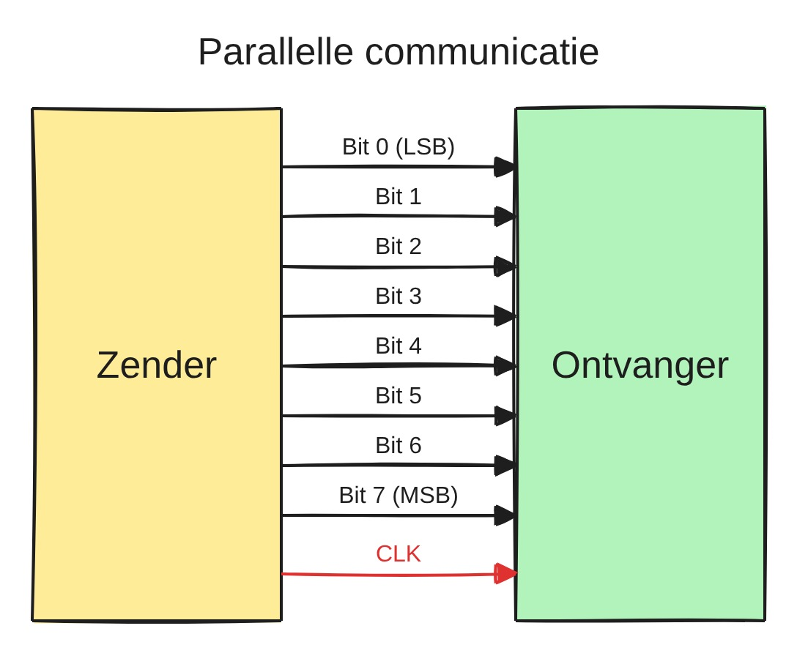
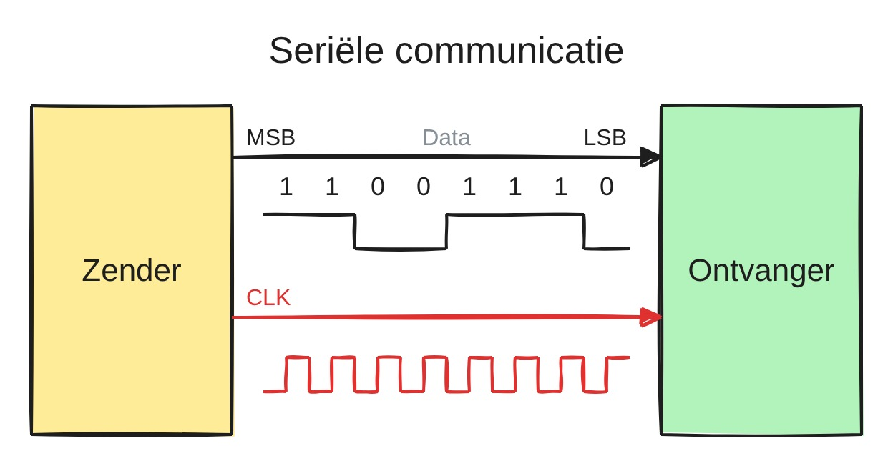
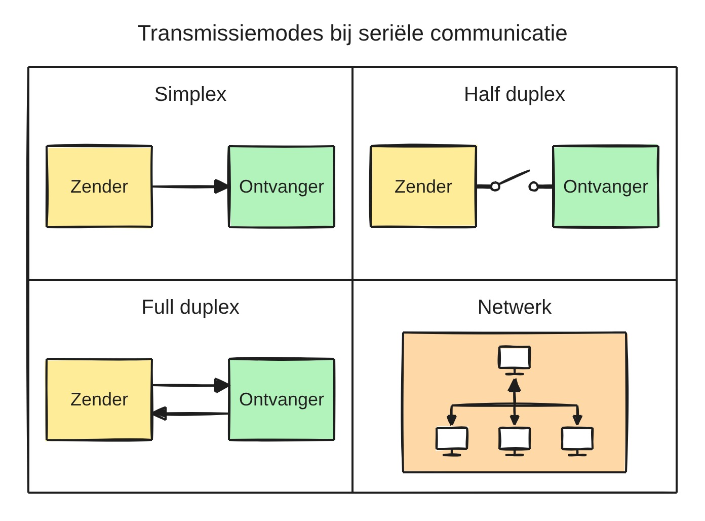
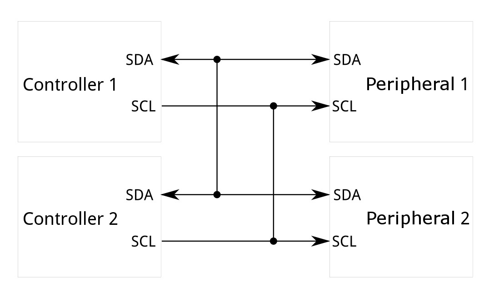
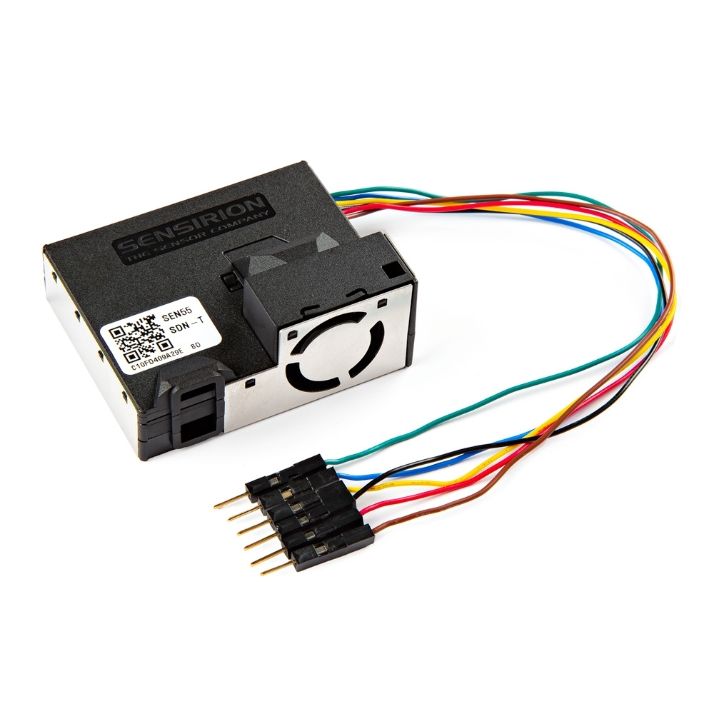
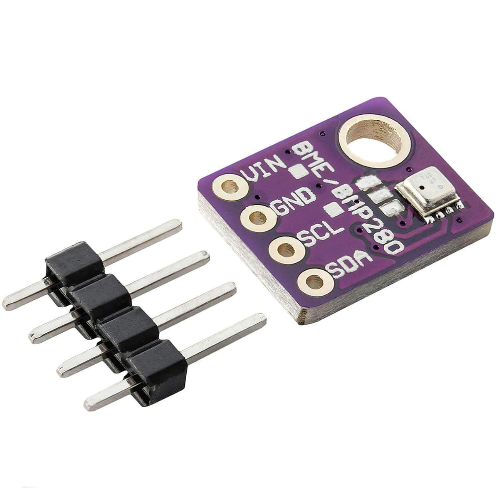
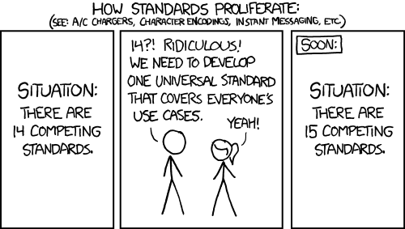

# 5.1 Wat is seriële communicatie

Communicatie tussen twee digitale componenten komt altijd neer op hetzelfde:
bits doorgeven via een spanning op een draad, HIGH of LOW, net zoals bij een
GPIO (zie [4.1.4](../4_gpio/4.1_wat_is_een_gpio.md#414-digitaal-versus-analoog)). De vraag is hoe die bits georganiseerd worden:

- hoeveel draden er gebruikt worden;
- in welke richting de data mag lopen;
- hoe de ontvanger weet wanneer een volgend bit begint.

Deze sectie overloopt die keuzes. Elk communicatieprotocol maakt er een eigen
combinatie van.

## 5.1.1 Serieel versus parallel

Een byte kan op twee manieren verstuurd worden:

- **Parallel**: elk bit krijgt een eigen draad. Een byte gaat in één keer over
  8 datalijnen, meestal met een extra lijn (een klok) die aangeeft wanneer de
  data geldig is.
- **Serieel**: alle bits gaan na elkaar over één datalijn.

Op het eerste zicht lijkt parallel sneller: per klokpuls gaan er 8 bits
tegelijk over. Toch is bijna alle communicatie tussen chips en toestellen
vandaag serieel:

- **Minder draden en pinnen**: een parallelle bus van 8 bits vraagt al gauw
  10 pinnen of meer. Op een microcontroller met een beperkt aantal GPIO's
  (zie [4.2](../4_gpio/4.2_welke_pin_kan_wat.md)) is dat een grote kost.
- **Hogere snelheden**: bij hoge snelheden komen de bits van parallelle lijnen
  niet meer exact tegelijk aan (*skew*), door kleine verschillen in de lengte
  en de eigenschappen van de draden. Een seriële lijn heeft dat probleem niet,
  en kan daardoor veel sneller geklokt worden.
- **Goedkopere kabels en connectoren**: minder aders, kleinere stekkers.

De oude printerpoort van een pc was parallel, zijn opvolger USB is serieel.
Hetzelfde gebeurde met harde schijven (van PATA naar SATA) en
uitbreidingskaarten (van PCI naar PCI Express). Binnenin een chip wordt nog
volop parallel gewerkt, maar tussen chips en toestellen is serieel de norm.

## 5.1.2 Richting: simplex, half duplex en full duplex

Een tweede keuze is de richting waarin de data mag lopen:

- **Simplex**: de data gaat in één richting, van een zender naar een
  ontvanger. Een eenvoudige sensormodule die continu meetwaarden uitstuurt
  maar nooit een commando ontvangt, werkt simplex.
- **Half duplex**: de data gaat in twee richtingen, maar niet tegelijk. Beide
  kanten gebruiken om beurten dezelfde lijn, zoals bij een walkietalkie.
  Voorbeelden: I²C (één datalijn, SDA) en RS-485 met twee draden (zie [5.3](./5.3_rs232_rs422_rs485.md)).
- **Full duplex**: de data gaat tegelijk in beide richtingen, via een aparte
  lijn per richting, zoals bij een telefoongesprek. Voorbeelden: UART (TX en
  RX) en SPI (MOSI en MISO).

De figuur toont ook een **netwerk**: meerdere toestellen op dezelfde lijnen.
Of dat kan, hangt af van het protocol. Een UART-verbinding verbindt exact
twee toestellen, I²C en RS-485 laten er meerdere toe.

## 5.1.3 Synchroon versus asynchroon

Een ontvanger moet weten **wanneer** hij de lijn moet uitlezen. Een reeks van
vijf nullen ziet er op de draad immers uit als één lange LOW: zonder
tijdsafspraak is niet te zeggen of dat vier, vijf of zes bits zijn. Er zijn
twee oplossingen:

- **Synchroon**: naast de data loopt een aparte **kloklijn**. Eén component
  (de *master*, tegenwoordig ook *controller* genoemd) genereert de klok, en
  bij elke flank van de klok leest de ontvanger een bit.
  - De snelheid hoeft niet op voorhand afgesproken te worden. De klok mag
    zelfs even pauzeren.
  - Dat kost wel een extra draad.
  - Voorbeelden: I²C (kloklijn SCL) en SPI (kloklijn SCK).
- **Asynchroon**: er is geen kloklijn. Beide kanten spreken op voorhand een
  snelheid af, en gebruiken elk een eigen klok om de lijn op de juiste
  momenten uit te lezen. Een vast signaal aan het begin van elk pakketje (bij
  UART het *start bit*, zie [5.2.5](./5.2_uart.md#525-synchronisatie-start-bit-en-stop-bit)) synchroniseert de ontvanger.
  - Eén draad per richting volstaat.
  - Beide kanten moeten wel exact dezelfde snelheid gebruiken.
  - Voorbeeld: UART.

De eerste figuur toont een asynchrone UART-verbinding: geen kloklijn, en een
aparte lijn per richting. De tweede figuur toont een synchrone I²C-bus: één
datalijn (SDA) en één kloklijn (SCL), gedeeld door alle toestellen.

> **Let op:** in beide gevallen moeten de **GND's** van de toestellen met
> elkaar verbonden zijn. Een spanning is altijd een verschil ten opzichte van
> een referentie. Zonder gemeenschappelijke GND is niet bepaald ten opzichte
> waarvan een HIGH of LOW gemeten wordt, en is de communicatie onbetrouwbaar
> of werkt ze helemaal niet. Bij een module met een eigen voeding wordt die
> verbinding gemakkelijk vergeten.

In de praktijk is het protocol een eigenschap van de sensor of module die
aangesloten wordt. De fijnstofsensor **SPS30** van Sensirion communiceert
bijvoorbeeld via UART, de **BME280**-module (temperatuur, luchtvochtigheid en
luchtdruk) via I²C. De SPS30 kan zelfs beide: een selectiepin bepaalt welk
protocol actief is. Het datasheet van een module vermeldt altijd welk
protocol gebruikt wordt.

## 5.1.4 De meest gebruikte seriële protocollen

Vier seriële protocollen komen in embedded systemen het vaakst voor:

| Protocol | Volledige naam                              | Klok                                         | Lijnen (naast GND)   | Richting    | Aantal toestellen                               |
| -------- | ------------------------------------------- | -------------------------------------------- | -------------------- | ----------- | ----------------------------------------------- |
| **UART** | Universal Asynchronous Receiver-Transmitter | asynchroon                                   | TX, RX               | full duplex | exact 2 (*point-to-point*)                      |
| **SPI**  | Serial Peripheral Interface                 | synchroon                                    | SCK, MOSI, MISO, CS  | full duplex | 1 master, meerdere slaves (een CS-lijn per slave) |
| **I²C**  | Inter-Integrated Circuit                    | synchroon                                    | SDA, SCL             | half duplex | tientallen, elk met een eigen adres             |
| **USB**  | Universal Serial Bus                        | geen kloklijn, synchronisatie op elk pakket | D+, D−               | half duplex | 1 host, meerdere devices                        |

Wanneer in de praktijk gesproken wordt over "seriële communicatie" of "de
seriële poort", gaat het bijna altijd over **UART**. Ook het `Serial`-object
in Arduino is een UART-verbinding (zie [5.5](./5.5_serial_in_de_arduino_core.md)). I²C en SPI komen later in de
cursus aan bod. De rest van dit hoofdstuk focust op UART.

Naast deze vier bestaan er nog heel wat andere seriële protocollen, zoals
CAN in auto's, 1-Wire voor eenvoudige temperatuursensoren, of RS-485 in de
industrie (zie [5.3](./5.3_rs232_rs422_rs485.md)). Elk protocol is ooit ontstaan om een probleem op te
lossen dat de bestaande protocollen niet goed oplosten.

*Bron: [xkcd 927](https://xkcd.com/927)*
