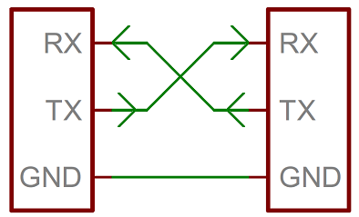
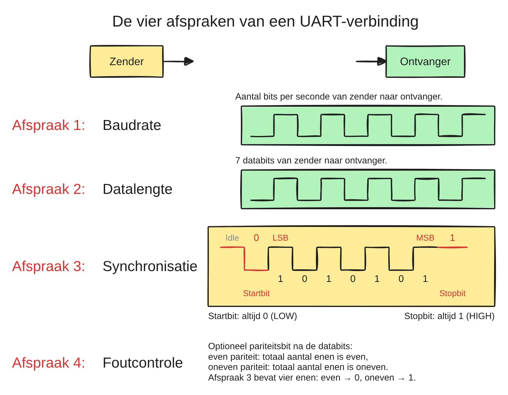
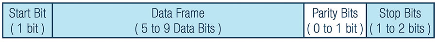
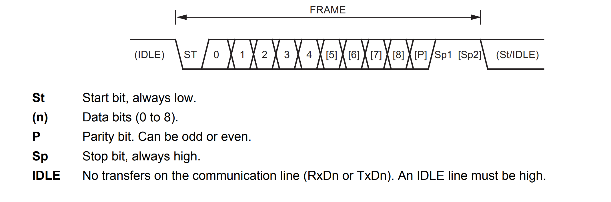
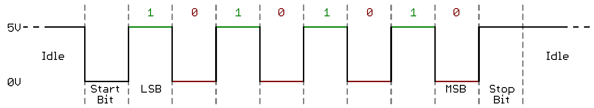

# 5.2 UART

Een **UART** (*Universal Asynchronous Receiver-Transmitter*) is een stuk
hardware in de microcontroller, een peripheral, dat bytes omzet naar een
serieel signaal en omgekeerd. De naam vat samen wat het doet:

- **Universal**: snelheid en opbouw van een pakketje zijn instelbaar.
- **Asynchronous**: er is geen kloklijn (zie [5.1.3](./5.1_wat_is_seriele_communicatie.md#513-synchroon-versus-asynchroon)).
- **Receiver-Transmitter**: dezelfde peripheral kan zowel ontvangen als
  zenden.

Strikt genomen is UART de naam van de peripheral, maar de term wordt ook
gebruikt voor het protocol zelf. De ATmega328P van de Arduino Nano heeft één
UART, de ESP32 heeft er drie (zie [5.4.4](./5.4_van_usb_naar_uart.md#544-de-uarts-van-de-esp32)).

## 5.2.1 Aansluiten

Een UART-verbinding tussen twee toestellen heeft drie draden nodig:

- **TX** (*transmit*) van het ene toestel naar **RX** (*receive*) van het
  andere;
- **RX** van het ene toestel naar **TX** van het andere;
- **GND** naar **GND** (zie [5.1.3](./5.1_wat_is_seriele_communicatie.md#513-synchroon-versus-asynchroon)).

TX en RX worden dus **gekruist**: wat het ene toestel verstuurt, moet bij de
ingang van het andere toestel aankomen. De labels op een module zijn bijna
altijd vanuit het standpunt van die module zelf benoemd. De pin `TX` op een
GPS-module is dus de uitgang van de module, en hoort aan de RX-pin van de
ESP32. Een veelgemaakte fout is TX aan TX verbinden: dan verbindt de draad
twee uitgangen met elkaar, en luistert er geen enkele ingang.

Twee eigenschappen van de lijn zelf:

- In rust (*idle*) is de lijn **HIGH**. Zolang er niets verstuurd wordt,
  houdt de zender zijn TX-uitgang hoog.
- De spanningsniveaus zijn die van de chip zelf, daarom heet dit ook
  **TTL-UART**: 0 V en 3,3 V bij de ESP32, 0 V en 5 V bij een Arduino Nano.
  Een module die op 5 V werkt, stuurt dus ook een HIGH van 5 V naar de
  RX-pin van de ESP32. Zoals in [4.4.3](../4_gpio/4.4_digitale_input.md#443-spanningsniveaus-combineren) besproken, is daar een spanningsdeler
  of een level shifter nodig. Omgekeerd herkent een 5 V-ingang een HIGH van
  3,3 V meestal wel, maar niet altijd: VIH in het datasheet van de
  module geeft uitsluitsel (zie [4.4.2](../4_gpio/4.4_digitale_input.md#442-spanningsniveaus-van-een-digitale-gpio)).

## 5.2.2 Vier afspraken

Omdat er geen kloklijn is, moeten zender en ontvanger op voorhand dezelfde
afspraken maken. Het zijn er vier:

1. de **baudrate**: hoe snel de bits elkaar opvolgen;
2. de **datalengte**: hoeveel databits er per pakketje verstuurd worden;
3. de **synchronisatie**: hoe het begin en het einde van een pakketje
   aangegeven worden;
4. de **foutcontrole**: of er een pariteitsbit meegestuurd wordt, en welk.

Zijn de afspraken aan beide kanten niet identiek, dan ontvangt de ontvanger
iets anders dan wat verstuurd werd. De volgende subsecties overlopen ze één
voor één.

## 5.2.3 Baudrate

De **baudrate** is het aantal symbolen dat per seconde over de lijn gaat. Bij
UART is één symbool gelijk aan één bit, dus de baudrate is het aantal bits per
seconde. Let wel: dat zijn **alle** bits, ook de start-, stop- en
pariteitsbits. De bruikbare datasnelheid ligt dus lager (zie [5.2.8](#528-hoe-snel-is-uart)).

Twee waarden komen veel voor:

- **9600**: in klassieke Arduino-voorbeelden, en bij veel GPS-modules;
- **115200**: de gangbare waarde bij de ESP32. Ook de opstartberichten van de
  ESP32 zelf verschijnen aan 115200 baud.

De gebruikelijke waarden (1200, 2400, 4800, 9600, 19200, 38400, 57600,
115200, ...) stammen uit de tijd van de modems. Strikt genomen kan elke waarde
gebruikt worden, zolang **beide kanten dezelfde** instellen.

Hoe gebruikt de ontvanger die baudrate? Aan 9600 baud duurt één bit
1 / 9600 = 104 µs. De ontvanger wacht op de dalende flank van het start bit
(zie [5.2.5](#525-synchronisatie-start-bit-en-stop-bit)), en leest daarna de lijn telkens in het **midden** van elk bit,
om de 104 µs. Dat werkt enkel als de ontvanger dezelfde bittijd gebruikt als
de zender. Bij een verkeerde baudrate leest de ontvanger op de verkeerde
momenten, en verschijnen er vreemde tekens in de Serial Monitor (zie [2.2.1](../2_arduino/2.2_de_serial_monitor.md#221-tekst-naar-de-computer-sturen)).

Zender en ontvanger hebben elk een eigen klok, en twee klokken lopen nooit
exact gelijk. Een afwijking van enkele procenten wordt verdragen. Na elk
pakketje wacht de ontvanger immers op een nieuw start bit, en begint hij
opnieuw te tellen. Een fout in de timing stapelt zich dus maar over één
pakketje van een tiental bits op. Daarom zijn UART-pakketjes zo kort.

## 5.2.4 Datalengte

Een pakketje bevat **5 tot 9 databits**. In de praktijk zijn het er bijna
altijd 8, zodat één pakketje precies één byte bevat. De ESP32 ondersteunt 5 tot
8 databits. Kortere lengtes zijn historisch: 7 bits volstaan voor een
ASCII-teken (zie [5.6.1](./5.6_tekst_en_bytes.md#561-ascii)), 5 bits voor de code van oude telexmachines.

De databits worden verstuurd met het **minst significante bit eerst** (*LSB
first*).

Belangrijk: de **datalengte is niet de framelengte**. Rond de databits komen
nog een start bit, eventueel een pariteitsbit, en één of twee stopbits. Het
volledige pakketje heet een **frame**.

## 5.2.5 Synchronisatie: start bit en stop bit

- Het **start bit** is altijd **LOW**. Omdat de lijn in rust HIGH is, geeft
  het begin van een frame altijd een dalende flank. Op die flank start de
  ontvanger zijn timing.
- Het **stop bit** is altijd **HIGH**, en duurt 1, 1,5 of 2 bittijden. Het
  brengt de lijn terug naar de rusttoestand, zodat het volgende start bit
  opnieuw een dalende flank geeft. Het geeft de ontvanger ook even tijd om de
  ontvangen byte te verwerken.

Leest de ontvanger een LOW op de plaats waar het stop bit hoort, dan klopt er
iets niet. Dat heet een *framing error*. Een verkeerde baudrate is daarvan de
meest voorkomende oorzaak.

## 5.2.6 Foutcontrole: pariteit

Tussen de databits en het stop bit kan een **pariteitsbit** (*parity bit*)
meegestuurd worden. Er zijn drie mogelijkheden:

- **None** (N): geen pariteitsbit. Dit is veruit het meest gebruikt.
- **Even** (E): het pariteitsbit wordt zo gekozen dat het totaal aantal enen
  (databits en pariteitsbit samen) **even** is.
- **Odd** (O): het pariteitsbit wordt zo gekozen dat het totaal aantal enen
  **oneven** is.

Een voorbeeld: het teken `'A'` is 0x41, of `0b01000001`. Daarin staan twee
enen.

- Bij even pariteit is het pariteitsbit `0`: het totaal blijft 2, even.
- Bij oneven pariteit is het pariteitsbit `1`: het totaal wordt 3, oneven.

De ontvanger telt zelf de enen en vergelijkt. Wordt er onderweg één bit
omgedraaid door ruis, dan klopt de pariteit niet meer en is de fout
gedetecteerd. De methode heeft wel duidelijke grenzen:

- Twee omgedraaide bits heffen elkaar op en blijven onopgemerkt.
- Een fout wordt enkel gedetecteerd, niet verbeterd.

Daarom voegen veel protocollen bovenop UART een eigen controle toe over een
volledig bericht, zoals een *checksum* of een CRC. De berichten van een
GPS-module eindigen bijvoorbeeld op `*` gevolgd door een checksum (zie
[5.5.5](./5.5_serial_in_de_arduino_core.md#555-een-tweede-uart-gebruiken)).

## 5.2.7 Het volledige frame

Alle afspraken samen geven het frame. Het datasheet van een microcontroller
toont het meestal in een figuur zoals deze, uit het datasheet van de
ATmega328P:

*Bron: Microchip, ATmega328P datasheet, USART Frame Formats*

De velden tussen vierkante haken zijn optioneel: de databits `[5]` tot `[8]`
(een frame heeft dus 5 tot 9 databits, genummerd vanaf 0), het pariteitsbit
`[P]` en het tweede stopbit `[Sp2]`.

Een configuratie wordt kort genoteerd als **databits, pariteit, stopbits**:

- **8N1**: 8 databits, geen pariteit (*None*), 1 stopbit. Dit is de standaard,
  ook bij `Serial.begin()` in Arduino.
- **7E1**: 7 databits, even pariteit, 1 stopbit.
- **8E2**: 8 databits, even pariteit, 2 stopbits.

Op een oscilloscoop of logic analyzer ziet een 8N1-frame er zo uit:

*Bron: [SparkFun, Serial Communication](https://learn.sparkfun.com/tutorials/serial-communication/wiring-and-hardware)*

- De lijn is in rust HIGH (*Idle*).
- Het start bit trekt de lijn LOW.
- Daarna volgen de 8 databits, LSB eerst: 1, 0, 1, 0, 1, 0, 1, 0. Van MSB naar
  LSB gelezen is dat `0b01010101`, of 0x55: het teken `'U'`.
- Het stop bit brengt de lijn terug HIGH.

Deze figuur toont een signaal van 5 V, zoals bij een Arduino Nano. Bij de
ESP32 is HIGH 3,3 V.

## 5.2.8 Hoe snel is UART?

Bij 8N1 zijn er voor elke byte **10 bits** nodig: 1 start bit, 8 databits en
1 stop bit. Een vijfde van de baudrate gaat dus op aan de omkadering.

| Baudrate | Bits per seconde | Bytes per seconde (8N1) | Tijd per byte |
| -------- | ---------------- | ----------------------- | ------------- |
| 9600     | 9600             | 960                     | 1,04 ms       |
| 115200   | 115200           | 11 520                  | 87 µs         |

Dat lijkt snel, maar voor een microcontroller is het traag. De regel
`pot: 2048`, verstuurd met `println()`, telt 11 bytes: 9 tekens en het
regeleinde `\r\n` (zie [5.6.3](./5.6_tekst_en_bytes.md#563-regeleindes)). Aan 115200 baud duurt dat bijna 1 ms, aan
9600 baud 11,5 ms. In diezelfde tijd kan `loop()` honderden keren doorlopen
worden. Printen kost dus tijd, en wie te veel print, vertraagt het hele
programma (zie [5.5.4](./5.5_serial_in_de_arduino_core.md#554-functies-die-wachten)).

### Oefening

Een ESP32 stuurt elke 100 ms de regel `temperature: 21.5` met `println()`.

1. Hoeveel bytes zijn dat per regel?
2. Hoeveel procent van de tijd is de TX-lijn bezig aan 9600 baud? En aan
   115200 baud?
3. Wat is het pariteitsbit bij even pariteit voor het teken `'C'` (0x43)?

Oplossing

1. `temperature: 21.5` telt 17 tekens (de spatie meegeteld). `println()` voegt
   er `\r\n` aan toe: samen **19 bytes**.
2. 19 bytes × 10 bits = 190 bits per regel.
   - Aan 9600 baud: 190 / 9600 = 19,8 ms per 100 ms, of ongeveer **20 %**.
   - Aan 115200 baud: 190 / 115200 = 1,65 ms per 100 ms, of ongeveer
     **1,6 %**.
3. 0x43 is `0b01000011`: drie enen. Bij even pariteit moet het totaal even
   zijn, dus het pariteitsbit is **1**.

