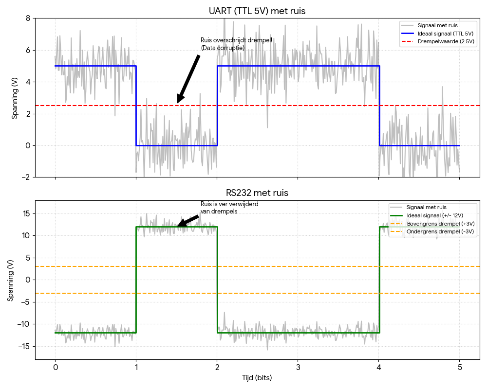
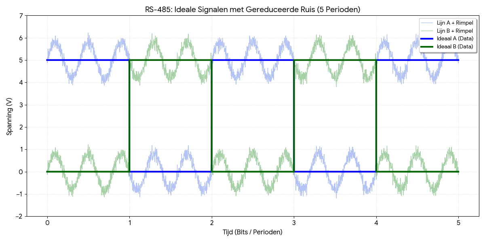
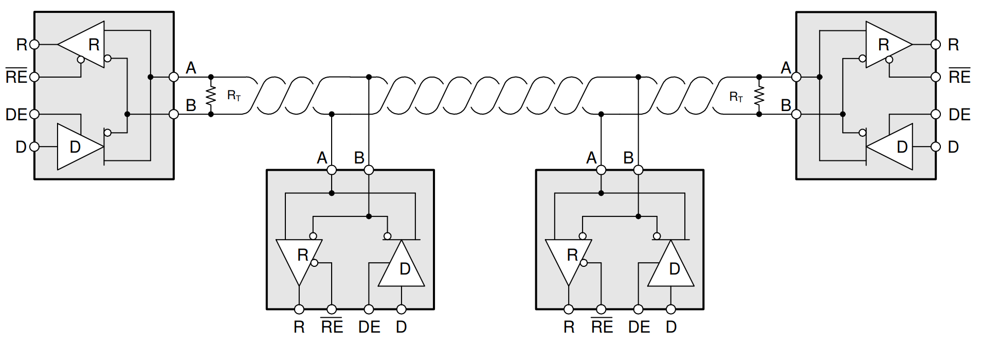

# 5.3 RS-232, RS-422 en RS-485

UART legt vast **hoe** een byte verpakt wordt in een frame (zie [5.2](./5.2_uart.md)), maar met
de spanningsniveaus van de chip zelf (TTL-UART) is de afstand beperkt. Op een
PCB of over een kort kabeltje is dat geen probleem, over enkele meters wel.
Daarvoor bestaan andere **fysieke lagen**: het frame blijft identiek, enkel
het elektrische signaal op de kabel verandert.

Tussen de UART-pinnen van de microcontroller en de kabel zit dan een
**transceiver**: een chip die het TTL-signaal omzet naar het signaal van de
kabel, en omgekeerd. De UART in de microcontroller, en dus ook de code,
blijft dezelfde.

## 5.3.1 TTL-UART: kort en kwetsbaar

Bij een TTL-UART ligt het verschil tussen HIGH en LOW maar enkele volts uit
elkaar. Een lange kabel werkt als een antenne en pikt storingen op van
motoren, voedingen of andere kabels. Zodra die ruis een signaal over de
drempelspanning duwt (zie [4.4.2](../4_gpio/4.4_digitale_input.md#442-spanningsniveaus-van-een-digitale-gpio)), leest de ontvanger een verkeerd bit:

In de bovenste grafiek overschrijdt de ruis op het 5 V-signaal de drempel van
2,5 V: de data is corrupt. In de onderste grafiek, met RS-232, blijft dezelfde
ruis ver weg van de drempels.

## 5.3.2 RS-232

**RS-232** is een standaard uit de jaren 60. Het is de klassieke "COM-poort"
van oudere pc's, met een 9-polige D-sub-connector.

- Het werkt met **positieve en negatieve spanningen**, en met **omgekeerde
  logica**:
  - een logische `1` is een spanning tussen −3 V en −15 V;
  - een logische `0` is een spanning tussen +3 V en +15 V;
  - typisch wordt ±12 V gebruikt.
- Door die grote marge is het signaal veel robuuster dan TTL, tot ongeveer
  15 m, aan lage snelheden.
- Het is nog steeds te vinden op industriële toestellen, PLC's en
  labo-apparatuur zoals voedingen en oscilloscopen.

> **Let op:** een RS-232-signaal mag **nooit** rechtstreeks op een GPIO
> aangesloten worden: ±12 V vernielt de pin. Een transceiver zoals de
> **MAX3232** zet het signaal om naar 3,3 V en omgekeerd. Voor een computer
> zonder COM-poort bestaan er USB-naar-RS-232-adapters.

## 5.3.3 RS-422 en RS-485: differentieel

RS-422 en RS-485 pakken het probleem van ruis anders aan, met een
**differentieel signaal**:

- Het signaal gaat over **twee draden**, A en B, die altijd het tegengestelde
  signaal dragen.
- De ontvanger kijkt niet naar de spanning van één draad ten opzichte van
  GND, maar naar het **verschil** tussen A en B. Een verschil van 200 mV
  volstaat al om een bit te herkennen.
- De twee draden zijn in elkaar gedraaid (*twisted pair*). Een storing treft
  daardoor beide draden op dezelfde manier. Het verschil tussen beide blijft
  hetzelfde, en de ruis valt weg.

In de grafiek dragen beide lijnen een rimpel, maar A en B blijven altijd
elkaars tegengestelde. De data zit in het verschil tussen beide, en dat
verschil wisselt duidelijk tussen positief en negatief.

### RS-422

- Eén zender en tot 10 ontvangers op dezelfde lijn.
- Een apart draadpaar per richting, dus 4 draden en **full duplex**.

### RS-485

- **Meerdere zenders** op hetzelfde draadpaar: een echte **bus** met tot 32
  toestellen volgens de standaard, en meer met moderne transceivers.
- Met 2 draden is RS-485 **half duplex**: er mag maar één toestel tegelijk
  zenden. Een RS-485-transceiver heeft daarom een **richtingspin** (DE/RE).
  De microcontroller stuurt die aan met een gewone GPIO: vóór het zenden op
  zenden, daarna terug op ontvangen.
- Aan beide uiteinden van de kabel komt een **afsluitweerstand** van 120 Ω,
  die reflecties op de lijn tegengaat.

*Bron: [Texas Instruments, SLLA545](https://www.ti.com/lit/wp/slla545/slla545.pdf)*

Met RS-422 en RS-485 zijn afstanden tot ongeveer 1200 m mogelijk, of
snelheden tot 10 Mbit/s, maar niet allebei tegelijk: hoe langer de kabel, hoe
lager de haalbare snelheid.

RS-485 is de standaard in de industrie en in gebouwbeheer, onder meer met het
protocol **Modbus RTU**. Ook de lichtsturing in theaters en op podia (DMX512)
gebruikt RS-485. Een veelgebruikte transceiver op 3,3 V is de **MAX3485**.

## 5.3.4 Overzicht

| Kenmerk              | UART (TTL)                  | RS-232                     | RS-422                       | RS-485                                  |
| -------------------- | --------------------------- | -------------------------- | ---------------------------- | --------------------------------------- |
| **Type signaal**     | single-ended (0 V / 3,3 V of 5 V) | single-ended (±12 V)  | differentieel (A en B)       | differentieel (A en B)                  |
| **Communicatie**     | full duplex                 | full duplex                | full duplex (4 draden)       | half duplex (2 draden)                  |
| **Max. afstand**     | < 1 m                       | ~15 m                      | ~1200 m                      | ~1200 m                                 |
| **Max. snelheid**    | hoog (op korte afstand)     | laag (tot 20 kbit/s)       | hoog (tot 10 Mbit/s)         | hoog (tot 10 Mbit/s)                    |
| **Topologie**        | point-to-point (1 op 1)     | point-to-point (1 op 1)    | 1 zender, tot 10 ontvangers  | bus, tot 32 toestellen of meer          |
| **Ruisgevoeligheid** | zeer hoog                   | gemiddeld                  | zeer laag                    | zeer laag                               |
| **Typisch gebruik**  | binnenin een toestel (PCB)  | configuratiepoorten        | lange afstanden              | industrie, Modbus, gebouwbeheer         |

In alle gevallen blijft de UART in de microcontroller dezelfde, en ook de
code die erop draait. Enkel de transceiver tussen de pinnen en de kabel
verandert. Bij RS-485 komt er één GPIO bij om de richting te kiezen.
