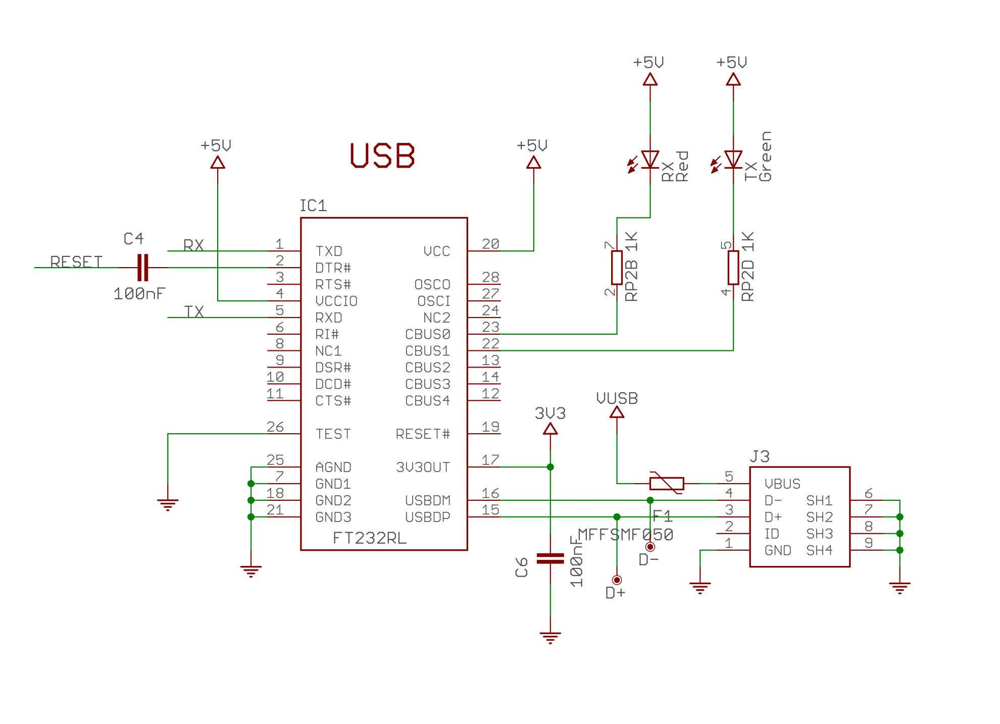
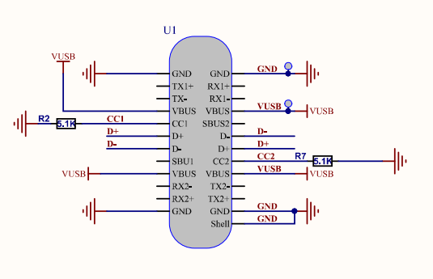
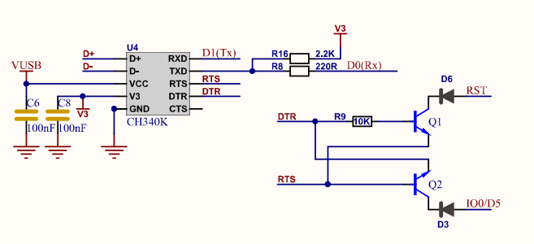
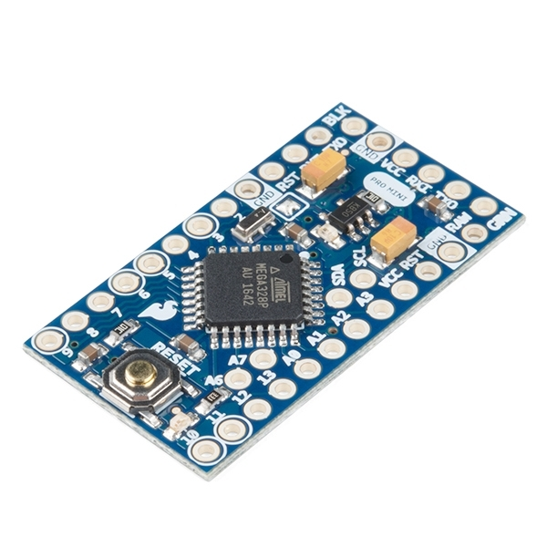
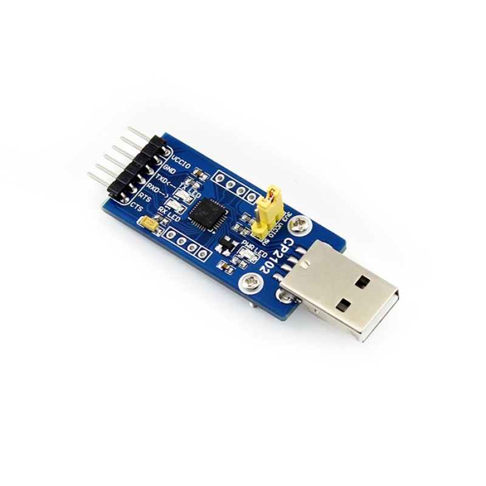

# 5.4 Van USB naar UART

Sinds [hoofdstuk 2](../2_arduino/2_arduino.md) hangt de FireBeetle 2 met een USB-kabel aan de computer,
terwijl `Serial` een UART-verbinding is (zie [5.1.4](./5.1_wat_is_seriele_communicatie.md#514-de-meest-gebruikte-seriële-protocollen)). Tussen beide zit dus een
vertaalslag. Deze sectie bekijkt die verbinding, en de UART's die de ESP32
aan boord heeft.

## 5.4.1 USB is geen UART

USB is ook een serieel protocol, maar een heel wat complexer protocol dan
UART:

- de data gaat differentieel over twee draden, D+ en D−;
- er is altijd één **host** (de computer) die de communicatie regelt, en een
  of meer **devices**;
- de data gaat in pakketten met een adres en een controle, en een device
  moet zich bij het inpluggen eerst voorstellen aan de host (*enumeration*).

De ESP32 en de ATmega328P hebben geen USB-peripheral. Zoals al aangehaald in
[1.2.4](../1_introductie/1.2_wat_is_een_microcontroller.md#124-programmeren-van-een-microcontroller), zit er daarom een aparte chip op het board: een
**USB-naar-UART-bridge**. De volledige keten ziet er zo uit:

| Stap               | Voorbeelden                     |
| ------------------ | ------------------------------- |
| Computer           | laptop met een USB-poort (host) |
| USB-naar-UART-bridge | CP2102, FT232RL, CH340, CH9102F |
| Microcontroller    | ESP32, ATmega328P               |

Op het schema van de Arduino Nano is de bridge een FT232RL. Aan de ene kant
komt de USB-connector binnen (`USBDP` en `USBDM`, de D+ en D−), aan de
andere kant vertrekken `TXD` en `RXD` naar de UART van de ATmega328P:

*Bron: [Arduino, Nano V3.3 schema](https://content.arduino.cc/assets/NanoV3.3_sch.pdf)*

Op de FireBeetle 2 is het niet anders. De D+ en D− van de USB-C-connector
gaan naar de bridge, en die is aan de andere kant verbonden met GPIO1 (TX)
en GPIO3 (RX) van de ESP32:

*Bron: [DFRobot, FireBeetle 2 ESP32-E schema](https://dfimg.dfrobot.com/wiki/23249/DFR0654_firebeetle-2-esp32-e_schematics_v1.0.pdf)*

Afhankelijk van de revisie van het board zit er een **CH340K** of een
**CH9102F** op (zie ook [4.2.3](../4_gpio/4.2_welke_pin_kan_wat.md#423-pinnen-met-een-vaste-taak-op-de-firebeetle-2)). Beide doen hetzelfde, maar hebben elk een
eigen driver (zie [2.4](../2_arduino/2.4_de_ontwikkelomgeving_klaarzetten.md)). Naast TX en RX stuurt de bridge ook de signalen DTR
en RTS uit. Die zetten het board automatisch in download mode bij het
uploaden (zie [4.2.3](../4_gpio/4.2_welke_pin_kan_wat.md#423-pinnen-met-een-vaste-taak-op-de-firebeetle-2)).

## 5.4.2 De virtuele COM-poort

Met de juiste driver verschijnt de bridge op de computer als een
**seriële poort**:

- op Windows als `COM3`, `COM4`, ...;
- op Linux als `/dev/ttyUSB0`;
- op macOS als `/dev/cu.usbserial-...`.

Programma's zoals de Serial Monitor, een terminalprogramma of een
Python-script openen die poort alsof het een ouderwetse RS-232-poort is. Dat
de data onderweg over USB gaat, merken ze niet.

Dat verklaart ook waarom de baudrate aan beide kanten gelijk moet zijn. USB
zelf werkt aan een vaste, veel hogere snelheid. De baudrate die in de Serial
Monitor gekozen wordt, gaat via USB naar de bridge, en die stelt daarmee zijn
UART-kant in. De baudrate geldt dus enkel voor het korte stukje UART tussen
de bridge en de ESP32, en moet overeenkomen met `Serial.begin()`.

> **Let op:** een COM-poort kan maar door **één programma tegelijk** geopend
> worden. Staat de poort nog open in een ander programma, zoals een
> terminalprogramma of een tweede venster van de IDE, dan mislukt het
> uploaden.

## 5.4.3 Boards zonder bridge

Niet elk board heeft een bridge. Om kosten, plaats of stroom te besparen,
laat een board zoals de **Arduino Pro Mini** ze weg. De UART-pinnen zitten
dan op een header, en voor het uploaden en de Serial Monitor wordt een
externe **USB-naar-UART-adapter** aangesloten, bijvoorbeeld met een CP2102:

Bij het aansluiten gelden dezelfde regels als in [5.2.1](./5.2_uart.md#521-aansluiten):

- TX van de adapter naar RX van het board, en omgekeerd;
- GND naar GND;
- eventueel DTR, zodat de adapter het board kan resetten voor het uploaden;
- een adapter met het juiste **spanningsniveau**: 3,3 V of 5 V. Veel adapters
  hebben daarvoor een jumper.

> **Tip:** op veel boards is de metalen behuizing van de USB-connector met GND
> verbonden. Dat is een handig punt om de zwarte meetpen (COM) van een
> multimeter tegen te houden. Controleer het wel eerst met de doorgangstest:
> niet elk board verbindt de behuizing rechtstreeks met GND.

## 5.4.4 De UART's van de ESP32

De ESP32 heeft drie UART's. Elke UART heeft vaste standaardpinnen in de
**IO MUX** (zie [4.2.1](../4_gpio/4.2_welke_pin_kan_wat.md#421-gpio-multiplexing)), maar dankzij de **GPIO matrix** kan elke UART ook naar
een andere pin gerouteerd worden.

| UART  | TX (IO MUX) | RX (IO MUX) | Op de FireBeetle 2                                                                                      |
| ----- | ----------- | ----------- | ------------------------------------------------------------------------------------------------------- |
| UART0 | GPIO1       | GPIO3       | verbonden met de USB-naar-UART-bridge: Serial Monitor en uploaden                                      |
| UART1 | GPIO10      | GPIO9       | GPIO9 en GPIO10 zijn verbonden met het flashgeheugen (zie [4.2.2](../4_gpio/4.2_welke_pin_kan_wat.md#422-lagen-die-de-functionaliteit-vastleggen)): UART1 moet altijd op andere pinnen |
| UART2 | GPIO17      | GPIO16      | D10 en D11; kan ook op andere pinnen                                                                    |

Enkele praktische gevolgen:

- **UART0** is in gebruik voor de verbinding met de computer. GPIO1 (TX) en
  GPIO3 (RX) zitten wel op de header, maar wie er iets anders op aansluit,
  verstoort het uploaden en de Serial Monitor (zie [4.2.3](../4_gpio/4.2_welke_pin_kan_wat.md#423-pinnen-met-een-vaste-taak-op-de-firebeetle-2)).
- **UART1** en **UART2** zijn vrij voor externe modules. Omdat de GPIO matrix
  elke pin toelaat, wordt best een pin gekozen die nog niet in gebruik is.
  Op de Basic GPIO Board van de labo's zijn GPIO16 en GPIO17 bijvoorbeeld al
  verbonden met twee leds.
- Een RX-pin is een ingang. Een pin die **enkel input** kan zijn, zoals
  GPIO34 tot GPIO39 (zie [4.2.3](../4_gpio/4.2_welke_pin_kan_wat.md#423-pinnen-met-een-vaste-taak-op-de-firebeetle-2)), is dus een prima keuze voor RX, maar niet
  voor TX.

> **Let op:** dat de standaardpinnen van UART1 onbruikbaar zijn, is geen
> eigenaardigheid van de FireBeetle 2. Bij de meeste ESP32-modules, zoals de
> ESP32-WROOM-32 en de ESP32-WROVER, zijn GPIO6 tot GPIO11 intern verbonden met
> het SPI-flashgeheugen. GPIO9 (RX1) en GPIO10 (TX1) zijn daar de lijnen SD2 en
> SD3 van. Wie UART1 op de standaardpinnen gebruikt, verstoort de verbinding
> met het flashgeheugen en laat de ESP32 crashen. Geef bij UART1 dus altijd
> zelf de pinnen op, bijvoorbeeld met
> `Serial1.begin(9600, SERIAL_8N1, rx_pin, tx_pin)`.
>
> Bij modules met extra PSRAM, zoals de ESP32-WROVER, zijn ook GPIO16 en
> GPIO17, de standaardpinnen van UART2, intern in gebruik. Daar moet UART2 dus
> eveneens naar andere pinnen.

Ter vergelijking: de ATmega328P van de Arduino Nano heeft maar één UART, en
die is al verbonden met de bridge. Een tweede seriële module aansluiten kan
op een Nano enkel met *SoftwareSerial*, een library die de UART in software
nabootst en daarbij veel rekentijd vraagt. De drie hardware-UART's van de
ESP32 zijn dus een groot voordeel.

> **Let op:** recentere ESP32-varianten, zoals de ESP32-S3 en de ESP32-C3,
> hebben wel een ingebouwde USB-peripheral. Op boards met zo'n chip ontbreekt
> de bridge soms, en is `Serial` in de Arduino core een USB-verbinding in
> plaats van UART0. Dat wordt ingesteld met de optie *USB CDC On Boot* in het
> Tools-menu. Voor de FireBeetle 2 ESP32-E speelt dit niet: daar is `Serial`
> altijd UART0.
