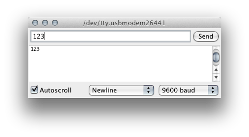

# 5.6 Tekst en bytes

Een UART verstuurt **bytes**, niets meer. Of die bytes tekst voorstellen, een
getal of een meetwaarde van een sensor, weet de UART niet. Die betekenis is een
afspraak tussen zender en ontvanger. Deze sectie bekijkt de twee meest
voorkomende afspraken: tekst volgens de ASCII-tabel, en binaire data.

## 5.6.1 ASCII

Om tekst als bytes te versturen, krijgt elk teken een vast nummer. De
klassieke afspraak daarvoor is de **ASCII-tabel** (*American Standard Code for
Information Interchange*): 128 tekens, genummerd van 0 tot 127, en dus te
versturen in 7 bits (zie [5.2.4](./5.2_uart.md#524-datalengte)). Een uittreksel:

| Teken          | Decimaal  | Hexadecimaal  |
| -------------- | --------- | ------------- |
| `'\n'` (newline)        | 10        | 0x0A          |
| `'\r'` (carriage return) | 13       | 0x0D          |
| `' '` (spatie) | 32        | 0x20          |
| `'0'` tot `'9'` | 48 tot 57 | 0x30 tot 0x39 |
| `'A'` tot `'Z'` | 65 tot 90 | 0x41 tot 0x5A |
| `'a'` tot `'z'` | 97 tot 122 | 0x61 tot 0x7A |

De volledige tabel staat onder meer op
[asciitable.com](https://www.asciitable.com/). Een paar zaken vallen op:

- De cijfers `'0'` tot `'9'` staan na elkaar, vanaf 48. Het teken `'7'` is dus
  niet de waarde 7, maar 55. Dat verschil is belangrijk bij het inlezen van
  getallen (zie [5.6.4](#564-van-teken-naar-getal)).
- Een hoofdletter en de bijhorende kleine letter verschillen altijd 32.
- De waarden onder 32 zijn **stuurtekens**: ze zijn niet zichtbaar, maar
  sturen de weergave, zoals een nieuwe regel.

In C en C++ is een `char` gewoon een getal van één byte. `'A'` en `65` zijn
voor de compiler exact hetzelfde. Tekens buiten de ASCII-tabel, zoals `é` of
`€`, nemen meer dan één byte in (in de codering UTF-8). In seriële output en
in commando's worden ze daarom best vermeden.

## 5.6.2 print() of write()?

Het verschil tussen `print()` en `write()` zit in wat er met een getal gebeurt:

| Code                | Verstuurde bytes            | Serial Monitor toont |
| ------------------- | --------------------------- | -------------------- |
| `Serial.write(65)`  | 65                          | `A`                  |
| `Serial.print(65)`  | 54 (`'6'`) en 53 (`'5'`)    | `65`                 |
| `Serial.print('A')` | 65                          | `A`                  |

- `write()` verstuurt de waarde **als byte**, zonder omzetting.
- `print()` zet een getal eerst om naar **tekst**: elk cijfer wordt een
  ASCII-teken.

`print()` is dus bedoeld voor tekst die een mens leest. `write()` is bedoeld
voor binaire data die een ander toestel leest (zie [5.6.5](#565-binaire-data-en-endianness)).

## 5.6.3 Regeleindes

Hoeveel bytes ontvangt het board nadat `123` verstuurd wordt in deze Serial
Monitor?



<details>
<summary>Oplossing</summary>

**Vier.** De drie cijfers, plus het regeleinde dat de Serial Monitor er zelf
aan toevoegt, omdat rechtsonder *Newline* gekozen is:

| Teken  | Hex  | Dec |
| ------ | ---- | --- |
| `'1'`  | 0x31 | 49  |
| `'2'`  | 0x32 | 50  |
| `'3'`  | 0x33 | 51  |
| `'\n'` | 0x0A | 10  |

Met de instelling *Both NL & CR* zouden het er vijf zijn.

</details>

Het regeleinde is geen detail: het is de manier waarop de ontvanger weet dat
een regel volledig is. De Serial Monitor van de Arduino IDE biedt vier opties:

| Optie               | Toegevoegd na elke invoer |
| ------------------- | ------------------------- |
| No Line Ending      | niets                     |
| New Line            | `'\n'`                    |
| Carriage Return     | `'\r'`                    |
| Both NL & CR        | `'\r'` en `'\n'`          |

De twee tekens komen uit het tijdperk van de schrijfmachine en de telex:

- `'\r'` (*carriage return*) bracht de wagen terug naar het begin van de regel;
- `'\n'` (*line feed* of *newline*) schoof het papier één regel op.

Windows gebruikt nog steeds beide (`\r\n`), Linux en macOS enkel `\n`. Ook
`println()` sluit af met `\r\n` (zie [5.5.3](./5.5_serial_in_de_arduino_core.md#553-de-belangrijkste-functies)). Een programma dat regels
inleest, gaat best om met elk van die varianten: `'\n'` betekent "de regel is
volledig", en een `'\r'` wordt genegeerd. In dit vak staat de Serial Monitor
op **New Line**.

## 5.6.4 Van teken naar getal

Omdat de cijfers in de ASCII-tabel na elkaar staan, volstaat een aftrekking om
van één cijfer een getal te maken:

```cpp
char received_char = '7';         // ASCII 55
int digit = received_char - '0';  // 55 - 48 = 7
```

Een toepassing: de helderheid van een led instellen met één toets, van `0`
(uit) tot `9` (volle helderheid).

```cpp
const uint8_t LED_PIN = 17;  // D10
const int MAX_DUTY = 255;    // analogWrite(): 8 bit
const int MAX_LEVEL = 9;     // brightness levels '0' ... '9'

void setup() {
  Serial.begin(115200);
  pinMode(LED_PIN, OUTPUT);
}

void loop() {
  if (Serial.available() > 0) {
    char received_char = Serial.read();

    // only digits are commands, other characters such as '\n' are ignored
    if (received_char >= '0' && received_char <= '9') {
      int level = received_char - '0';
      analogWrite(LED_PIN, level * MAX_DUTY / MAX_LEVEL);
      Serial.print("brightness level: ");
      Serial.println(level);
    }
  }
}
```

Elke doorloop van `loop()` verwerkt hoogstens één teken en keert meteen terug.
Het regeleinde dat de Serial Monitor meestuurt, valt buiten `'0'` tot `'9'`
en wordt dus gewoon genegeerd.

Voor een getal van **meer dan één cijfer**, zoals `120`, volstaat dat niet.
Dan zijn er drie stappen nodig:

1. **Verzamelen**: de tekens één voor één in een `char`-array plaatsen, zonder
   te wachten: elke doorloop van `loop()` verwerkt enkel de tekens die al
   binnen zijn (zie [5.5.4](./5.5_serial_in_de_arduino_core.md#554-functies-die-wachten)). Zo'n array is een buffer om in te schrijven, zoals
   in [3.4.3](../3_c_en_cpp/3.4_functies.md#343-pass-by-value-en-pass-by-reference).
2. **Afsluiten**: bij een `'\n'` is de regel volledig. Een afsluitend `'\0'`
   maakt van de array een geldige C-string (zie [3.2.5](../3_c_en_cpp/3.2_datatypes.md#325-string-vermijden-char-en-stringh)), die dan met de
   functies uit `string.h` verwerkt kan worden, zoals `strcmp()`.
3. **Omzetten**: de tekst omzetten naar een getal. `atoi()` geeft bij
   ongeldige invoer gewoon `0` terug. `strtol()` uit `stdlib.h` meldt ook waar
   het lezen gestopt is, zodat ongeldige invoer zoals `12a` herkend wordt.

Let daarbij steeds op de grootte van de array: een regel die langer is dan de
buffer, mag niet voorbij het einde geschreven worden (zie [3.2.5](../3_c_en_cpp/3.2_datatypes.md#325-string-vermijden-char-en-stringh)).

## 5.6.5 Binaire data en endianness

Tekst is leesbaar, maar niet zuinig. De meetwaarde 1023 als tekst, met een
regeleinde, is `"1023\n"`: 5 bytes. Als `uint16_t` zijn het er maar 2. Veel
sensoren met een UART-aansluiting gebruiken daarom een **binair protocol**: ze
sturen de ruwe bytes van hun meetwaarden door, en geen tekst.

Een waarde van 16 bits bestaat uit twee bytes. De vraag is dan welke byte
eerst komt. Daarover bestaan twee afspraken, samen **endianness** genoemd:

- **Big endian**: de meest significante byte eerst.
- **Little endian**: de minst significante byte eerst.

De waarde 1000 is 0x03E8:

| Volgorde      | Eerste byte | Tweede byte |
| ------------- | ----------- | ----------- |
| Big endian    | 0x03        | 0xE8        |
| Little endian | 0xE8        | 0x03        |

Endianness speelt op twee plaatsen:

- **In het geheugen** van de microcontroller. De ESP32 en de ATmega328P zijn
  allebei little endian.
- **In het protocol** van een sensor of een netwerk. Daar is big endian
  gebruikelijk, en heet het soms *network byte order*. Het datasheet van een
  sensor vermeldt altijd welke volgorde gebruikt wordt.

> **Let op:** endianness gaat over de volgorde van de **bytes**. Dat is iets
> anders dan de volgorde van de **bits** binnen een UART-frame, die altijd
> LSB eerst is (zie [5.2.4](./5.2_uart.md#524-datalengte)). Voor die bitvolgorde zorgt de UART zelf, voor de
> bytevolgorde de programmeur.

Met bitbewerkingen werkt de code altijd, los van de endianness van de
microcontroller. Twee bytes in big endian **versturen**:

```cpp
uint16_t measurement = 1000;              // 0x03E8
sensor_serial.write(measurement >> 8);    // most significant byte first: 0x03
sensor_serial.write(measurement & 0xFF);  // then the least significant byte: 0xE8
```

En twee bytes in big endian terug samenvoegen tot één waarde bij het
**ontvangen**:

```cpp
if (sensor_serial.available() >= 2) {
  uint8_t high_byte = sensor_serial.read();
  uint8_t low_byte = sensor_serial.read();
  uint16_t measurement = (high_byte << 8) | low_byte;  // 0x03 << 8 = 0x0300, | 0xE8 = 0x03E8
}
```

Een klassieke valkuil is de bytes van een variabele rechtstreeks uit het
geheugen te versturen:

```cpp
sensor_serial.write((uint8_t *)&measurement, sizeof(measurement));
```

Dat verstuurt de bytes in de volgorde waarin ze in het geheugen staan, op de
ESP32 dus little endian: eerst 0xE8, dan 0x03. Verwacht de ontvanger big
endian, dan leest die 0xE803, of 59395 in plaats van 1000.
