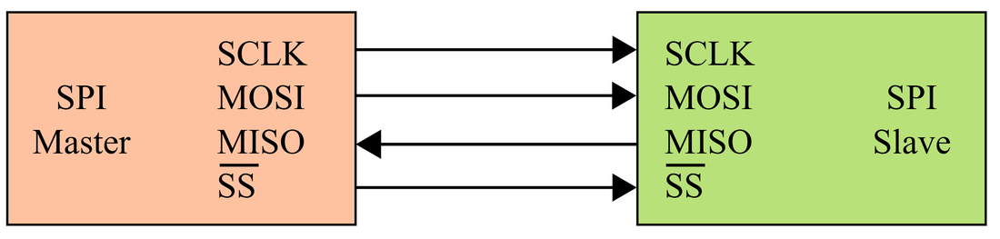
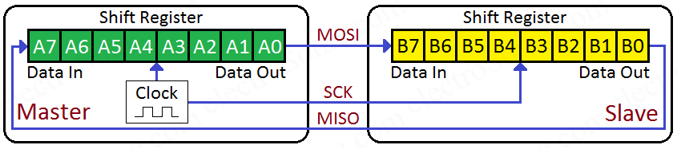

# 6.1 SPI

**SPI** (*Serial Peripheral Interface*) werd halverwege de jaren 80 door
Motorola ontwikkeld om een microcontroller met randcomponenten op dezelfde
printplaat te verbinden. Het protocol is nooit officieel gestandaardiseerd.
Het is een *de facto* standaard: elke fabrikant implementeert het op zijn
manier, met kleine verschillen. Een gevolg daarvan komt aan bod in [6.2](./6.2_spi_modes.md).

SPI duikt op bij componenten die veel data moeten verwerken, of snel moeten
reageren:

- flashgeheugens en SD-kaarten;
- displays (TFT, OLED, e-paper);
- externe ADC's en DAC's;
- digitale potentiometers;
- bewegingssensoren, zoals accelerometers en gyroscopen.

Ook de ESP32 zelf gebruikt SPI: het flashgeheugen op de module, waar het
programma in staat, is via SPI met de chip verbonden (zie [4.2.2](../4_gpio/4.2_welke_pin_kan_wat.md#422-lagen-die-de-functionaliteit-vastleggen)).

## 6.1.1 Kenmerken

- **Master-slave-architectuur**: één toestel, de **master**, genereert de klok
  en beslist wanneer er gecommuniceerd wordt. Meestal is dat de
  microcontroller. De andere toestellen, de **slaves**, antwoorden enkel
  wanneer de master daarom vraagt.
- **Synchroon**: naast de data loopt een aparte kloklijn (zie [5.1.3](../5_seriele_communicatie/5.1_wat_is_seriele_communicatie.md#513-synchroon-versus-asynchroon)).
- **Full duplex**: er is een aparte datalijn per richting, dus data kan
  tegelijk verzonden en ontvangen worden (zie [5.1.2](../5_seriele_communicatie/5.1_wat_is_seriele_communicatie.md#512-richting-simplex-half-duplex-en-full-duplex)).
- **Geen adressering**: de master kiest een slave niet via een adres in de
  data, maar via een aparte **selectielijn** per slave. I²C werkt net
  omgekeerd (zie [6.4](./6.4_i2c.md)).

## 6.1.2 Aansluiten

Een SPI-verbinding tussen een master en één slave ziet er zo uit:

*Bron: [Wikimedia Commons, SPI single slave](https://en.wikipedia.org/wiki/File:SPI_single_slave.svg)*

Er zijn vier signalen:

- **SCLK** (*Serial Clock*, ook **SCK** of **CLK**): de klok. Die wordt altijd
  door de master gegenereerd.
- **MOSI** (*Master Out Slave In*): de data van de master naar de slave.
- **MISO** (*Master In Slave Out*): de data van de slave naar de master.
- **SS** (*Slave Select*, ook **CS**, *Chip Select*): selecteert de slave. Deze
  lijn is **actief laag**:
  - in rust is SS **HIGH**: de slave negeert de klok en de data;
  - zodra de master SS **LOW** trekt, is de slave geselecteerd en luistert
    hij mee.

Dat een signaal actief laag is, wordt aangeduid met een streep boven de naam,
zoals in de figuur. Omdat die streep in gewone tekst niet te typen is, staan
er in datasheets ook varianten zoals `/CS`, `nCS`, `CS#` of `CS_B`. Ze
betekenen allemaal hetzelfde.

SPI heeft dus **3 + n** verbindingen nodig, met n het aantal slaves: SCLK,
MOSI en MISO worden gedeeld, en elke slave krijgt een eigen SS-lijn (zie
[6.3.1](./6.3_meerdere_spi_peripherals.md#631-multidrop)).

Wat ontbreekt er nog in de figuur? De voeding en de GND. Een SPI-module
krijgt meestal zijn voeding van het ontwikkelbord. Een typische SPI-module
heeft dus zes aansluitingen: VCC, GND, SCK, MOSI, MISO en CS.

> **Let op:** vergeet ook niet de **GND**'s van beide toestellen met elkaar te
> verbinden. Een spanning is altijd een verschil ten opzichte van een
> referentie: zonder gemeenschappelijke GND is de communicatie onbetrouwbaar,
> of werkt ze helemaal niet (zie [5.1.3](../5_seriele_communicatie/5.1_wat_is_seriele_communicatie.md#513-synchroon-versus-asynchroon)). Bij een module met een eigen voeding
> wordt die verbinding gemakkelijk vergeten.

> **Let op:** bij SPI worden de datalijnen **niet gekruist**, in tegenstelling
> tot TX en RX bij UART (zie [5.2.1](../5_seriele_communicatie/5.2_uart.md#521-aansluiten)). MOSI gaat naar MOSI, MISO naar MISO. De
> namen zeggen immers niet vanuit welk toestel er gekeken wordt, maar wie er
> zendt en wie er ontvangt: MOSI is altijd de lijn waarop de master zendt. Bij
> de nieuwe namen uit [6.1.3](#613-nieuwe-namen) ligt dat anders.

## 6.1.3 Nieuwe namen

De termen *master* en *slave* worden in de elektronica stilaan vervangen.
De Open Source Hardware Association (OSHWA) publiceerde daarvoor een resolutie
met nieuwe namen voor de SPI-signalen. Vertaald:

- **SDO** – *Serial Data Out*: een uitgang van een device, waarlangs data naar
  een ander SPI-device verstuurd wordt.
- **SDI** – *Serial Data In*: een ingang van een device, waarlangs data van een
  ander SPI-device ontvangen wordt.
- **CS** – *Chip Select*: wordt door de **controller** geactiveerd om de
  communicatie met een bepaalde **peripheral** te starten.
- **PICO** (*peripheral in/controller out*): voor devices die zowel controller
  als peripheral kunnen zijn. Het signaal waarop het device data verstuurt
  wanneer het als controller werkt, en data ontvangt wanneer het als
  peripheral werkt.
- **POCI** (*peripheral out/controller in*): voor dezelfde devices. Het signaal
  waarop het device data ontvangt wanneer het als controller werkt, en data
  verstuurt wanneer het als peripheral werkt.
- **SDIO** – *Serial Data In/Out*: een bidirectioneel serieel signaal (zie
  [6.3.3](./6.3_meerdere_spi_peripherals.md#633-niet-elke-peripheral-volgt-de-regels)).

*Bron: [OSHWA, A Resolution to Redefine SPI Signal Names](https://oshwa.org/resources/a-resolution-to-redefine-spi-signal-names/)*

De master heet voortaan **controller**, de slave **peripheral**. De oude namen
MOSI, MISO en SS worden afgeraden. SCK blijft ongewijzigd.

| Klassieke naam | Nieuwe naam                                | Nieuwe naam bij een device dat controller én peripheral kan zijn |
| -------------- | ------------------------------------------ | ---------------------------------------------------------------- |
| SCLK, SCK      | SCK                                        | SCK                                                              |
| MOSI           | SDO op de controller, SDI op de peripheral | PICO                                                             |
| MISO           | SDI op de controller, SDO op de peripheral | POCI                                                             |
| SS             | CS                                         | CS                                                               |

Op sommige boards staan ook de namen **COPI** en **CIPO** (*controller
out/peripheral in* en omgekeerd). Die betekenen hetzelfde als PICO en POCI.

In de praktijk komen alle namen door elkaar voor. De meeste datasheets en
figuren gebruiken nog de klassieke namen, en ook de pinout van de FireBeetle 2
spreekt van SCK, MOSI en MISO (zie [6.1.5](#615-spi-op-de-esp32-en-de-firebeetle-2)). Deze cursus gebruikt daarom master,
slave, MOSI en MISO, en vermeldt de nieuwe namen waar dat nuttig is.

> **Let op:** SDO en SDI zijn benoemd vanuit het device **zelf**, net zoals TX
> en RX bij UART. Bij deze namen worden de datalijnen dus **wel gekruist**: de
> SDO van de controller gaat naar de SDI van de peripheral, en omgekeerd.
> Controleer bij elke module welke naamgeving gebruikt wordt.

> **Let op:** de nieuwe namen zijn te vergelijken met de naamgeving van
> branches in git. Vroeger heette de hoofdbranch van een repository standaard
> `master`, vandaag is dat `main`. Die nieuwe naam is vrij wijdverspreid
> aangenomen. Bij SPI is dat veel minder het geval: daar zijn fabrikanten,
> datasheets en libraries vooral bij de oude naamgeving gebleven.

## 6.1.4 Hoe werkt SPI?

De werking van SPI is het eenvoudigst te begrijpen vanuit de hardware. Zowel
de master als de slave bevatten een **schuifregister** (*shift register*) van
meestal 8 bits. Via MOSI en MISO vormen de twee schuifregisters samen één
ring:

*Bron: [electroSome, SPI – Serial Peripheral Interface](https://electrosome.com/spi/)*

Bij elke klokpuls schuiven beide registers één plaats op:

- het bit dat aan de *Data Out*-kant van de master naar buiten schuift, gaat
  via MOSI de slave binnen;
- tegelijk schuift het bit aan de *Data Out*-kant van de slave via MISO de
  master binnen.

Na 8 klokpulsen hebben de master en de slave de inhoud van hun registers
**uitgewisseld**. Daaruit volgen drie eigenschappen:

- **Gelijktijdige uitwisseling**: voor elk bit dat de master naar buiten
  stuurt via MOSI, komt er een bit van de slave binnen via MISO.
- **Geen "lege" transacties**: data wordt niet gewoon verzonden, maar
  **uitgewisseld**. Enkel de master kan de klok genereren. Wil de master data
  van een slave lezen, dan moet hij zelf bytes versturen om de klok te laten
  lopen. Dat zijn **dummy bytes** (meestal 0x00 of 0xFF), waarvan de inhoud
  voor de slave niet uitmaakt.
- **Registers**: zowel de master als de slave hebben een intern schuifregister
  van (meestal) 8 bits. Bij SPI wordt bijna altijd het **MSB eerst**
  verstuurd, het omgekeerde van UART (zie [5.2.4](../5_seriele_communicatie/5.2_uart.md#524-datalengte)). Ook dat ligt echter niet
  vast: de figuren in [6.2](./6.2_spi_modes.md) tonen een instelling voor beide volgordes.

Wil de master enkel data **versturen**, bijvoorbeeld naar een display, dan
negeert hij gewoon wat er via MISO binnenkomt. Sommige slaves hebben zelfs geen
MISO-pin.

### Een typische transactie

Een slave weet pas wat de master wil nadat hij het eerste byte volledig
ontvangen heeft. Een typische leesopdracht verloopt daarom in een aantal
stappen. Een voorbeeld: een temperatuursensor met SPI-aansluiting uitlezen.

1. De master trekt **CS** van de sensor LOW.
2. De master stuurt een **commandobyte**, bijvoorbeeld "lees het
   temperatuurregister". Wat er tegelijk via MISO binnenkomt, heeft nog geen
   betekenis: de sensor wist op dat moment nog niet wat er gevraagd werd.
3. De master stuurt twee **dummy bytes**. Daarmee klokt hij de twee bytes van
   de meetwaarde uit de sensor.
4. De master trekt **CS** terug HIGH. De transactie is afgelopen.

Welke commando's er zijn en hoeveel bytes een antwoord telt, verschilt per
component, en staat in het datasheet. Het SPI-protocol zelf legt enkel vast
hoe de bits over de lijnen gaan.

### Hoe snel is SPI?

Er is **geen vaste maximale kloksnelheid**. De snelheid wordt beperkt door de
master, de slave en de bedrading. Een klok van 10 MHz en meer is geen
uitzondering, en de SPI-peripheral van de ESP32 haalt tot 80 MHz. Ter
vergelijking: een UART-verbinding werkt meestal aan 115200 baud (zie [5.2.3](../5_seriele_communicatie/5.2_uart.md#523-baudrate)),
I²C meestal aan 100 of 400 kbit/s (zie [6.4.1](./6.4_i2c.md#641-kenmerken)).

Bij SPI gaat er bovendien niets verloren aan omkadering: er zijn geen start-,
stop- of pariteitsbits. Bij een klok van 10 MHz worden er effectief 10
miljoen databits per seconde uitgewisseld, en dat in beide richtingen tegelijk.

## 6.1.5 SPI op de ESP32 en de FireBeetle 2

De ESP32 heeft vier SPI-peripherals:

- **SPI0** en **SPI1** worden intern gebruikt voor het flashgeheugen van de
  module (zie [4.2.2](../4_gpio/4.2_welke_pin_kan_wat.md#422-lagen-die-de-functionaliteit-vastleggen)), en zijn niet beschikbaar.
- **SPI2** en **SPI3** zijn vrij voor eigen gebruik. In oudere documentatie en
  in de Arduino core heten ze **HSPI** en **VSPI**.

Op de pinout van de FireBeetle 2 staan drie pinnen met een SPI-label:

| Label | GPIO   | Functie        |
| ----- | ------ | -------------- |
| SCK   | GPIO18 | klok           |
| MOSI  | GPIO23 | master → slave |
| MISO  | GPIO19 | slave → master |

Dat zijn de vaste pinnen (IO MUX) van SPI3. Via de GPIO matrix kan SPI ook op
andere pinnen terechtkomen (zie [4.2.1](../4_gpio/4.2_welke_pin_kan_wat.md#421-gpio-multiplexing)), maar de vaste pinnen laten de hoogste
snelheden toe. Op de Basic GPIO Board zijn ze alle drie vrij.

Een **CS**-pin staat niet op de pinout. CS is niets anders dan een gewone
digitale uitgang die LOW of HIGH gezet wordt, dus elke vrije GPIO komt in
aanmerking. Per slave is er één nodig.

> **Let op:** de standaard CS-pin van SPI3 is GPIO5. Op de FireBeetle 2 is
> GPIO5 echter verbonden met de RGB-led (WS2812) op het board. Kies voor CS
> dus een andere vrije pin.
