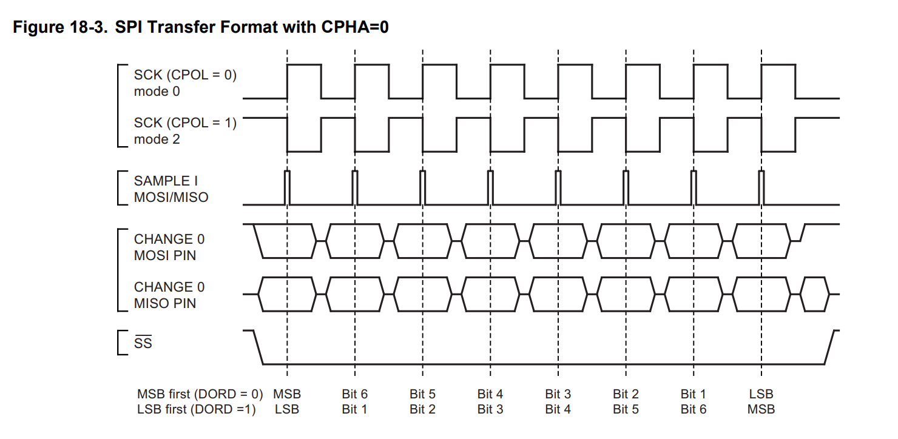
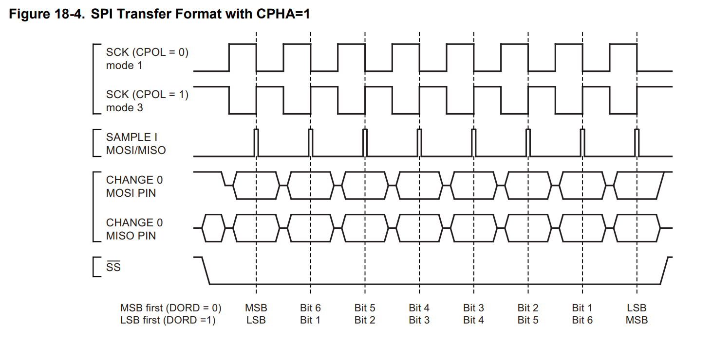

# 6.2 SPI-modes

SPI is een eenvoudig en weinig strikt protocol. Eén probleem daarbij is dat
het protocol niet vastlegt **op welk moment** de data precies gelezen
(*sampled*) en doorgeschoven (*shifted*) wordt. Dat resulteert in vier
verschillende mogelijkheden: de **SPI-modes**.

Zoals bij de afspraken van een UART-verbinding (zie [5.2.2](../5_seriele_communicatie/5.2_uart.md#522-vier-afspraken)) moeten de master
en de slave dezelfde mode gebruiken. Anders leest de ontvanger de lijn op de
verkeerde momenten.

## 6.2.1 Klokpolariteit en klokfase

Een SPI-mode is een combinatie van twee instellingen:

- **CPOL** (*Clock Polarity*): het niveau van de klok **in rust**.
  - CPOL = 0: de klok is in rust LOW;
  - CPOL = 1: de klok is in rust HIGH.
- **CPHA** (*Clock Phase*): op **welke flank** de data gelezen wordt.
  - CPHA = 0: op de **eerste** flank na het activeren van SS;
  - CPHA = 1: op de **tweede** flank.

Op de andere flank wordt de data doorgeschoven: de zender zet dan het
volgende bit op de lijn.

Welke flank de "eerste" is, hangt af van CPOL. Is de klok in rust LOW, dan is
de eerste flank een stijgende flank. Is de klok in rust HIGH, dan is de eerste
flank een dalende flank. Samen geeft dat vier modes:

| Mode | CPOL | CPHA | Klok in rust | Sample op       | Shift op        |
| ---- | ---- | ---- | ------------ | --------------- | --------------- |
| 0    | 0    | 0    | LOW          | stijgende flank | dalende flank   |
| 1    | 0    | 1    | LOW          | dalende flank   | stijgende flank |
| 2    | 1    | 0    | HIGH         | dalende flank   | stijgende flank |
| 3    | 1    | 1    | HIGH         | stijgende flank | dalende flank   |

## 6.2.2 De timingdiagrammen

Het datasheet van een microcontroller toont de modes meestal in twee
timingdiagrammen, één per waarde van CPHA. Deze komen uit het datasheet van de
ATmega328P.

### CPHA = 0: sampling op de eerste klokflank

*Bron: Microchip, ATmega328P datasheet, SPI Transfer Format with CPHA=0*

Het diagram leest van boven naar onder:

- **SCK**: de klok, voor CPOL = 0 (mode 0) en voor CPOL = 1 (mode 2).
- **SAMPLE I**: de momenten waarop de ingangen MOSI en MISO gelezen worden.
  Dat is telkens op de **eerste** flank van een klokpuls.
- **CHANGE O**: de momenten waarop de uitgangen MOSI en MISO van waarde
  veranderen. Dat is telkens op de andere flank.
- **SS**: de selectielijn, die tijdens de volledige transfer LOW is.
- Onderaan staat welk bit er op elk moment over de lijn gaat: het MSB eerst
  (DORD = 0) of het LSB eerst (DORD = 1). DORD (*Data Order*) is een
  instelling van de SPI-peripheral van de ATmega328P.

Bij CPHA = 0 wordt het eerste bit al gelezen op de allereerste klokflank. Dat
bit moet dus al op de lijn staan **voor** de klok begint. Daarom zet een slave
zijn eerste bit op MISO zodra SS LOW wordt.

### CPHA = 1: sampling op de tweede klokflank

*Bron: Microchip, ATmega328P datasheet, SPI Transfer Format with CPHA=1*

Hier is de volgorde omgekeerd. De eerste flank van elke klokpuls zet het
volgende bit op de lijn, de tweede flank leest het. Het eerste bit hoeft dus
pas op de lijn te staan na de eerste klokflank.

## 6.2.3 De juiste mode kiezen

De master past zich altijd aan de slave aan. Welke mode een slave verwacht,
staat in zijn datasheet. Dat kan op twee manieren:

- **Expliciet**: het datasheet vermeldt de ondersteunde modes, bijvoorbeeld
  "SPI mode 0 and 3".
- **Enkel in een timingdiagram**: dan moeten CPOL en CPHA afgeleid worden.
  - Kijk naar het niveau van de klok op het moment dat CS LOW wordt: dat geeft
    CPOL.
  - Kijk op welke flank de data stabiel is en gelezen wordt: de eerste flank
    (CPHA = 0) of de tweede (CPHA = 1).

In de praktijk is **mode 0** het meest gebruikt. Veel componenten
ondersteunen zowel mode 0 als mode 3: in beide modes wordt de data gelezen op
de stijgende flank, enkel het niveau van de klok in rust verschilt.

Een verkeerde mode geeft niet altijd volledige onzin. Vaak zijn de ontvangen
waarden één bit verschoven, of lijkt de communicatie af en toe te werken. Zo'n
fout is verraderlijk. Bij twijfel geeft een logic analyzer snel uitsluitsel:
die toont de klok, de data en CS onder elkaar, zoals in de diagrammen
hierboven.

### Oefening

1. Een datasheet vermeldt: "SCK is low when idle. Data is sampled on the
   rising edge of SCK." Welke SPI-mode is dat?
2. Een ander datasheet vermeldt: "SCK idles high. Data is latched on the
   falling edge of SCK." Welke SPI-mode is dat?
3. Een sensor ondersteunt mode 1 en mode 2. Wat hebben beide modes gemeen?

Oplossing

1. De klok is in rust LOW: **CPOL = 0**. Bij een klok die in rust LOW is, is
   de stijgende flank de eerste flank: **CPHA = 0**. Dat is **mode 0**.
2. De klok is in rust HIGH: **CPOL = 1**. Bij een klok die in rust HIGH is,
   is de dalende flank de eerste flank: **CPHA = 0**. Dat is **mode 2**.
3. In beide modes wordt de data gelezen op de **dalende flank**, en
   doorgeschoven op de stijgende flank. Enkel het niveau van de klok in rust
   verschilt.

