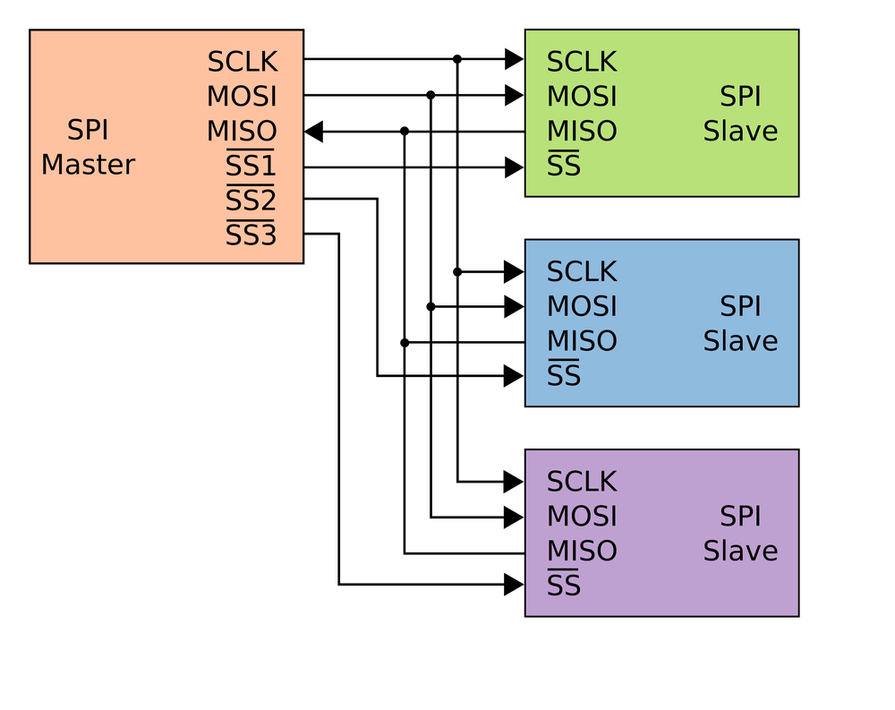
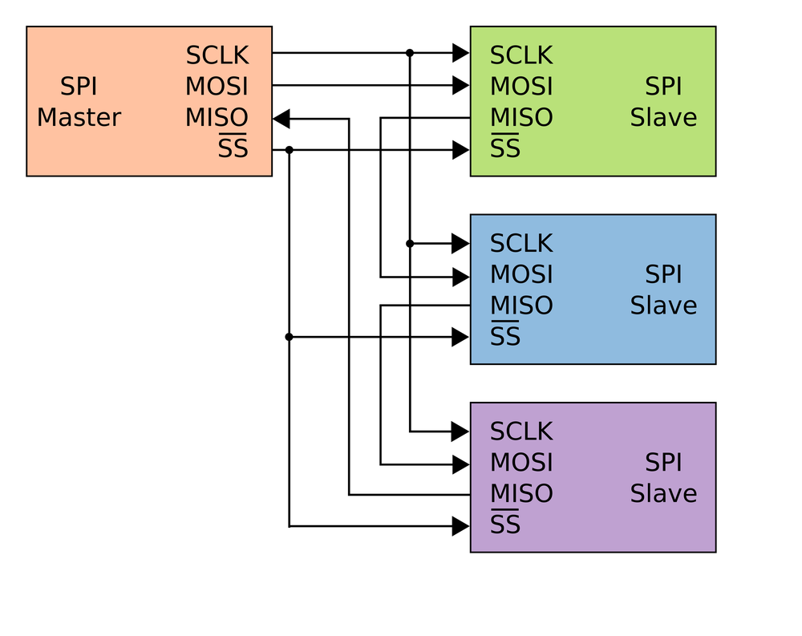
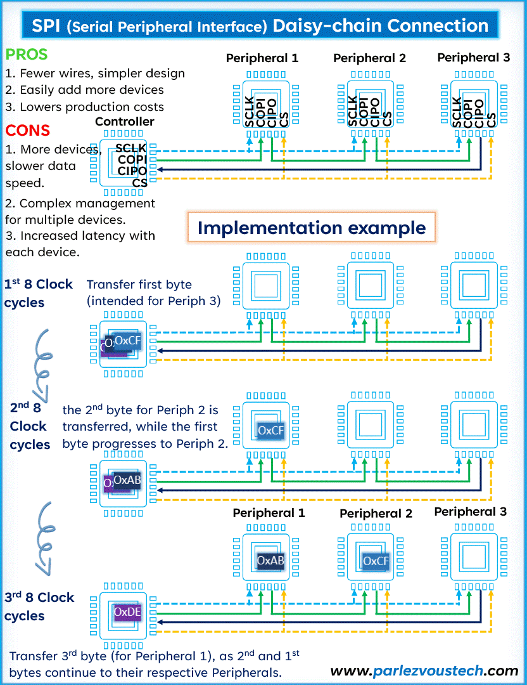
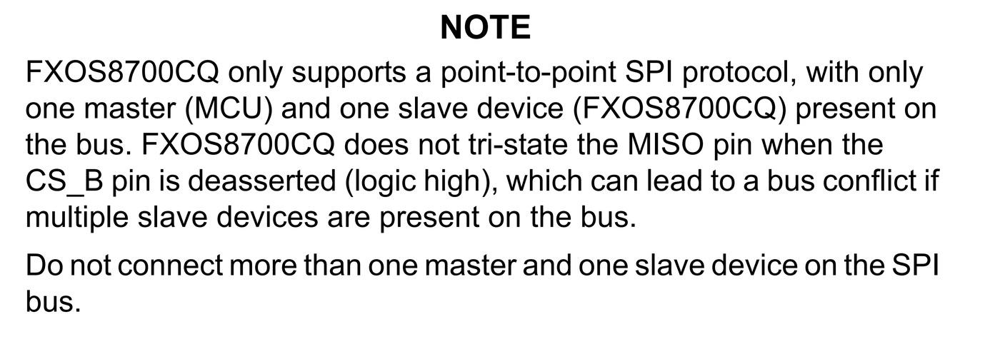
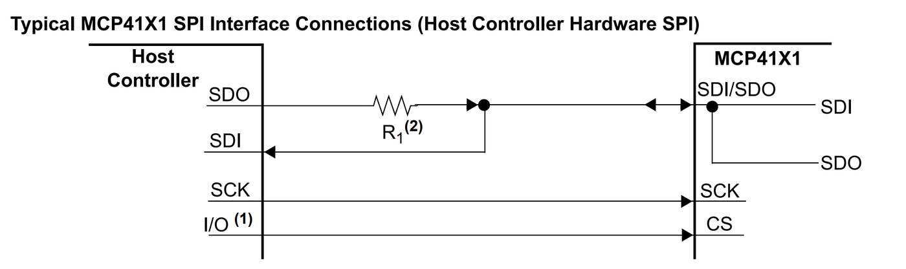
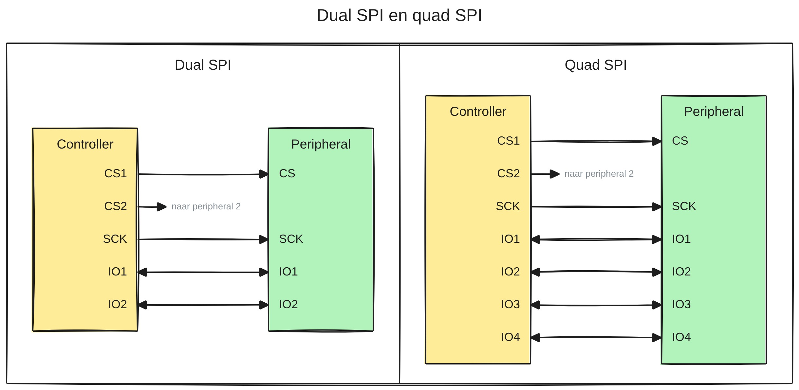
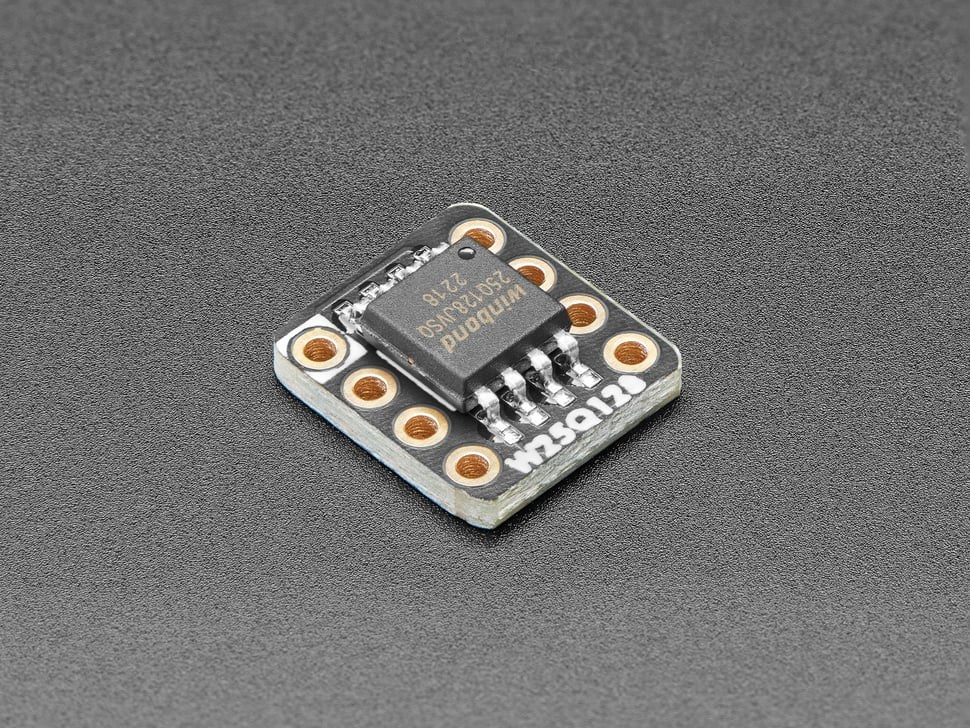

# 6.3 Meerdere SPI-peripherals

Een ESP32 die een display, een SD-kaart en een sensor via SPI aanstuurt, is
geen uitzondering. Er zijn twee manieren om meerdere slaves op één master aan
te sluiten: **multidrop** en **daisy chain**.

## 6.3.1 Multidrop

In een **multidrop**-configuratie delen alle slaves de lijnen SCLK, MOSI en
MISO. Elke slave krijgt een **eigen SS-lijn**:

*Bron: [Wikimedia Commons, SPI three slaves](https://en.wikipedia.org/wiki/File:SPI_three_slaves.svg)*

De master trekt telkens maar **één** SS-lijn LOW. Enkel die slave luistert mee
en antwoordt. De andere slaves negeren de klok en de data.

Dat werkt enkel als de slaves die niet geselecteerd zijn, de MISO-lijn
**loslaten**. Hun MISO-uitgang moet dan **hoogohmig** zijn (*high impedance*,
ook *tri-state* genoemd): de uitgang stuurt geen HIGH en geen LOW, en gedraagt
zich alsof ze niet aangesloten is. Zou een niet-geselecteerde slave toch een
HIGH op MISO zetten terwijl de geselecteerde slave een LOW stuurt, dan ontstaat
er een **busconflict**: twee uitgangen sturen dezelfde lijn in een andere
richting. De data is dan onbruikbaar, en er loopt een grote stroom tussen beide
uitgangen. De meeste slaves laten MISO netjes los, maar niet allemaal (zie
[6.3.3](#633-niet-elke-peripheral-volgt-de-regels)).

Een multidrop-configuratie vraagt **3 + n** lijnen voor n slaves. Bij een paar
slaves is dat geen probleem, bij tien slaves wordt het een flinke kost aan
GPIO's.

## 6.3.2 Daisy chain

In een **daisy chain** worden de slaves in serie geschakeld. SCLK en SS worden
gedeeld, de data loopt van slave naar slave:

- de MOSI van de master gaat naar de MOSI van de eerste slave;
- de MISO van de eerste slave gaat naar de MOSI van de tweede slave;
- ...
- de MISO van de laatste slave gaat terug naar de MISO van de master.

*Bron: [Wikimedia Commons, SPI three slaves daisy chained](https://en.wikipedia.org/wiki/File:SPI_three_slaves_daisy_chained.svg)*

De schuifregisters van alle slaves vormen zo samen **één lang schuifregister**
(zie [6.1.4](./6.1_spi.md#614-hoe-werkt-spi)). Om drie slaves elk een byte te geven:

1. trekt de master SS LOW;
2. stuurt hij drie bytes na elkaar, samen 24 klokpulsen. Elk byte schuift bij
   elke 8 klokpulsen één slave verder. Het **eerste** byte komt daardoor in de
   **laatste** slave terecht, het laatste byte in de eerste slave;
3. trekt hij SS terug HIGH. Op dat moment neemt elke slave het byte over dat
   op dat moment in zijn schuifregister staat.

De animatie hieronder toont hoe de bytes door de ketting schuiven:

*Bron: [Parlez-vous Tech, Daisy chain SPI](https://www.parlezvoustech.com/en/daisy-chain-spi-avantages-applications/)*

Een daisy chain heeft voor- en nadelen:

- **Voordelen**:
  - minder draden en een eenvoudiger ontwerp: altijd 4 lijnen, ongeacht het
    aantal slaves;
  - extra slaves zijn eenvoudig toe te voegen, zonder extra GPIO's.
- **Nadelen**:
  - hoe meer slaves, hoe meer klokpulsen er nodig zijn om er één aan te
    sturen: de vertraging (*latency*) stijgt met elke slave;
  - elke transactie gaat langs alle slaves, ook als er maar één nieuwe data
    nodig heeft;
  - niet elke slave ondersteunt een daisy chain. Het datasheet moet dat
    expliciet vermelden.

Een typisch voorbeeld zijn ledmatrixmodules met een MAX7219-driver. Die
worden vaak per vier of meer aan elkaar gekoppeld tot een lange lichtkrant,
met maar drie signaallijnen naar de microcontroller: zo'n display ontvangt
enkel data, dus de MISO van de laatste module blijft onverbonden.

## 6.3.3 Niet elke peripheral volgt de regels

SPI is geen officiële standaard (zie [6.1](./6.1_spi.md)). Een fabrikant kan dus afwijken van
wat hierboven beschreven staat. Twee voorbeelden uit de praktijk.

### Point-to-point: enkel één slave op de bus

Het datasheet van de **FXOS8700CQ**, een combinatie van een accelerometer en
een magnetometer van NXP, bevat deze opmerking:

*Bron: [NXP, FXOS8700CQ datasheet](https://www.nxp.com/docs/en/data-sheet/FXOS8700CQ.pdf)*

Vertaald: de FXOS8700CQ ondersteunt enkel een *point-to-point*
SPI-verbinding, met precies één master (de microcontroller) en één slave (de
FXOS8700CQ) op de bus. De FXOS8700CQ maakt zijn MISO-pin **niet hoogohmig**
wanneer CS_B niet actief is (logisch hoog). Dat kan een busconflict
veroorzaken als er meerdere slaves op de bus zitten. Sluit dus nooit meer dan
één master en één slave aan op deze SPI-bus.

Dit is precies het probleem uit [6.3.1](#631-multidrop). Wie zo'n sensor toch samen met andere
slaves gebruikt, zoekt eventueel lang naar een fout in de software, terwijl de
oorzaak in de hardware zit. Een aparte SPI-bus voor deze sensor is de
eenvoudigste oplossing: de ESP32 heeft er twee vrij (zie [6.1.5](./6.1_spi.md#615-spi-op-de-esp32-en-de-firebeetle-2)).

### Gedeelde datalijn: SDI en SDO op één pin

Kleine componenten hebben weinig pinnen. De **MCP41X1**, een digitale
potentiometer van Microchip, combineert SDI en SDO daarom op **één pin**:
SDI/SDO. Dat is het SDIO-signaal uit [6.1.3](./6.1_spi.md#613-nieuwe-namen). Het datasheet toont hoe die op een
gewone SPI-master aangesloten wordt:

*Bron: Microchip, MCP41X1 datasheet, Typical MCP41X1 SPI Interface Connections*

- De **SDI** van de master gaat rechtstreeks naar de gedeelde pin.
- De **SDO** van de master gaat naar dezelfde pin, maar via een weerstand
  **R1**.
- De CS van de potentiometer hangt aan een gewone GPIO (`I/O`).

De communicatie is nu **half duplex**: de gedeelde lijn wordt om beurten in
één richting gebruikt. De weerstand R1 beschermt de uitgangen: op
het moment dat de potentiometer antwoordt, stuurt de master zijn SDO-uitgang
nog steeds aan. Zet de master een HIGH terwijl de potentiometer een LOW
terugstuurt, dan beperkt R1 de stroom tussen beide uitgangen, en
leest de SDI van de master toch het niveau van de potentiometer.

De SPI-peripheral van de ESP32 ondersteunt die werking ook rechtstreeks, met
één datalijn voor beide richtingen. Dat heet de *3-wire*-modus.

## 6.3.4 Dual en quad SPI

Standaard SPI verstuurt één bit per klokpuls in elke richting. Voor
toepassingen waar snelheid alles is, bestaan er varianten die **meerdere
datalijnen tegelijk** in dezelfde richting gebruiken:

- **Dual SPI**: twee datalijnen (IO1 en IO2), dus twee bits per klokpuls.
- **Quad SPI** (QSPI): vier datalijnen (IO1 tot IO4), dus vier bits per
  klokpuls.

De datalijnen zijn **bidirectioneel**: daarom staan er in de figuur pijlen in
twee richtingen. Dezelfde lijnen worden afwisselend gebruikt om een commando
naar de peripheral te versturen en om het antwoord te ontvangen. Beide
varianten zijn dus **half duplex**: op elk moment gaan alle datalijnen in
dezelfde richting. CS en SCK blijven, zoals bij gewone SPI, altijd door de
controller aangestuurd.

Dual SPI komt niet veel voor. Quad SPI wordt regelmatig gebruikt voor
toepassingen die veel data snel moeten lezen, vooral bij **flashgeheugens**.
Een voorbeeld is de W25Q128 van Winbond: een flashgeheugen van 128 Mbit
(16 MByte), hier op een breakout board van Adafruit:

*Bron: Adafruit, QSPI DIP Breakout Board – W25Q128*

Zo'n flashgeheugen werkt standaard als een gewone SPI-slave. Pas wanneer de
quad-modus ingeschakeld is (met een bit in een statusregister), gebruiken de
snelle leescommando's vier datalijnen. De twee extra datalijnen hebben in
gewone SPI-modus een andere functie: `/WP` (*write protect*) en `/HOLD`.

Ook de ESP32 zelf gebruikt quad SPI: het flashgeheugen op de module is via
zes lijnen met de chip verbonden: een klok, een CS en vier datalijnen. Dat zijn
GPIO6 tot GPIO11, en daarom zijn die pinnen niet beschikbaar (zie [4.2.2](../4_gpio/4.2_welke_pin_kan_wat.md#422-lagen-die-de-functionaliteit-vastleggen) en
[5.4.4](../5_seriele_communicatie/5.4_van_usb_naar_uart.md#544-de-uarts-van-de-esp32)).

## 6.3.5 Voor- en nadelen van SPI

Alles samen:

- **Voordelen**:
  - **Hoge snelheid**: geen vaste maximale kloksnelheid, vaak 10 MHz en meer.
  - **Full duplex**: data kan tegelijk verzonden en ontvangen worden.
  - **Eenvoudige hardware**: geen adressering in de bitstroom. Een
    schuifregister volstaat om SPI te implementeren.
- **Nadelen**:
  - **Veel pinnen**: minimaal 4 draden (naast GND), en in een
    multidrop-configuratie een extra SS-lijn per slave.
  - **Geen flow control**: de master "pusht" data, zonder te weten of de slave
    klaar is, of de data correct ontvangen heeft. Er is geen bevestiging, in
    tegenstelling tot I²C (zie [6.6.4](./6.6_het_i2c_protocol.md#664-bevestiging-ack-en-nack)).
  - **Eén master**: standaard SPI ondersteunt officieel maar één master op de
    bus.

### Oefening

1. Een ESP32 stuurt een display, een SD-kaart en een externe ADC aan via SPI,
   in een multidrop-configuratie. Hoeveel GPIO's zijn daarvoor nodig?
2. Vier ledmatrixmodules zitten in een daisy chain. Elke module heeft een
   schuifregister van 16 bits. Hoeveel klokpulsen zijn er nodig om alle
   modules nieuwe data te geven? In welke module komen de eerste 16 bits
   terecht?
3. Een FXOS8700CQ en een SD-kaart worden in multidrop op dezelfde SPI-bus
   aangesloten. De SD-kaart werkt niet betrouwbaar, ook niet wanneer de
   FXOS8700CQ niet geselecteerd is. Wat is de oorzaak, en wat is een
   oplossing?

Oplossing

1. SCK, MOSI en MISO worden gedeeld, en elke slave krijgt een eigen CS:
   3 + 3 = **6 GPIO's**.
2. Alle schuifregisters samen tellen 4 × 16 = **64 bits**, dus 64 klokpulsen.
   De eerste 16 bits schuiven het verst door, en komen terecht in de **laatste
   module** van de ketting.
3. De FXOS8700CQ maakt zijn MISO-pin niet hoogohmig wanneer hij niet
   geselecteerd is. Wanneer de SD-kaart antwoordt, sturen dus twee uitgangen
   tegelijk de MISO-lijn aan: een **busconflict**. Een oplossing is de
   FXOS8700CQ op een **aparte SPI-bus** aan te sluiten, bijvoorbeeld de tweede
   vrije SPI-peripheral van de ESP32.

