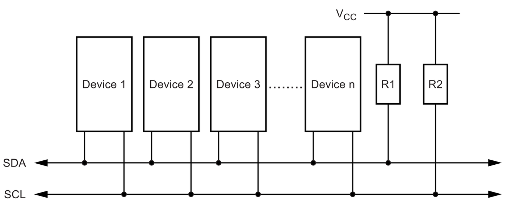

# 6.4 I²C

**I²C** (*Inter-Integrated Circuit*), uitgesproken als "I-kwadraat-C", werd in
1982 door **Philips** ontwikkeld om chips binnen eenzelfde toestel met elkaar
te laten praten, zoals in een televisie. Andere schrijfwijzen zijn I2C en IIC.
De halfgeleiderafdeling van Philips heet vandaag **NXP**, en I²C is een
handelsmerk van NXP.

Andere fabrikanten gebruiken daarom soms een eigen naam voor (bijna) hetzelfde
protocol, zonder handelsmerk: **TWI** (*Two Wire Interface*). Het datasheet
van de ATmega328P spreekt bijvoorbeeld van de *2-wire Serial Interface*.

In tegenstelling tot SPI is I²C wel officieel vastgelegd, in de
[I²C-bus specification](https://www.nxp.com/docs/en/user-guide/UM10204.pdf)
(UM10204) van NXP. Sinds versie 7 van die specificatie (2021) heten master en
slave daar **controller** en **target**. In de meeste datasheets, en in deze
cursus, staan nog de klassieke namen.

I²C is het typische protocol voor componenten die af en toe een kleine
hoeveelheid data uitwisselen:

- sensoren voor temperatuur, luchtvochtigheid, luchtdruk, licht, ...;
- EEPROM-geheugens;
- IO-expanders, voor extra GPIO's;
- real-time clocks (RTC);
- kleine OLED-displays.

## 6.4.1 Kenmerken

- **Synchroon**: de master genereert de klok op **SCL** (*Serial Clock*).
- **Half duplex**: er is maar één datalijn, **SDA** (*Serial Data*), die om
  beurten in beide richtingen gebruikt wordt (zie [5.1.2](../5_seriele_communicatie/5.1_wat_is_seriele_communicatie.md#512-richting-simplex-half-duplex-en-full-duplex)).
- **Twee lijnen**: SDA en SCL, naast GND. Daarom heet I²C ook *Two Wire
  Interface*.
- **Meerdere werkingswijzen**:
  - één master en meerdere slaves: verreweg het meest gebruikt;
  - meerdere masters en meerdere slaves (*multi-master*).
- **Elk device kan zenden en ontvangen**: wanneer de master data leest, is
  het de slave die SDA aanstuurt.
- **Adressering**: elke slave heeft een eigen **adres**, dat de master in de
  bitstroom meestuurt (zie [6.6.3](./6.6_het_i2c_protocol.md#663-adres-en-readwrite-bit)). Een aparte selectielijn per slave, zoals
  bij SPI, is dus niet nodig.

### Snelheden

De specificatie legt een aantal snelheden vast. De eerste twee zijn veruit de
meest gebruikte:

| Mode                       | Maximale bitrate                    |
| -------------------------- | ----------------------------------- |
| Standard mode (Sm)         | 100 kbit/s                          |
| Fast mode (Fm)             | 400 kbit/s                          |
| Fast mode Plus (Fm+)       | 1 Mbit/s                            |
| High-speed mode (Hs)       | 3,4 Mbit/s                          |
| Ultra Fast-mode (UFm)      | 5 Mbit/s, enkel in één richting     |

Per klokpuls gaat er één bit over SDA. Een snelheid van 100 kbit/s komt dus
overeen met een klok van 100 kHz op SCL. Een sensor die "400 kHz" vermeldt,
ondersteunt fast mode, en dus ook standard mode.

I²C is daarmee een stuk trager dan SPI (zie [6.1.4](./6.1_spi.md#614-hoe-werkt-spi)). Voor een sensor die enkele
keren per seconde een meetwaarde van een paar bytes doorgeeft, is dat ruim
voldoende.

### Adressen

Een I²C-adres telt **7 bits**. Dat geeft 27 = **128** mogelijke
adressen. Zestien daarvan zijn gereserveerd voor speciale functies: de adressen
0000xxx en 1111xxx. Er blijven dus **112** adressen over voor slaves op één
bus. In de praktijk zitten er veel minder devices op een bus: de capaciteit van
de lijnen legt een grens op (zie [6.5.2](./6.5_open_drain_en_pull_ups.md#652-de-pull-up-weerstand-berekenen)).

Er bestaan ook adressen van 10 bits, maar die komen weinig voor.

Het adres van een component ligt meestal vast in de chip. Vaak kunnen één of
twee bits ingesteld worden met een adrespin. De BME280 uit [5.1.3](../5_seriele_communicatie/5.1_wat_is_seriele_communicatie.md#513-synchroon-versus-asynchroon) heeft
bijvoorbeeld een pin **SDO**:

- SDO aan GND: adres **0x76**;
- SDO aan de voedingsspanning: adres **0x77**.

Op één bus passen dus hooguit twee BME280's. Zijn er meer identieke devices
nodig, dan zijn er twee oplossingen:

- een tweede I²C-bus, met de tweede I²C-peripheral van de ESP32 (zie [6.4.3](#643-i²c-op-de-esp32-en-de-firebeetle-2));
- een **I²C-multiplexer**, zoals de TCA9548A, die één bus opsplitst in acht
  aparte bussen.

## 6.4.2 Aansluiten

Een I²C-bus met meerdere devices ziet er zo uit:

- Alle **SDA**-pinnen worden met elkaar verbonden, en alle **SCL**-pinnen ook.
  Er wordt niets gekruist, in tegenstelling tot TX en RX bij UART (zie
  [5.2.1](../5_seriele_communicatie/5.2_uart.md#521-aansluiten)).
- Elke lijn krijgt **één pull-up-weerstand** naar de voedingsspanning: R1 op
  SDA, R2 op SCL. Dat is één weerstand per **lijn**, niet per device. Waarom
  die weerstanden nodig zijn, en hoe groot ze moeten zijn, komt aan bod in
  [6.5](./6.5_open_drain_en_pull_ups.md).
- De modules krijgen hun voeding meestal van het ontwikkelbord.

> **Let op:** vergeet ook niet de **GND**'s van alle devices met elkaar te
> verbinden. Een spanning is altijd een verschil ten opzichte van een
> referentie: zonder gemeenschappelijke GND is de communicatie onbetrouwbaar,
> of werkt ze helemaal niet (zie [5.1.3](../5_seriele_communicatie/5.1_wat_is_seriele_communicatie.md#513-synchroon-versus-asynchroon)). Bij een module met een eigen voeding
> wordt die verbinding gemakkelijk vergeten.

Een extra device toevoegen is dus eenvoudig: het komt gewoon mee op dezelfde
twee lijnen. Drie slaves via SPI vragen 6 GPIO's (zie [6.3.1](./6.3_meerdere_spi_peripherals.md#631-multidrop)), drie slaves via
I²C nog steeds maar 2.

## 6.4.3 I²C op de ESP32 en de FireBeetle 2

De ESP32 heeft twee I²C-peripherals. Via de GPIO matrix kunnen ze op bijna
elke GPIO terechtkomen (zie [4.2.1](../4_gpio/4.2_welke_pin_kan_wat.md#421-gpio-multiplexing)).

Op de pinout van de FireBeetle 2 staan **SDA** (GPIO21) en **SCL** (GPIO22),
aan beide zijden van het board. Dat zijn ook de standaardpinnen van I²C in de
Arduino core. Op de Basic GPIO Board zijn ze vrij.

Twee aandachtspunten bij het aansluiten van een I²C-module:

- **Pull-up-weerstanden**: de ESP32 heeft interne pull-ups (zie [4.4.5](../4_gpio/4.4_digitale_input.md#445-interne-pull-up-en-pull-down)), maar
  die zijn met ongeveer 45 kΩ veel te zwak voor I²C (zie [6.5.2](./6.5_open_drain_en_pull_ups.md#652-de-pull-up-weerstand-berekenen)). De meeste
  breakout boards hebben de pull-ups al aan boord, vaak 4,7 kΩ of 10 kΩ. Het
  schema van de module geeft uitsluitsel. Bij meerdere modules op dezelfde
  bus staan die weerstanden in **parallel** (zie de oefening in [6.5](./6.5_open_drain_en_pull_ups.md)).
- **Spanningsniveau**: een module die op 5 V werkt, trekt SDA en SCL via zijn
  pull-ups naar 5 V, en dus ook de pinnen van de ESP32. Daar is een
  bidirectionele level shifter nodig. De MOSFET-schakeling uit [4.4.3](../4_gpio/4.4_digitale_input.md#443-spanningsniveaus-combineren) is
  precies voor I²C ontworpen.
