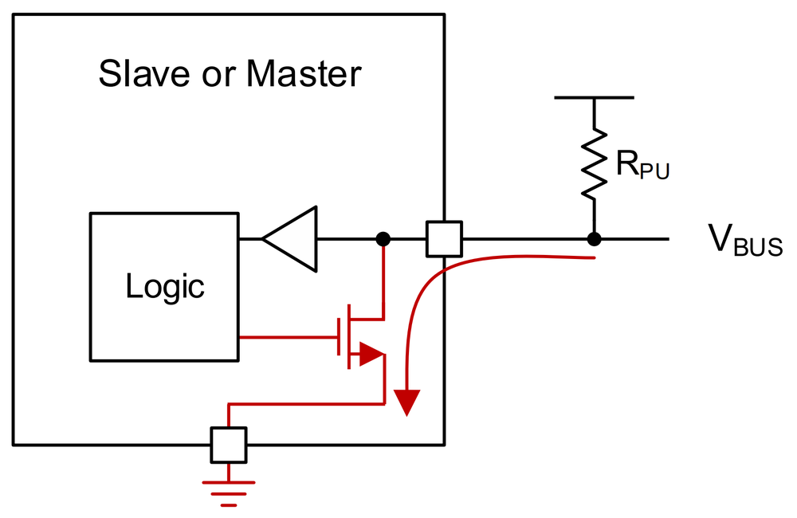
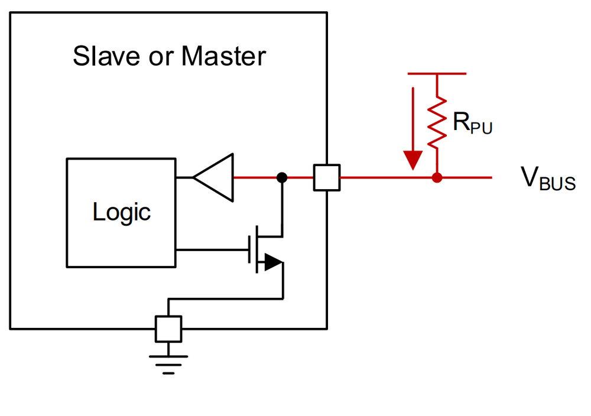
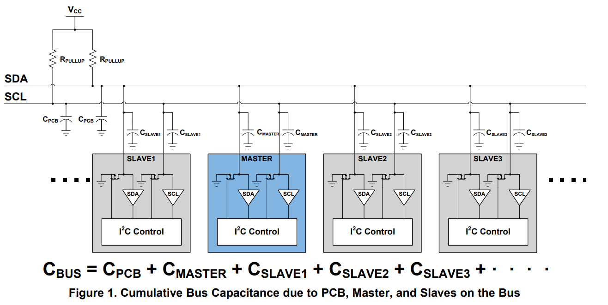
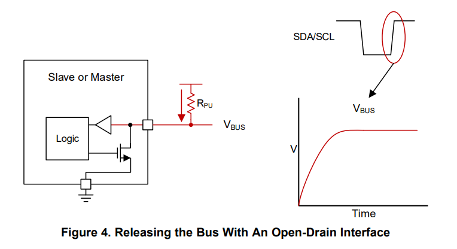

# 6.5 Open drain en pull-up-weerstanden

> **Per traject:**
>
> - **IT & IMT**: te lezen (kijk zeker naar de [vuistregel](#vuistregel) in
>   [6.5.2](#652-de-pull-up-weerstand-berekenen)).
> - **IT & IoT**: te kennen.

Bij SPI heeft elke lijn één vaste zender: de master stuurt SCLK en MOSI aan, de
geselecteerde slave stuurt MISO aan. Bij I²C ligt dat anders. SDA wordt om
beurten door de master en door de slaves aangestuurd, en met meerdere masters
zelfs ook SCL.

Een gewone digitale uitgang, zoals in [4.3](../4_gpio/4.3_digitale_output.md), is een **push-pull**-uitgang: ze
maakt de lijn actief HIGH (verbonden met de voedingsspanning) of actief LOW
(verbonden met GND). Zetten twee push-pull-uitgangen dezelfde lijn tegelijk op
een andere waarde, dan ontstaat er via beide uitgangen een kortsluiting tussen
de voedingsspanning en GND. Dat is het busconflict uit [6.3.1](./6.3_meerdere_spi_peripherals.md#631-multidrop). I²C lost dat
op met een ander type uitgang: **open drain**.

## 6.5.1 Open drain

Een **open-drain**-uitgang kan de bus naar een spanning trekken (meestal GND),
of de bus "loslaten", zodat een pull-up-weerstand de bus hoog trekt.

Binnenin bestaat zo'n uitgang uit één N-channel MOSFET tussen de pin en GND.
De drain van de MOSFET is verbonden met de pin, en verder met niets: ze is
"open". Er is geen transistor die de pin met de voedingsspanning verbindt.

| De lijn laag trekken                                                       | De lijn loslaten                                                             |
| -------------------------------------------------------------------------- | ---------------------------------------------------------------------------- |
|  |    |

*Bron: [Texas Instruments, Understanding the I2C Bus (SLVA704)](https://www.ti.com/lit/an/slva704/slva704.pdf)*

- **De lijn laag trekken**: de MOSFET geleidt. Er loopt een stroom van
  VBUS via de pull-up-weerstand RPU en de MOSFET naar
  GND. De lijn is **LOW**.
- **De lijn loslaten**: de MOSFET spert. Er loopt geen stroom door de
  uitgang, en de pull-up-weerstand trekt de lijn naar VBUS. De lijn
  is **HIGH**.

In de figuren is ook te zien dat de **ingang** (de driehoek, een buffer naar de
logica) altijd met de pin verbonden blijft. Een device leest de lijn dus ook
terwijl het zelf zendt. Dat wordt gebruikt bij de bevestiging van een byte
(zie [6.6.4](./6.6_het_i2c_protocol.md#664-bevestiging-ack-en-nack)).

Bij een bipolaire transistor in plaats van een MOSFET heet hetzelfde principe
**open collector**. Ook de level shifter uit [4.4.3](../4_gpio/4.4_digitale_input.md#443-spanningsniveaus-combineren) werkt volgens dit
principe.

### Gevolgen

- **Voordeel**: een lijn kan **gedeeld** worden door meerdere devices. Een
  kortsluiting is onmogelijk: in het slechtste geval trekken twee devices de
  lijn tegelijk laag, en dat is onschuldig. De lijn is LOW zodra minstens één
  device ze laag trekt, en enkel HIGH wanneer alle devices ze loslaten.
- **Nadeel**: er is altijd een **externe pull-up-weerstand** nodig. Zonder
  pull-up wordt de lijn nooit HIGH, maar blijft ze zweven (zie [4.4.4](../4_gpio/4.4_digitale_input.md#444-zwevende-ingangen-pull-up-en-pull-down)).
- **Nadeel**: de stijgende flank is **traag**. Een LOW wordt actief gemaakt
  door de MOSFET, en die flank is snel. Een HIGH komt er enkel via de
  pull-up-weerstand, en die flank is veel trager (zie [6.5.2](#652-de-pull-up-weerstand-berekenen)).

## 6.5.2 De pull-up-weerstand berekenen

De waarde van de pull-up-weerstand RP is een compromis. Hij mag
niet te klein zijn en niet te groot.

### Ondergrens: RP(min)

Trekt een device de lijn laag, dan loopt er een stroom door de pull-up en de
MOSFET:

> I = (VCC − VOL) / RP

Hoe kleiner RP, hoe groter die stroom. Ook de MOSFET heeft een
kleine weerstand. Bij een te grote stroom stijgt de spanning over de MOSFET,
en is de lijn niet meer laag genoeg: ze komt boven VOL(max) uit,
en een ontvanger herkent de LOW niet meer zeker (zie [4.4.2](../4_gpio/4.4_digitale_input.md#442-spanningsniveaus-van-een-digitale-gpio)).

De I²C-specificatie legt vast dat een uitgang een stroom van **3 mA** moet
kunnen opnemen (*sink*) bij een spanning van hoogstens **0,4 V**. Daaruit volgt
de kleinste toegelaten weerstand:

> RP(min) = (VCC − VOL(max)) / IOL

### Bovengrens: RP(max)

Elke lijn heeft een zekere **capaciteit**: die van de sporen op de printplaat
of de draden, en die van de pinnen van elk device op de bus. Samen is dat de
**buscapaciteit** Cb:

*Bron: [Texas Instruments, I2C Bus Pullup Resistor Calculation (SLVA689)](https://www.ti.com/lit/an/slva689/slva689.pdf)*

Laat een device de lijn los, dan moet de pull-up-weerstand die capaciteit
opladen. Samen vormen ze een **RC-kring**, net zoals het RC-filter uit [4.4.6](../4_gpio/4.4_digitale_input.md#446-drukknoppen-zijn-niet-digitaal).
De spanning stijgt daardoor niet meteen, maar volgens een laadcurve:

*Bron: [Texas Instruments, Understanding the I2C Bus (SLVA704)](https://www.ti.com/lit/an/slva704/slva704.pdf)*

Hoe groter RP, hoe trager die curve stijgt. Stijgt ze te traag,
dan is de lijn nog niet HIGH op het moment dat het volgende bit gelezen wordt.

De specificatie legt daarom een maximale **stijgtijd** tr (*rise
time*) vast. Die wordt gemeten van 30 % tot 70 % van VCC. Dat zijn
de ingangsdrempels van I²C: VIL = 0,3 × VCC en
VIH = 0,7 × VCC (vergelijk met de drempels van de
ESP32 in [4.4.2](../4_gpio/4.4_digitale_input.md#442-spanningsniveaus-van-een-digitale-gpio)).

De spanning op een RC-kring die oplaadt, volgt:

> V(t) = VCC × (1 − e−t / RC)

- 30 % van VCC wordt bereikt na t = RC × ln(1 / 0,7) ≈ 0,3567 × RC;
- 70 % van VCC wordt bereikt na t = RC × ln(1 / 0,3) ≈ 1,2040 × RC.

Het verschil is de stijgtijd:

> tr = 0,8473 × RP × Cb

Omgevormd naar de grootste toegelaten weerstand:

> RP(max) = tr / (0,8473 × Cb)

### De waarden uit de specificatie

| Parameter            | Betekenis                                                     | Standard mode | Fast mode         | Fast mode Plus    | Eenheid |
| -------------------- | ------------------------------------------------------------- | ------------- | ----------------- | ----------------- | ------- |
| tr        | maximale stijgtijd van SDA en SCL                              | 1000          | 300               | 120               | ns      |
| Cb        | maximale capaciteit per buslijn                               | 400           | 400               | 550               | pF      |
| VOL(max)  | lage uitgangsspanning bij 3 mA sink, VCC > 2 V     | 0,4           | 0,4               | 0,4               | V       |
| VOL(max)  | lage uitgangsspanning bij 2 mA sink, VCC ≤ 2 V     | –             | 0,2 × VCC | 0,2 × VCC | V       |

*Bron: [Texas Instruments, I2C Bus Pullup Resistor Calculation (SLVA689)](https://www.ti.com/lit/an/slva689/slva689.pdf), Table 1, op basis van de I²C-specificatie*

De maximale buscapaciteit van 400 pF is ook de reden waarom er in de praktijk
geen 112 devices op één bus zitten (zie [6.4.1](./6.4_i2c.md#641-kenmerken)): elk device en elke centimeter
draad voegt capaciteit toe.

### Een voorbeeld

Een I²C-bus in **fast mode**, met Cb = 200 pF en VCC =
3,3 V. Met de waarden uit de tabel:

> RP(max) = tr / (0,8473 × Cb) = 300 ns / (0,8473 × 200 pF) = **1,77 kΩ**
>
> RP(min) = (VCC − VOL(max)) / IOL = (3,3 V − 0,4 V) / 3 mA = **967 Ω**

Elke standaardwaarde tussen 967 Ω en 1,77 kΩ is dus geldig, bijvoorbeeld
1,2 kΩ of 1,5 kΩ. Binnen dat bereik is de keuze een afweging:

- een **kleinere** weerstand geeft snellere flanken, maar er loopt meer stroom
  telkens een lijn LOW is, en het verbruik stijgt;
- een **grotere** weerstand verbruikt minder, maar geeft tragere flanken.

### Vuistregel

Zonder berekening is **4,7 kΩ** een veilige keuze, zolang de bus **niet te
snel** gaat en niet te lang is:

- 4,7 kΩ ligt ruim boven RP(min), zowel op 3,3 V (967 Ω) als op
  5 V (1,53 kΩ).
- Met 4,7 kΩ mag de buscapaciteit in standard mode tot ongeveer 250 pF
  bedragen. In fast mode is dat nog maar ongeveer 75 pF: een korte bus met een
  paar modules.

### Waarom de interne pull-ups niet volstaan

De interne pull-up van de ESP32 is ongeveer 45 kΩ (zie [4.4.5](../4_gpio/4.4_digitale_input.md#445-interne-pull-up-en-pull-down)). Op een bus met
een bescheiden capaciteit van 100 pF geeft dat een stijgtijd van:

> tr = 0,8473 × 45 kΩ × 100 pF ≈ **3,8 µs**

Dat is bijna vier keer meer dan de 1000 ns die zelfs standard mode toelaat.
Voor een betrouwbare I²C-bus zijn dus externe pull-ups nodig, op de module of
op de printplaat.

### Oefening

1. Een I²C-bus in **standard mode** heeft een buscapaciteit van 300 pF, en
   werkt op 3,3 V. Bereken RP(min) en RP(max), en kies
   een geschikte weerstand.
2. Dezelfde bus moet in **fast mode** werken. Is dat haalbaar? Welke weerstand
   is dan nodig?
3. Een ESP32 heeft drie I²C-modules op dezelfde bus, op 3,3 V. Elke module
   heeft zelf pull-ups van 4,7 kΩ op SDA en SCL. Hoe groot is de totale
   pull-up-weerstand per lijn? Is dat nog toegelaten? Hoeveel van deze modules
   kunnen er maximaal op de bus?

Oplossing

1. RP(min) = (3,3 V − 0,4 V) / 3 mA = **967 Ω**.
   RP(max) = 1000 ns / (0,8473 × 300 pF) = **3,93 kΩ**.
   Elke standaardwaarde daartussen is geldig, bijvoorbeeld **2,2 kΩ** of
   **3,3 kΩ**.
2. RP(min) blijft 967 Ω. RP(max) = 300 ns / (0,8473 ×
   300 pF) = **1,18 kΩ**. Dat is nog haalbaar, maar krap: enkel een weerstand
   van **1 kΩ** past in het bereik. In de praktijk is het beter de
   buscapaciteit te verkleinen (kortere draden, minder devices), of in
   standard mode te blijven.
3. De drie weerstanden staan in parallel: 4,7 kΩ / 3 = **1,57 kΩ** per lijn.
   Dat is groter dan RP(min) = 967 Ω, dus toegelaten.
   Bij n modules is de totale weerstand 4,7 kΩ / n. Die moet minstens 967 Ω
   zijn: n ≤ 4,7 kΩ / 967 Ω = 4,86. Er kunnen dus maximaal **4 modules** op
   de bus. Bij een vijfde module (940 Ω) moeten de pull-ups op een aantal
   modules uitgeschakeld worden. Veel breakout boards hebben daarvoor een
   soldeerjumper.

