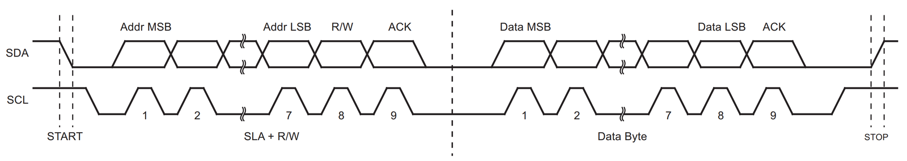
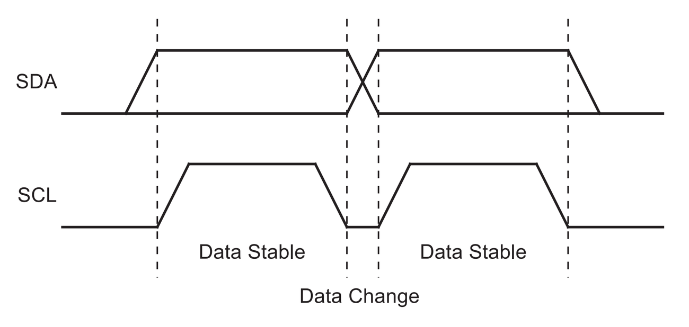
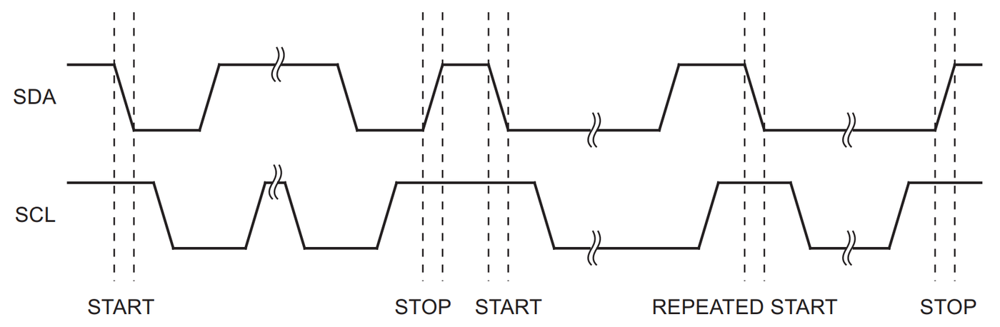

# 6.6 Het I²C-protocol

Bij SPI zorgen de selectielijnen ervoor dat een slave weet wanneer hij moet
luisteren (zie [6.1.2](./6.1_spi.md#612-aansluiten)). Bij I²C zijn er geen selectielijnen: alle devices zitten
op dezelfde twee lijnen. Het protocol moet dus zelf aangeven wanneer een
transmissie begint, voor welke slave ze bedoeld is, in welke richting de data
gaat, en wanneer ze afgelopen is.

Elke I²C-transmissie verloopt in dezelfde stappen:

1. Rust (*idle state*)
2. Startconditie (*start signal*)
3. Kloksignaal (*clock signal*)
4. Adres versturen (*send address*)
5. Lezen of schrijven (*read/write*)
6. Bevestiging (*acknowledge*)
7. Data versturen (*data transfer*)
8. Bevestiging (*acknowledge*)
9. Stopconditie (*stop signal*)

Op de lijnen ziet een volledige transmissie met één databyte er zo uit:



*Bron: Microchip, ATmega328P datasheet, 2-wire Serial Interface, Typical Data Transmission*

- Bovenaan staat **SDA**, onderaan **SCL**.
- De klokpulsen zijn per byte genummerd van 1 tot 9: 8 bits en een
  bevestiging.
- Het eerste byte heet in de figuur **SLA+R/W**: het adres van de slave
  (*SLave Address*) en het read/write-bit. Daarna volgt een **Data Byte**.

De volgende subsecties overlopen de stappen één voor één.

## 6.6.1 Geldige data

Eerst een basisregel, die voor elk bit geldt:



*Bron: Microchip, ATmega328P datasheet, 2-wire Serial Interface, Data Validity*

- De data op SDA is **geldig zolang SCL HIGH is**. In die periode moet SDA
  stabiel blijven, en leest de ontvanger het bit (*Data Stable*).
- SDA mag enkel veranderen **terwijl SCL LOW is** (*Data Change*).

Op die regel zijn twee uitzonderingen: de **startconditie** en de
**stopconditie**. Net omdat SDA dan verandert terwijl SCL HIGH is, herkent elk
device ze meteen, ongeacht waar in een byte het zich bevindt.

## 6.6.2 Rust en startconditie

**1. Rust**: zolang er niets gebeurt, zijn beide lijnen **HIGH**. Geen enkel
device trekt een lijn laag, en de pull-up-weerstanden trekken ze hoog (zie
[6.5.1](./6.5_open_drain_en_pull_ups.md#651-open-drain)). De klok pulst niet.

**2. Startconditie**: de master trekt **SDA LOW**, terwijl SCL nog HIGH is. De
klok start nog niet. Alle slaves weten nu dat er een transmissie begint, en
luisteren mee. Zijn er meerdere masters, dan weten die dat de bus bezet is.



*Bron: Microchip, ATmega328P datasheet, 2-wire Serial Interface, START, REPEATED START and STOP conditions*

De figuur toont links een startconditie (*START*). De andere condities komen
aan bod in [6.6.6](#666-stopconditie-en-repeated-start).

## 6.6.3 Adres en read/write-bit

**3. Kloksignaal**: de master begint te klokken op SCL.

**4. Adres versturen**: tijdens de klokpulsen 1 tot 7 verstuurt de master het
**adres van 7 bits** van de slave, met het MSB eerst.

**5. Lezen of schrijven**: tijdens klokpuls 8 geeft de master met het
**R/W-bit** aan wat hij wil doen:

- **0 = write**: de master stuurt data naar de slave;
- **1 = read**: de master leest data van de slave.

Adres en R/W-bit vormen samen het eerste byte van elke transmissie: het adres
staat in de bovenste 7 bits, het R/W-bit in het minst significante bit.

### Valkuil: 7 of 8 bits?

Doordat het adres één plaats naar links opschuift, krijgt het eerste byte een
andere waarde dan het adres zelf. Voor een BME280 op adres 0x76:

| Actie | Adres (7 bits) | R/W | Eerste byte         |
| ----- | -------------- | --- | ------------------- |
| write | 1110110        | 0   | 11101100 = **0xEC** |
| read  | 1110110        | 1   | 11101101 = **0xED** |

Sommige datasheets en forums vermelden die waarden van 8 bits als "adres", of
geven een apart schrijf- en leesadres. De I²C-functies in de Arduino core en
in het ESP-IDF verwachten echter het adres van **7 bits**: 0x76. Antwoordt een
sensor niet, controleer dan eerst die notatie. Een geldig adres van 7 bits is
nooit groter dan 0x77. Is een "adres" groter, dan is het bijna zeker de
notatie van 8 bits, en volstaat het om het één bit naar rechts te schuiven
(of door twee te delen).

## 6.6.4 Bevestiging: ACK en NACK

**6. Bevestiging**: tijdens klokpuls 9 laat de zender SDA los, en bevestigt de
**ontvanger** de ontvangst door SDA **LOW** te trekken. Dat is een **ACK**
(*acknowledge*). Na het adresbyte is de ontvanger de slave met dat adres. De
andere slaves negeren de rest van de transmissie.

Trekt niemand SDA laag, dan blijft de lijn HIGH door de pull-up. Dat is een
**NACK** (*not acknowledge*). Mogelijke oorzaken:

- er zit geen slave met dat adres op de bus;
- de ontvanger is bezig, en kan op dat moment niets ontvangen;
- de ontvanger begrijpt de ontvangen data niet, bijvoorbeeld een onbekend
  commando;
- de ontvanger kan geen data meer ontvangen;
- bij het lezen: de master geeft aan dat hij genoeg data ontvangen heeft (zie
  [6.6.5](#665-data)).

Dat de zender tijdens de ACK de lijn kan teruglezen, is een gevolg van open
drain: de ingang blijft altijd met de pin verbonden (zie [6.5.1](./6.5_open_drain_en_pull_ups.md#651-open-drain)).

Een **I²C-scanner** maakt hier handig gebruik van. Zo'n programma stuurt een
startconditie en een adresbyte naar elk mogelijk adres, en noteert welke
adressen met een ACK antwoorden. Dat is een ideale eerste test bij een nieuwe
module: is de module goed aangesloten, en op welk adres zit ze?

## 6.6.5 Data

**7. Data versturen**: na het adres volgen de databytes, telkens 8 bits met
het MSB eerst. Wie de data verstuurt, hangt af van het R/W-bit:

- bij **write** verstuurt de master de data;
- bij **read** verstuurt de slave de data.

**8. Bevestiging**: na elk databyte volgt opnieuw een ACK, telkens van de
**ontvanger**:

- bij **write** bevestigt de slave elk byte;
- bij **read** bevestigt de master elk byte. Na het laatste byte dat hij nodig
  heeft, stuurt de master een **NACK**. Zo weet de slave dat hij moet stoppen
  met zenden, en SDA moet loslaten.

Het aantal databytes per transmissie ligt niet vast. Een sensor kan in één
transmissie één byte doorgeven, of tientallen.

### Clock stretching

Een slave die meer tijd nodig heeft, bijvoorbeeld om een meting af te ronden,
kan na een byte **SCL LOW houden**. De master merkt dat hij de klok niet hoog
krijgt, en wacht tot de slave SCL loslaat. Dat heet *clock stretching*. Ook dat
kan enkel dankzij open drain. Samen met de ACK is het een vorm van flow
control, iets wat SPI niet heeft (zie [6.3.5](./6.3_meerdere_spi_peripherals.md#635-voor--en-nadelen-van-spi)).

## 6.6.6 Stopconditie en repeated start

**9. Stopconditie**: de master laat **SDA HIGH** worden, terwijl SCL HIGH is.
De transmissie is afgelopen, en de bus is opnieuw in rust.

In de figuur uit [6.6.2](#662-rust-en-startconditie) staat ook een **repeated start**: een nieuwe
startconditie, zonder eerst een stopconditie te geven. De master houdt zo de
bus bezet, zodat geen andere master tussenkomt, en kan van richting
veranderen: eerst schrijven, dan lezen. Dat is precies wat nodig is om een
register te lezen.

## 6.6.7 Een register schrijven en lezen

De meeste I²C-componenten zijn opgebouwd als een verzameling **registers**:
genummerde geheugenplaatsen met instellingen of meetresultaten. Het datasheet
bevat een overzicht van alle registers: de *register map*. Schrijven en lezen
verloopt bij bijna alle componenten volgens hetzelfde patroon.

**Een register schrijven**: de master stuurt eerst het nummer van het
register, en daarna de nieuwe waarde.

```text
S | adres + W | A | register | A | data | A | P
```

**Een register lezen**: de master moet eerst laten weten welk register hij
wil lezen. Dat is een schrijfactie. Daarna volgen een repeated start en een
leesactie.

```text
S | adres + W | A | register | A | Sr | adres + R | A | data | N | P
```

De afkortingen:

- **S**: startconditie, **Sr**: repeated start, **P**: stopconditie;
- **A**: ACK, **N**: NACK.

De databyte bij het lezen komt van de slave. De NACK die erop volgt, komt van
de master.

### Voorbeeld: de BME280 identificeren

De BME280 heeft een register **0xD0** (`id`), dat altijd de waarde **0x60**
bevat. Dat register uitlezen is een ideale eerste test: komt 0x60 terug, dan
werkt de communicatie, en zit er effectief een BME280 op de bus. Met de BME280
op adres 0x76 ziet de transmissie er zo uit:

| Deel           | Verstuurd door | Waarde   | Bits op SDA                     |
| -------------- | -------------- | -------- | ------------------------------- |
| START          | master         |          | SDA daalt terwijl SCL HIGH is   |
| adres + W      | master         | 0x76, W  | 1110110 0                       |
| ACK            | BME280         |          | 0                               |
| register       | master         | 0xD0     | 11010000                        |
| ACK            | BME280         |          | 0                               |
| REPEATED START | master         |          | SDA daalt terwijl SCL HIGH is   |
| adres + R      | master         | 0x76, R  | 1110110 1                       |
| ACK            | BME280         |          | 0                               |
| data           | BME280         | 0x60     | 01100000                        |
| NACK           | master         |          | 1                               |
| STOP           | master         |          | SDA stijgt terwijl SCL HIGH is  |

Veel componenten verhogen na elk gelezen byte automatisch het registeradres.
Zo kunnen meerdere registers na elkaar in één transmissie gelezen worden. De
BME280 bewaart zijn meetwaarden bijvoorbeeld in de registers 0xF7 tot 0xFE:
één leesactie van 8 bytes vanaf 0xF7 geeft luchtdruk, temperatuur en
luchtvochtigheid in één keer.

## 6.6.8 SPI of I²C?

De twee protocollen naast elkaar:

|                          | SPI                                       | I²C                                         |
| ------------------------ | ----------------------------------------- | ------------------------------------------- |
| Lijnen (naast GND)       | SCK, MOSI, MISO en een CS per slave       | SDA en SCL                                  |
| Richting                 | full duplex                               | half duplex                                 |
| Een slave kiezen         | met een CS-lijn                           | met een adres in de bitstroom               |
| Snelheid                 | geen vaste grens, vaak 10 MHz en meer     | meestal 100 of 400 kbit/s                   |
| Bevestiging              | geen                                      | ACK na elk byte                             |
| Type uitgang             | push-pull                                 | open drain, met pull-up-weerstanden         |
| Typische toepassingen    | flash, SD-kaarten, displays, snelle ADC's | sensoren, EEPROM's, IO-expanders, RTC's     |

Meestal ligt de keuze vast door de component (zie [5.1.3](../5_seriele_communicatie/5.1_wat_is_seriele_communicatie.md#513-synchroon-versus-asynchroon)). Sommige componenten
ondersteunen beide: ook de BME280 heeft naast I²C een SPI-aansluiting. Dan
geldt:

- **SPI** voor snelheid en grote hoeveelheden data;
- **I²C** voor veel trage devices met zo weinig mogelijk pinnen.

### Oefening

1. Een master schrijft de waarde 0x27 naar register 0xF4 van een BME280 op
   adres 0x77. Dat zet de sensor in *normal mode*. Schrijf de volledige
   transmissie uit: per deel wie het verstuurt, en de bits op SDA.
2. Hoeveel klokpulsen telt die transmissie op SCL, zonder de start- en
   stopconditie? Hoe lang duurt ze aan 100 kHz? En aan 400 kHz?
3. Een I²C-scanner vindt geen enkel device op de bus. Geef drie mogelijke
   oorzaken.
4. Een datasheet vermeldt: "I²C address: 0xEE (write), 0xEF (read)". Welk
   adres moet er in de code gebruikt worden?

<details>
<summary>Oplossing</summary>

1. 0x77 is `1110111`, 0xF4 is `11110100` en 0x27 is `00100111`.

   | Deel      | Verstuurd door | Bits op SDA |
   | --------- | -------------- | ----------- |
   | START     | master         |             |
   | adres + W | master         | 1110111 0   |
   | ACK       | BME280         | 0           |
   | register  | master         | 11110100    |
   | ACK       | BME280         | 0           |
   | data      | master         | 00100111    |
   | ACK       | BME280         | 0           |
   | STOP      | master         |             |

2. Drie bytes van telkens 8 bits en een ACK: 3 × 9 = **27 klokpulsen**.
   - Aan 100 kHz duurt een klokpuls 10 µs: 27 × 10 µs = **270 µs**.
   - Aan 400 kHz duurt een klokpuls 2,5 µs: 27 × 2,5 µs = **67,5 µs**.
3. Bijvoorbeeld:
   - er zijn geen pull-up-weerstanden: de module heeft er zelf geen, en de
     interne pull-ups van de ESP32 zijn te zwak (zie [6.5.2](./6.5_open_drain_en_pull_ups.md#652-de-pull-up-weerstand-berekenen));
   - SDA en SCL zijn verwisseld;
   - de module krijgt geen voeding, of de GND's zijn niet doorverbonden;
   - de code gebruikt andere pinnen dan die waarop de module aangesloten is.
4. 0xEE is `11101110`: de notatie van 8 bits, met het R/W-bit achteraan. Eén
   bit naar rechts geschoven geeft `1110111` = **0x77**.

</details>
