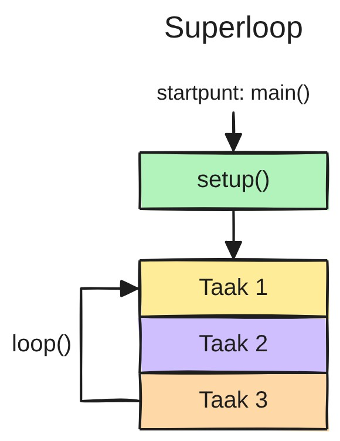
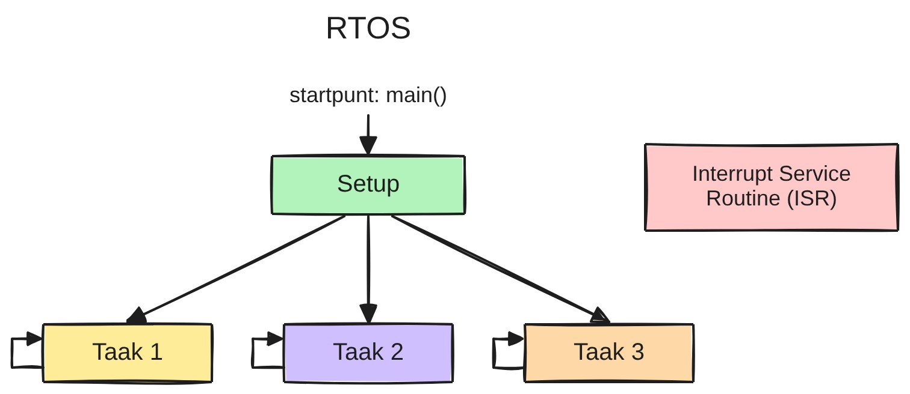
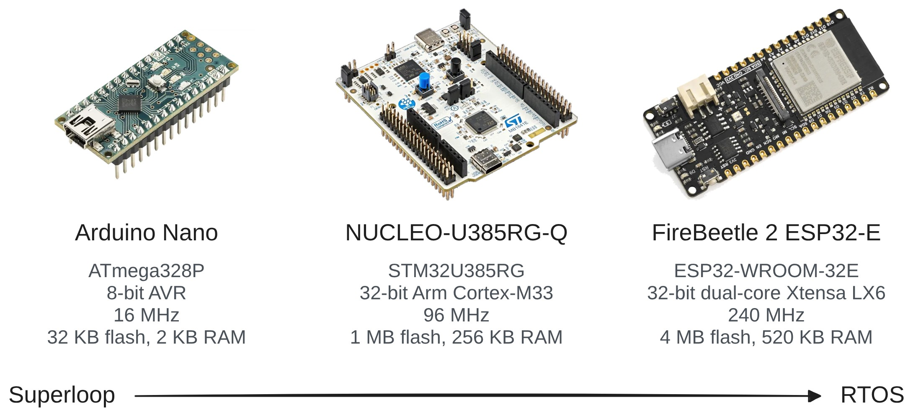
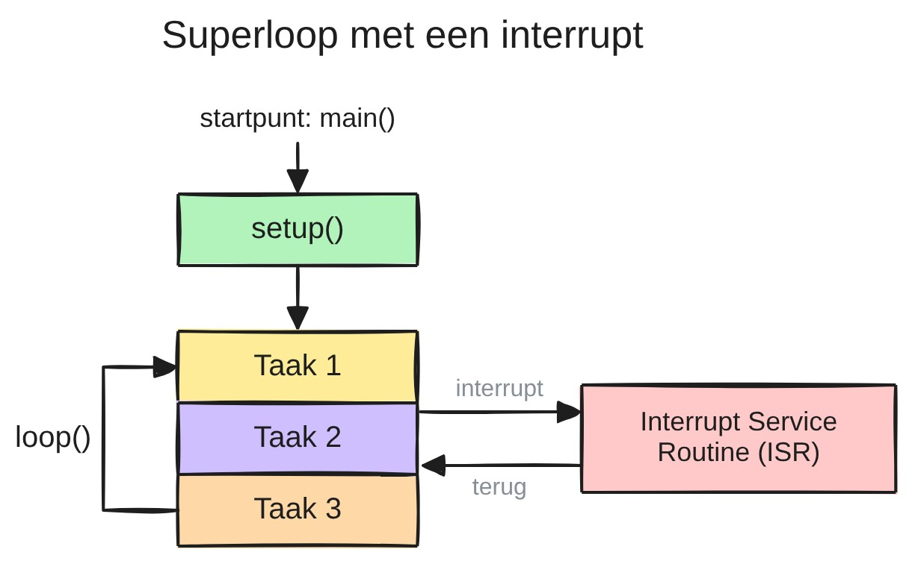

# 7.1 De superloop

Vóór het over interrupts gaat, eerst een stap terug: hoe zit een sketch
eigenlijk in elkaar, en waar loopt die opbouw tegen zijn grenzen aan?

## 7.1.1 Setup en loop

Elke sketch in deze cursus had dezelfde opbouw: `setup()` wordt één keer
uitgevoerd, daarna wordt `loop()` eindeloos herhaald. De `main()` die dat
regelt, zit verstopt in de Arduino core (zie [1.1.3](../1_introductie/1.1_wat_is_arduino.md#113-de-arduino-core-software)). Deze manier van
programmeren heet een **superloop** (*super loop*):



- **Een programmeerwijze**: een superloop is geen functie of bibliotheek,
  maar een manier om een programma op te bouwen.
- **Standaard ingebakken in het Arduino-ecosysteem**: `setup()` en `loop()`
  komen uit de Arduino core. In het ESP-IDF schrijft de programmeur de lus
  zelf, als een `while (1)` in `app_main()` (zie [4.3.6](../4_gpio/4.3_digitale_output.md#436-onder-de-motorkap-het-esp-idf)).
- **Sequentiële logica**: de taken worden na elkaar uitgevoerd, altijd in
  dezelfde volgorde.
- **Eenvoudige implementatie**: er is geen besturingssysteem nodig, enkel een
  oneindige lus.

## 7.1.2 Een letterlijke superloop

Bij het oplossen van een labo duikt geregeld een `loop()` op van meer dan
honderd regels: een letterlijke *super*loop. Twee oorzaken komen daarbij
telkens terug:

1. **Veel geneste `if`/`else`-structuren**: elke nieuwe voorwaarde komt in een
   bestaande `if` terecht, tot niet meer te volgen is welke code wanneer
   uitgevoerd wordt.
2. **De opdracht niet opsplitsen in deeltaken**: alles staat in één blok, in
   plaats van in functies die elk één ding doen.

Een eenvoudige werkwijze voorkomt beide: start een labo door de deeltaken als
**functie-oproepen** in `loop()` te schrijven, en vul daarna pas de functies
in. Zo leest `loop()` als een inhoudstafel (zie [A1.3.2](../appendix_1_codestandaarden/appendix_1_codestandaarden.md#a132-een-korte-loop)):

```cpp
void loop() {
  read_buttons();
  process_buttons();
  update_leds();
}
```

Elke functie is één taak uit de figuur hierboven: *Taak 1*, *Taak 2* en
*Taak 3*.

## 7.1.3 De reactietijd van een superloop

In een superloop merkt het programma een gebeurtenis pas op wanneer de taak
die ze controleert aan de beurt is. In het slechtste geval moet een
gebeurtenis dus wachten tot alle andere taken uitgevoerd zijn: de
**reactietijd** is zo lang als één volledige doorloop van `loop()`.

Een voorbeeld: stel dat een sketch een knop uitleest met `digitalRead()`, en
daarna een display ververst met een functie `update_display()` die 20 ms
nodig heeft.

- Een gebruiker die op de knop drukt, merkt een vertraging van 20 ms niet op.
- Een sensor die een puls van 5 ms geeft, kan tijdens `update_display()`
  volledig voorbijgaan. De sketch ziet die puls dan nooit.

Hoe meer taken er bijkomen, hoe langer één doorloop duurt, en hoe groter de
kans dat een korte gebeurtenis gemist wordt.

## 7.1.4 Voordelen en nadelen

| Voordelen                     | Nadelen                         |
| ----------------------------- | ------------------------------- |
| eenvoudig te implementeren    | geen multitasking               |
| lage overhead                 | beperkte schaalbaarheid         |
| weinig geheugenverbruik       | slechte real-time prestaties    |
| voorspelbaar gedrag           | moeilijk te onderhouden         |
| goede energie-efficiëntie     | slechte interrupt-handling      |

De **voordelen**:

- **Eenvoudig te implementeren**: geen besturingssysteem, enkel een
  oneindige lus.
- **Lage overhead**: er is geen scheduler die tussen taken wisselt
  (*context switching*), zoals bij een RTOS (zie [7.1.5](#715-een-alternatief-een-rtos)).
- **Weinig geheugenverbruik**: er is geen extra RAM of flash nodig voor een
  besturingssysteem. Dat is ideaal voor een microcontroller met weinig
  geheugen, zoals de ATmega328P met 2 kB RAM.
- **Voorspelbaar gedrag**: de taken lopen altijd in dezelfde volgorde.
  Zolang er geen onverwachte gebeurtenissen optreden, verloopt het programma
  deterministisch.
- **Goede energie-efficiëntie**: in combinatie met de slaapmodi van de
  microcontroller verbruikt een superloop weinig energie.

De **nadelen**:

- **Geen multitasking**: de taken lopen na elkaar, nooit tegelijk.
- **Beperkte schaalbaarheid**: taken met verschillende prioriteiten en
  deadlines zijn moeilijk te combineren in één lus.
- **Slechte real-time prestaties**: een taak die lang duurt, laat alle andere
  taken wachten (zie [7.1.3](#713-de-reactietijd-van-een-superloop)).
- **Moeilijk te onderhouden**: naarmate er taken bijkomen, wordt de code
  complex en moeilijk te debuggen.
- **Slechte interrupt-handling**: afhankelijk van de implementatie wordt een
  gebeurtenis niet altijd correct verwerkt wanneer de superloop met iets
  anders bezig is.

Daaruit volgt een eenvoudige keuze:

- **Een superloop** volstaat voor eenvoudige embedded toepassingen, zoals een
  systeem dat een paar sensoren uitleest en een actuator aanstuurt, en
  wanneer lage overhead en eenvoud belangrijker zijn dan multitasking.
- **Een alternatief, zoals een RTOS**, is aangewezen:
  - wanneer meerdere taken met verschillende prioriteiten beheerd moeten
    worden;
  - bij strenge real-time-eisen, zoals in medische toestellen of
    industriële besturingen;
  - wanneer de code onderhoudbaar en uitbreidbaar moet blijven voor
    toekomstige functies.

## 7.1.5 Een alternatief: een RTOS

Een **RTOS** (*Real-Time Operating System*) is een besturingssysteem voor
microcontrollers. Elke taak krijgt een eigen lus, en een **scheduler** beslist
welke taak op welk moment de processor krijgt. Voor het programma lijkt het
alsof de taken tegelijk lopen (*multithreading*):



Espressif gebruikt een eigen versie van **FreeRTOS**: het ESP-IDF is erop
gebouwd (zie [1.3.1](../1_introductie/1.3_de_keuze_van_een_ecosysteem.md#131-van-prototype-naar-productie-de-stap-van-arduino-naar-esp-idf)). Daar staat wel een **complexere implementatie**
tegenover:

- elke taak heeft een eigen stack nodig, en dus extra RAM (zie [A3.5.2](../appendix_3_static/appendix_3_static.md#a352-grote-buffers));
- taken die dezelfde data gebruiken, moeten op elkaar afgestemd worden;
- fouten zijn moeilijker te reproduceren en te debuggen, omdat de volgorde
  van uitvoeren niet meer vastligt.

Welke aanpak past, hangt ook af van de hardware. Hoe meer rekenkracht en
geheugen een microcontroller heeft, hoe interessanter een RTOS wordt. Drie
ontwikkelborden als voorbeeld:



*Foto NUCLEO-U385RG-Q: [STMicroelectronics](https://www.st.com/content/dam/category-pages/stm32-ultra-low-power-mcus-catalog-item/stm32u3-series/nucleo-u385rg-q-perspective.png)*

<!-- bron foto's Arduino Nano en FireBeetle 2 nog aan te vullen -->

- De **Arduino Nano** (zie [1.1](../1_introductie/1.1_wat_is_arduino.md)) heeft een 8-bit-processor en 2 KB RAM. Voor
  een besturingssysteem is daar geen plaats: een superloop is de logische
  keuze.
- Het **NUCLEO-U385RG-Q** is een ontwikkelbord van STMicroelectronics met een
  STM32U3, een zuinige 32-bit-microcontroller uit de STM32-familie (zie
  [1.3.3](../1_introductie/1.3_de_keuze_van_een_ecosysteem.md#133-waardige-alternatieven-stm32-en-nordic-semiconductor)). Met 256 KB RAM is zowel een superloop als een RTOS mogelijk.
- De **FireBeetle 2** (zie [1.4.1](../1_introductie/1.4_de_hardware_keuze.md#141-dfrobot-firebeetle-2)) heeft twee cores en 520 KB RAM. Het
  ESP-IDF draait standaard op FreeRTOS.

Op de ESP32 lopen beide werelden zelfs door elkaar: de Arduino core start
`loop()` in een FreeRTOS-taak, `loopTask` (zie [A3.5.2](../appendix_3_static/appendix_3_static.md#a352-grote-buffers)). Een sketch is dus
een superloop die binnen één taak van een RTOS draait. Vanuit de sketch is
daar weinig van te merken.

Dit was maar een korte kadering van een superloop tegenover een RTOS. In dit
vak ligt de focus op de **superloop**. Een RTOS op de ESP32 komt later in de
opleiding aan bod.

## 7.1.6 Prioriteiten met interrupts

Een superloop kent geen prioriteiten: elke taak wacht netjes op haar beurt,
ook wanneer er iets dringends gebeurt. Een **interrupt** voegt dat toe. Een
dringende gebeurtenis onderbreekt de lus, en wordt meteen afgehandeld in een
aparte functie, de **Interrupt Service Routine** (ISR):



De superloop blijft dus de basis. Interrupts zorgen ervoor dat een
gebeurtenis niet meer hoeft te wachten tot de juiste taak aan de beurt is.
