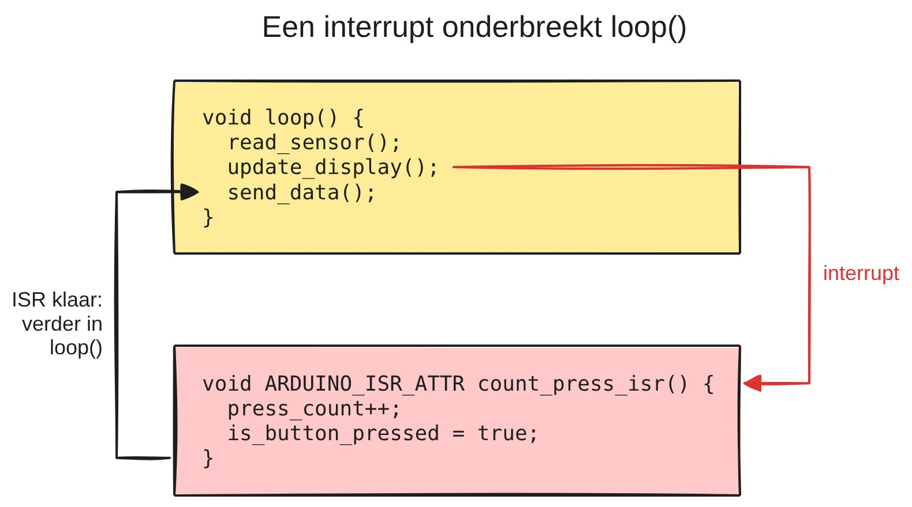
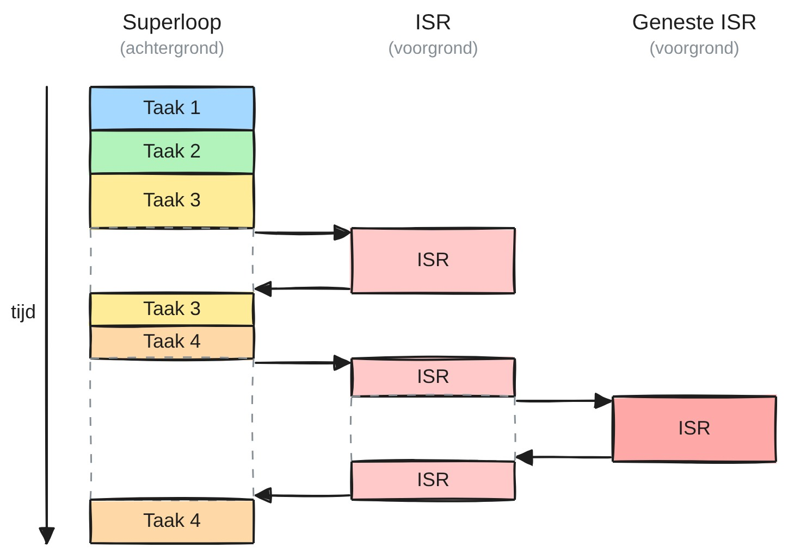

# 7.2 Wat is een interrupt

## 7.2.1 Definitie

Een **interrupt** is een **geconfigureerd event** op de microcontroller dat
de flow van een **programma** kan beïnvloeden. Elk deel van die definitie
heeft een betekenis:

- **Geconfigureerd**: een interrupt doet niets tot het programma hem
  instelt. Daarbij wordt vastgelegd:
  - welke bron de interrupt geeft, bijvoorbeeld pin D2;
  - bij welke gebeurtenis, bijvoorbeeld wanneer de pin van HIGH naar LOW
    gaat;
  - welke functie dan uitgevoerd wordt.
- **Event**: een gebeurtenis in de hardware, zoals een flank op een pin, een
  byte die binnenkomt op de UART, of een timer die een bepaalde waarde
  bereikt.
- **De flow van een programma beïnvloeden**: de processor onderbreekt wat hij
  aan het doen is, voert een aparte functie uit, en gaat daarna verder.

Enkele typische toepassingen:

- een **noodstop** die een motor meteen moet stilleggen, ongeacht waar
  `loop()` op dat moment mee bezig is;
- een **flowsensor** of **regenmeter** die per hoeveelheid water een korte
  puls geeft, waarbij elke puls geteld moet worden;
- een **rotary encoder**, die bij snel draaien snel na elkaar pulsen geeft
  (zie [4.4.7](../4_gpio/4.4_digitale_input.md#447-use-cases));
- een **sensor met een interrupt-uitgang**: veel sensoren met een SPI- of
  I²C-aansluiting (zie [hoofdstuk 6](../6_spi_en_i2c/6_spi_en_i2c.md)) hebben een extra pin, meestal `INT` of
  `DRDY` (*data ready*) genoemd, die aangeeft dat er een nieuwe meting klaarstaat.

## 7.2.2 Het verloop van een interrupt

Wat er gebeurt wanneer een interrupt optreedt, is in drie stappen samen te
vatten:

1. Een interrupt **stopt de superloop**, ongeacht welke regel code er op dat
   moment uitgevoerd wordt.
2. Aan elke interrupt is een functie gekoppeld, de **Interrupt Service
   Routine** (ISR). Die wordt uitgevoerd zodra de interrupt getriggerd wordt.
3. Zodra de ISR voltooid is, gaat de superloop **verder vanaf de plaats waar
   ze onderbroken werd**.

Om op de juiste plaats verder te kunnen gaan, bewaart de processor vóór de
ISR zijn toestand: de inhoud van zijn registers en het adres van de volgende
instructie. Dat heet de **context**. Na de ISR wordt die context hersteld,
en merkt `loop()` niets van de onderbreking, behalve dat ze even duurde.

> **Let op:** de processor wacht niet tot een regel C-code af is, maar enkel
> tot de huidige **machine-instructie** af is. Eén regel C-code, zoals
> `press_count++`, bestaat vaak uit meerdere machine-instructies. Een
> interrupt kan dus ook midden in één regel code vallen. Waarom dat van
> belang is, komt aan bod in [7.4.3](./7.4_gedeelde_variabelen_en_volatile.md#743-volatile-is-niet-genoeg).

Over de tijd bekeken ziet dat er zo uit:

- De superloop draait op de **achtergrond** (*background*), de ISR's op de
  **voorgrond** (*foreground*).
- Na de ISR gaat de superloop verder midden in *Taak 3*, waar ze onderbroken
  werd.
- Ook een ISR kan onderbroken worden, door een interrupt met een **hogere
  prioriteit**: een **geneste ISR** (*nested ISR*). Een interrupt met
  dezelfde of een lagere prioriteit wacht tot de lopende ISR klaar is.

## 7.2.3 De Interrupt Service Routine

Een **ISR** (*Interrupt Service Routine*) is niet meer dan een **functie**.
Het verschil met een gewone functie is dat het programma ze nooit zelf
oproept: de hardware doet dat, op het moment dat de interrupt optreedt.
Daardoor gelden er wel een aantal extra regels:

- **vereisten**: zonder die vereisten compileert de code niet, of werkt de
  ISR niet (zie [7.3.4](./7.3_gpio_interrupts_in_de_arduino_core.md#734-een-isr-declareren));
- **good practices**, die ervoor zorgen dat de ISR de rest van het programma
  niet stoort (zie [7.5](./7.5_de_ideale_isr.md)).

Er bestaan verschillende **types** interrupts. Elk onderdeel van de
microcontroller heeft zijn eigen interrupts:

- **GPIO**: een flank of een niveau op een pin. Dat is het onderwerp van dit
  hoofdstuk.
- **UART**: bijvoorbeeld wanneer er bytes ontvangen zijn. De UART-driver van
  de ESP32 gebruikt zo'n interrupt om ontvangen bytes uit de hardware-FIFO van
  128 bytes naar de ontvangstbuffer te verplaatsen (zie [5.5.3](../5_seriele_communicatie/5.5_serial_in_de_arduino_core.md#de-ontvangstbuffer-is-beperkt)). Zolang
  het programma die buffer op tijd uitleest, gaat er geen byte verloren, ook
  niet wanneer `loop()` even met iets anders bezig is.
- **Timers**: een interrupt die op vaste tijdstippen optreedt, bijvoorbeeld
  elke milliseconde.

## 7.2.4 Polling tegenover interrupts

|                   | Polling                                           | Interrupt                                       |
| ----------------- | ------------------------------------------------- | ----------------------------------------------- |
| Wie controleert?  | het programma, bij elke doorloop van `loop()`     | de hardware                                     |
| Reactietijd       | tot één volledige doorloop van `loop()`           | enkele microseconden                            |
| Processortijd     | gaat naar controleren, ook als er niets gebeurt   | enkel wanneer er iets gebeurt                   |
| Complexiteit      | eenvoudig                                         | gedeelde variabelen en extra regels voor de ISR |

Interrupts zijn dus niet altijd de betere keuze:

- **Polling** volstaat voor trage signalen, waarbij enkele milliseconden
  vertraging geen verschil maken: een knop in een menu, een potentiometer, een
  temperatuur.
- **Een interrupt** is aangewezen:
  - voor korte pulsen, die tussen twee keer `digitalRead()` kunnen vallen;
  - voor gebeurtenissen die zelden voorkomen, maar meteen afgehandeld moeten
    worden, zoals een noodstop;
  - voor het tellen van snelle pulsen, zoals bij een flowsensor of een
    encoder;
  - om de microcontroller uit een slaapmodus te halen (zie [7.3.3](./7.3_gpio_interrupts_in_de_arduino_core.md#733-interrupt-modes)).
