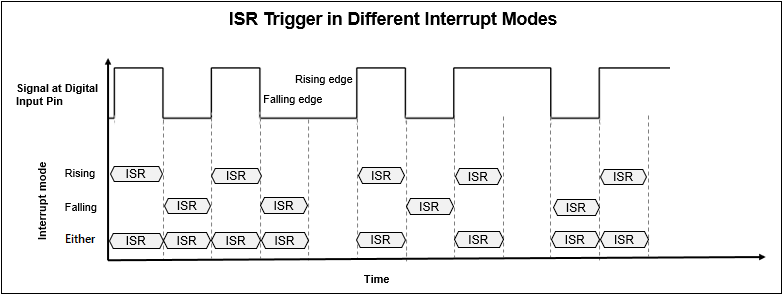

# 7.3 GPIO-interrupts in de Arduino core

Een GPIO-interrupt instellen gebeurt in de Arduino core met één functie:
`attachInterrupt()`. Deze sectie overloopt die functie, welke pinnen een
interrupt kunnen geven, wanneer een interrupt optreedt, en hoe een ISR
gedeclareerd wordt.

*Documentatie: [Arduino-ESP32, GPIO – Interrupts](https://docs.espressif.com/projects/arduino-esp32/en/latest/api/gpio.html#interrupts)*

## 7.3.1 attachInterrupt()

```cpp
attachInterrupt(uint8_t pin, voidFuncPtr handler, int mode);
```

- **`pin`**: de GPIO waarop de interrupt komt. Volgens de Arduino-conventie
  wordt het pinnummer eerst door `digitalPinToInterrupt()` gehaald (zie
  verder).
- **`handler`**: de ISR, de functie die uitgevoerd wordt wanneer de interrupt
  optreedt. `voidFuncPtr` is een pointer naar een functie zonder parameters
  en zonder return-waarde.
- **`mode`**: bij welke gebeurtenis de interrupt optreedt (zie [7.3.3](#733-interrupt-modes)).

Een eerste voorbeeld: een knop op D2 wisselt de ingebouwde led, volledig
vanuit de ISR.

```cpp
const int BUTTON_PIN = 25;  // D2
const int LED_PIN = 2;      // D9, built-in LED

bool led_on = false;  // only used inside the ISR

void ARDUINO_ISR_ATTR toggle_led_isr() {
  led_on = !led_on;
  digitalWrite(LED_PIN, led_on);
}

void setup() {
  pinMode(LED_PIN, OUTPUT);
  pinMode(BUTTON_PIN, INPUT_PULLUP);
  attachInterrupt(digitalPinToInterrupt(BUTTON_PIN), toggle_led_isr, FALLING);
}

void loop() {
  // nothing to do here: the ISR toggles the LED
}
```

Wat opvalt:

- **`loop()` is leeg.** De sketch doet niets tot de knop ingedrukt wordt. Dan
  onderbreekt de hardware de (lege) superloop en voert `toggle_led_isr()` uit.
- **De ISR wordt meegegeven zonder haakjes**: `toggle_led_isr`, niet
  `toggle_led_isr()`. Met haakjes zou de functie meteen uitgevoerd worden.
  Zonder haakjes wordt de functie zelf meegegeven, zodat de core ze later kan
  oproepen.
- **`FALLING`**: de knop hangt aan een interne pull-up. Bij het indrukken gaat
  de pin van HIGH naar LOW (zie [4.4.4](../4_gpio/4.4_digitale_input.md#444-zwevende-ingangen-pull-up-en-pull-down)).
- **`digitalPinToInterrupt()`**: op een Arduino Nano heeft een interrupt een
  eigen nummer, los van het pinnummer: pin D2 hoort bij interrupt 0. Op de
  ESP32 geeft `digitalPinToInterrupt()` gewoon het pinnummer terug. Door de
  functie altijd te gebruiken, blijft een sketch overdraagbaar naar andere
  boards.
- **`ARDUINO_ISR_ATTR`** staat voor de naam van de ISR (zie [7.3.4](#734-een-isr-declareren)).
- **`led_on` is een gewone globale variabele**, omdat enkel de ISR ze gebruikt.
  Zodra ook `loop()` de variabele leest, verandert dat (zie [7.4](./7.4_gedeelde_variabelen_en_volatile.md)).

> **Let op:** wie dit voorbeeld uitprobeert, ziet dat de led niet bij elke druk
> netjes wisselt. Dat is contactdender (zie [4.4.6](../4_gpio/4.4_digitale_input.md#446-drukknoppen-zijn-niet-digitaal)): elke keer dat het contact
> even loskomt en terug contact maakt, ontstaat er een nieuwe dalende flank,
> en dus een nieuwe interrupt. Ook bij het **loslaten** dendert de knop, en
> ontstaan er dalende flanken. Een interrupt reageert op elke flank, hoe kort
> ook. Een RC-filter in hardware (zie [4.4.6](../4_gpio/4.4_digitale_input.md#446-drukknoppen-zijn-niet-digitaal)) of een debounce in software (zie
> [7.7.1](./7.7_use_cases.md#771-een-drukknop-debouncen)) lost dat op.

## 7.3.2 Welke pinnen kunnen een interrupt geven?

Op de ESP32 kan **elke GPIO** een interrupt geven. Op de FireBeetle 2 komt
dus elke pin van de pinout in aanmerking (zie [4.2](../4_gpio/4.2_welke_pin_kan_wat.md)), met twee
kanttekeningen:

- **GPIO34–39 (A0–A3)** zijn enkel ingangen en hebben geen interne pull-up of
  pull-down (zie [4.2.3](../4_gpio/4.2_welke_pin_kan_wat.md#423-pinnen-met-een-vaste-taak-op-de-firebeetle-2)). Een knop op die pinnen heeft dus een externe
  pull-up-weerstand nodig.
- **GPIO36 (A0) en GPIO39 (A1)** geven valse interrupts wanneer de ADC, of
  Wi-Fi en Bluetooth met een slaapmodus, gebruikt worden. Dat is een gekende
  fout in de hardware van de ESP32: die pinnen worden dan telkens heel kort
  laag getrokken. Espressif raadt aan om in die situaties geen interrupt op
  die twee pinnen te gebruiken.

*Bron: [Espressif, ESP32 Series SoC Errata, GPIO-3.11](https://espressif.com/sites/default/files/documentation/eco_and_workarounds_for_bugs_in_esp32_en.pdf)*

Bij de Arduino Nano ligt dat helemaal anders. Daar zijn er voor
`attachInterrupt()` maar twee pinnen beschikbaar: **D2** (`INT0`) en **D3**
(`INT1`). Op de pinout in [4.2.4](../4_gpio/4.2_welke_pin_kan_wat.md#424-oefening-pinout-van-de-arduino-nano) staan ze aangeduid als interrupt-pinnen.

|                                     | Arduino Nano (ATmega328P)      | ESP32            |
| ----------------------------------- | ------------------------------ | ---------------- |
| Pinnen voor `attachInterrupt()`     | D2 (`INT0`) en D3 (`INT1`)     | elke GPIO        |
| `digitalPinToInterrupt(2)` geeft    | `0`                            | `2`              |

De ATmega328P kent daarnaast ook *pin change interrupts* op de andere pinnen,
maar die zijn niet bruikbaar via `attachInterrupt()`.

## 7.3.3 Interrupt modes

De parameter `mode` legt vast bij welke gebeurtenis de interrupt optreedt. De
ESP32 Arduino core kent acht modes:

| Mode        | Interrupt                                                   | Soort  |
| ----------- | ----------------------------------------------------------- | ------ |
| `DISABLED`  | geen interrupt                                              | –      |
| `RISING`    | wanneer de pin van LOW naar HIGH gaat                       | flank  |
| `FALLING`   | wanneer de pin van HIGH naar LOW gaat                       | flank  |
| `CHANGE`    | bij elke verandering, stijgend of dalend                    | flank  |
| `ONLOW`     | zolang de pin LOW is                                        | niveau |
| `ONHIGH`    | zolang de pin HIGH is                                       | niveau |
| `ONLOW_WE`  | zoals `ONLOW`, en de pin kan de ESP32 uit light sleep wekken  | niveau |
| `ONHIGH_WE` | zoals `ONHIGH`, en de pin kan de ESP32 uit light sleep wekken | niveau |



<!-- bron van deze figuur nog aan te vullen -->

Er zijn dus twee soorten:

- **Flank** (*edge*): `RISING`, `FALLING` en `CHANGE` reageren op een
  **verandering**. De interrupt treedt één keer op per overgang. Dat zijn de
  modes die in de praktijk gebruikt worden: `FALLING` voor een knop met een
  pull-up, `RISING` voor een knop met een pull-down, `CHANGE` wanneer zowel
  het indrukken als het loslaten van belang is.
- **Niveau** (*level*): `ONLOW` en `ONHIGH` reageren niet op een
  verandering, maar op een **specifiek signaal** dat op de pin staat. Zolang
  de knop ingedrukt blijft, treedt de interrupt telkens opnieuw op, meteen
  nadat de ISR afgelopen is. `loop()` krijgt dan nauwelijks nog processortijd.
  Deze modes worden in het algemeen afgeraden.

`ONLOW_WE` en `ONHIGH_WE` (*wake enable*) zijn niveau-interrupts die daarnaast
de pin instellen om de ESP32 uit **light sleep** te halen. Slaapmodi vallen
buiten dit hoofdstuk.

De laatste vier modes zijn specifiek voor de ESP32, en bestaan niet voor
Arduino-boards in het algemeen. De AVR-core van de Nano kent `LOW`, `CHANGE`,
`RISING` en `FALLING`.

> **Let op:** in de ESP32-core zijn `LOW` en `HIGH` gewoon `0` en `1`, net
> zoals `DISABLED` en `RISING`. Een sketch voor een Nano met
> `attachInterrupt(..., LOW)` compileert dus zonder fout op de ESP32, maar zet
> de interrupt **uit**. Gebruik op de ESP32 altijd de namen uit de tabel
> hierboven.

## 7.3.4 Een ISR declareren

Een ISR is een functie met een specifieke syntax:

```cpp
void ARDUINO_ISR_ATTR count_press_isr() {
  press_count++;
}
```

- **De return-waarde is `void`.** De hardware roept de ISR op, en er is
  niemand die een resultaat kan ontvangen.
- **Geen parameters.** Een ISR voor `attachInterrupt()` verwacht geen
  parameters. Een ISR voor `attachInterruptArg()` krijgt er precies één (zie
  [7.6.2](./7.6_vlaggen.md#762-attachinterruptarg)).
- **`ARDUINO_ISR_ATTR`** staat tussen het return-type en de naam.
- **De naam** begint, zoals elke functie, met een werkwoord (zie
  [A1.1.2](../appendix_1_codestandaarden/appendix_1_codestandaarden.md#a112-inhoud-van-een-naam)). In deze cursus krijgt een ISR daarnaast de suffix `_isr`, zodat
  meteen duidelijk is dat de hardware de functie oproept, en niet de sketch.

### ARDUINO_ISR_ATTR en IRAM_ATTR

Om te begrijpen wat `ARDUINO_ISR_ATTR` doet, is een stukje achtergrond nodig.
De ESP32 bewaart zijn programma in een extern flashgeheugen, dat via SPI met
de chip verbonden is (zie [6.1](../6_spi_en_i2c/6.1_spi.md)). De processor leest de code uit dat
flashgeheugen via een **cache**. Tijdens het **schrijven** naar het
flashgeheugen, bijvoorbeeld bij het opslaan van een instelling in het NVS of
bij een firmware-update, staat die cache uit. Code in het flashgeheugen is op
dat moment onbereikbaar.

Code in het **IRAM** (*instruction RAM*), het interne RAM voor instructies,
is altijd bereikbaar, en start bovendien sneller omdat ze niet eerst via de
cache geladen moet worden. Met **`IRAM_ATTR`** voor een functie komt die
functie in het IRAM terecht.

`ARDUINO_ISR_ATTR` is een **macro** uit de Arduino core (zie [A1.2.2](../appendix_1_codestandaarden/appendix_1_codestandaarden.md#a122-const-in-plaats-van-define)). In
`cores/esp32/esp32-hal.h` staat (versie 3.3.12):

```c
#if CONFIG_ARDUINO_ISR_IRAM
#define ARDUINO_ISR_ATTR IRAM_ATTR
#define ARDUINO_ISR_FLAG ESP_INTR_FLAG_IRAM
#else
#define ARDUINO_ISR_ATTR
#define ARDUINO_ISR_FLAG (0)
#endif
```

De core kent een optie *Run interrupts in IRAM* (`CONFIG_ARDUINO_ISR_IRAM`):

- **Staat de optie uit** (de standaard), dan is `ARDUINO_ISR_ATTR` leeg. De
  core stelt de GPIO-interrupts dan zo in dat ze **wachten** tot het
  schrijven naar het flashgeheugen afgelopen is (`ARDUINO_ISR_FLAG` is `0`).
  De ISR mag dus in het flashgeheugen blijven staan.
- **Staat de optie aan**, dan wordt `ARDUINO_ISR_ATTR` vervangen door
  `IRAM_ATTR`. De interrupts blijven dan ook werken tijdens het schrijven naar
  het flashgeheugen, en de ISR moet daarom in het IRAM staan.

Daaruit volgt:

- In een **sketch** wordt `ARDUINO_ISR_ATTR` gebruikt: de macro volgt de
  keuze van de core.
- `IRAM_ATTR` kan in een sketch ook gebruikt worden in plaats van
  `ARDUINO_ISR_ATTR`. De ISR staat dan altijd in het IRAM.
- In het **ESP-IDF** is `IRAM_ATTR` gebruikelijk (zie [7.6.3](./7.6_vlaggen.md#763-onder-de-motorkap-het-esp-idf)).

## 7.3.5 Een interrupt verwijderen

```cpp
detachInterrupt(uint8_t pin);
```

- **`pin`**: de GPIO waarvan de interrupt verwijderd wordt, net zoals bij
  `attachInterrupt()` via `digitalPinToInterrupt()`.

Na `detachInterrupt()` is de pin terug een gewone ingang: de ISR wordt niet
meer opgeroepen. Een nieuwe `attachInterrupt()` zet de interrupt terug aan.
Dat is handig wanneer een ingang maar tijdens een deel van het programma
mag reageren, zoals een alarm dat na de eerste melding geen nieuwe meldingen
meer moet geven, tot het gereset wordt:

```cpp
detachInterrupt(digitalPinToInterrupt(PIR_PIN));  // alarm given: ignore new detections
```
