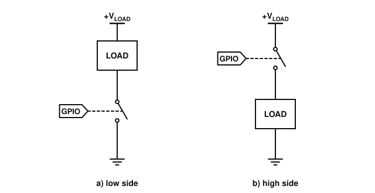
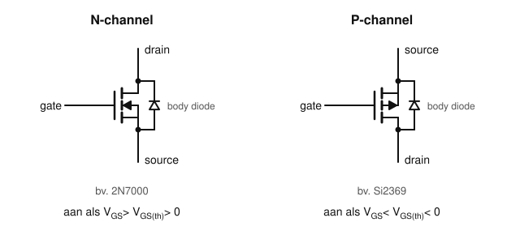
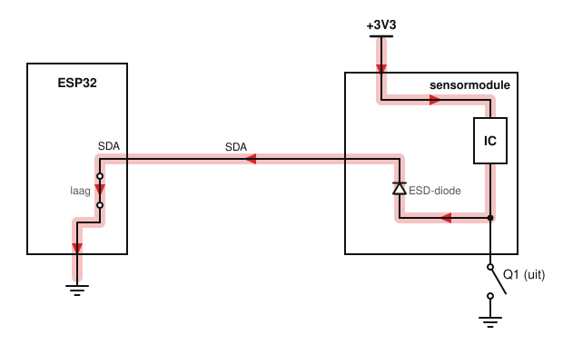
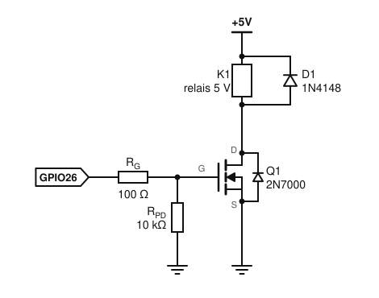
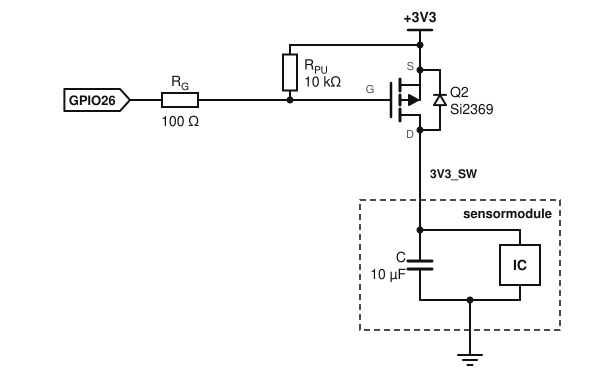
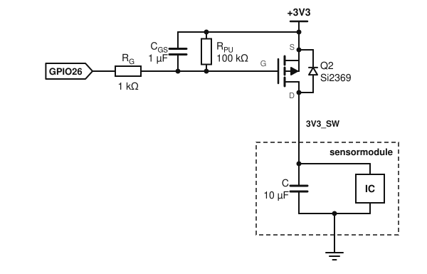
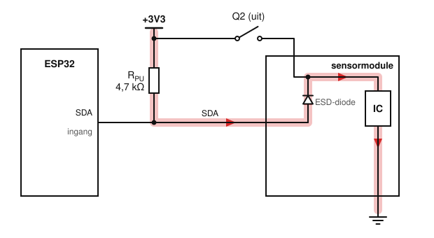
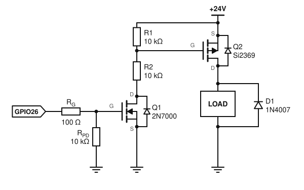
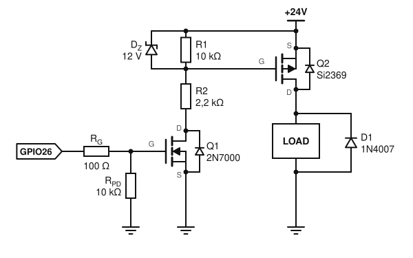

# Appendix 2: Loads en peripherals schakelen met een MOSFET

Een GPIO kan een led rechtstreeks aansturen, maar voor een relais, een
ledstrip of een sensormodule die volledig uitgeschakeld moet worden, is een
tussenstap nodig (zie [4.1.7](../4_gpio/4.1_wat_is_een_gpio.md#417-rechtstreeks-aansturen-versus-aansturen-via-een-tussenstap)). In [4.3.5](../4_gpio/4.3_digitale_output.md#435-use-cases) kwam de
**N-channel MOSFET** als elektronische schakelaar al kort aan bod. Deze
appendix gaat daar dieper op in, met de focus op het in- en uitschakelen van
een **load** in het algemeen en van **peripherals** in het bijzonder.

Drie schakelingen komen aan bod. Ze komen in bijna elk embedded ontwerp terug:

1. een **low side switch** met de 2N7000 ([A2.4](#a24-low-side-switch-met-de-2n7000));
2. een **high side switch** met de Si2369, rechtstreeks aan de GPIO ([A2.5](#a25-high-side-switch-met-de-si2369));
3. een **high side switch** waarbij de 2N7000 de Si2369 aanstuurt, voor loads
   tot 24 V ([A2.6](#a26-high-side-switch-met-de-2n7000-als-driver)).

Deze appendix overloopt:

- **[A2.1 Waarom een MOSFET als schakelaar?](#a21-waarom-een-mosfet-als-schakelaar)**: wat een GPIO niet kan, en
  waar de schakelaar in de stroomkring komt.
- **[A2.2 De MOSFET](#a22-de-mosfet)**: de werking, de body diode, de werkgebieden en
  hoe een datasheet gelezen wordt.
- **[A2.3 Low side versus high side](#a23-low-side-versus-high-side)**: wat de plaats van de schakelaar
  betekent voor de aansturing en voor de GND van de load.
- **[A2.4](#a24-low-side-switch-met-de-2n7000) tot [A2.6](#a26-high-side-switch-met-de-2n7000-als-driver)**: de drie schakelingen, met berekeningen en code.
- **[A2.7 Overzicht en keuzehulp](#a27-overzicht-en-keuzehulp)** en **[A2.8 Terugblik: waarom een MOSFET en geen bipolaire transistor?](#a28-terugblik-waarom-een-mosfet-en-geen-bipolaire-transistor)**
- **[A2.9 Oefeningen](#a29-oefeningen)** en **[A2.10 Checklist](#a210-checklist)**

## A2.1 Waarom een MOSFET als schakelaar?

Een GPIO van de ESP32 levert 3,3 V en een beperkte stroom: aanbevolen
ongeveer 20 mA, met een absoluut maximum van 40 mA (*source*) en 28 mA
(*sink*) (zie [4.3.4](../4_gpio/4.3_digitale_output.md#434-hoeveel-stroom-mag-een-gpio-leveren)). Dat is genoeg voor een led, maar niet voor:

- een **relais**: een 5 V-relais trekt al snel 70 mA;
- een **ledstrip**, een **ventilator** of een **DC-motor**: honderden mA tot
  enkele ampère;
- een **magneetventiel** of een **verwarmingselement** op 12 V of 24 V: die
  spanning mag zelfs niet in de buurt van een GPIO komen.

Er is nog een tweede reden om een schakelaar te gebruiken: een **peripheral
volledig uitschakelen**. Een sensormodule, een display of een GPS-module
verbruikt ook stroom wanneer die niet gebruikt wordt. Een breakout board met
een power-led en een eigen spanningsregelaar trekt al snel 2 mA. Dat lijkt
weinig, maar de ESP32 zelf verbruikt in deep sleep ongeveer 10 µA. Op een
batterij van 1000 mAh scheelt dat een factor 200:

- **2 mA** continu: 1000 mAh / 2 mA = 500 h, ongeveer **3 weken**;
- **10 µA**: 1000 mAh / 0,01 mA = 100 000 h, ongeveer **11 jaar**
  (theoretisch, zonder de zelfontlading van de batterij).

Daarnaast kan een vastgelopen module herstart worden door de voeding even te
onderbreken.

Er is dus een schakelaar nodig die door een GPIO bediend wordt en zelf de
stroom van de load draagt. Die schakelaar is een transistor, en vanuit een
microcontroller is een **MOSFET** (*Metal-Oxide-Semiconductor Field-Effect
Transistor*) de logische keuze: een MOSFET wordt gestuurd door een
**spanning**, en vraagt eenmaal aan of uit geen stroom van de GPIO. Een
bipolaire transistor (BJT), waaraan meestal gedacht wordt bij het woord
"transistor", kan het ook, maar vraagt zolang die aan staat een continue
basisstroom. Waarom dat voor een microcontroller het verschil maakt, komt aan
bod in [A2.8](#a28-terugblik-waarom-een-mosfet-en-geen-bipolaire-transistor), wanneer beide gekend zijn.

### Waar komt de schakelaar?

Er zijn twee plaatsen om de schakelaar in de stroomkring te zetten:

- **Low side**: de schakelaar zit tussen de load en GND. De load hangt vast
  aan de voeding, de schakelaar onderbreekt de weg terug naar GND.
- **High side**: de schakelaar zit tussen de voeding en de load. De load hangt
  vast aan GND, de schakelaar onderbreekt de voeding.



Voor de stroom maakt het niets uit: in een serieschakeling loopt overal
dezelfde stroom. De plaats bepaalt wel welke MOSFET gebruikt kan worden, hoe
die aangestuurd wordt en wat er met de GND van de load gebeurt (zie [A2.3](#a23-low-side-versus-high-side)).

## A2.2 De MOSFET

### A2.2.1 Een spanningsgestuurde schakelaar

Een MOSFET heeft drie aansluitingen: **gate (G)**, **drain (D)** en
**source (S)**. De hoofdstroom loopt tussen drain en source, de gate stuurt
die stroom. De gate is van de rest van de MOSFET gescheiden door een
flinterdunne isolerende oxidelaag. Er loopt dus geen gelijkstroom in de gate.

Wat telt, is de spanning tussen gate en source: **V<sub>GS</sub>**.

- Is V<sub>GS</sub> groot genoeg, dan ontstaat er tussen drain en source een
  geleidend kanaal: de MOSFET staat **aan**.
- Is V<sub>GS</sub> te klein, dan verdwijnt het kanaal: de MOSFET staat
  **uit**.

Het gaat dus om V<sub>GS</sub>, niet om de spanning op de gate ten opzichte van
GND:

- bij een **low side switch** hangt de source aan GND, en is V<sub>GS</sub>
  gewoon de spanning van de GPIO;
- bij een **high side switch** hangt de source aan de voeding, en daar wordt
  het interessant (zie [A2.3](#a23-low-side-versus-high-side)).

### A2.2.2 N-channel en P-channel

MOSFETs bestaan in twee soorten:



|                         | N-channel                                                   | P-channel                                                    |
| ----------------------- | ----------------------------------------------------------- | ------------------------------------------------------------ |
| Stroom als die aan is   | van drain naar source                                       | van source naar drain                                        |
| Aan als                 | V<sub>GS</sub> groter is dan V<sub>GS(th)</sub> (positief)  | V<sub>GS</sub> kleiner is dan V<sub>GS(th)</sub> (negatief)  |
| Source hangt meestal aan | GND                                                        | de voeding                                                   |
| Typisch gebruik         | low side switch                                             | high side switch                                             |
| In deze appendix        | 2N7000                                                      | Si2369                                                       |

**Het symbool lezen:**

- Het pijltje op de middelste lijn wijst bij een N-channel naar het kanaal
  toe, en bij een P-channel ervan weg.
- De onderbroken kanaallijn betekent ***enhancement mode***: zonder spanning op
  de gate is er geen kanaal, en staat de MOSFET uit. Precies wat van een
  schakelaar verwacht wordt: geen signaal betekent uit. Er bestaan ook
  *depletion mode* MOSFETs, die geleiden bij V<sub>GS</sub> = 0 V. Die komen in
  deze cursus niet voor.

> **Let op:** NPN en PNP zijn types van **bipolaire** transistoren. Bij een
> MOSFET wordt gesproken van N-channel en P-channel, of van NMOS en PMOS. Een
> "PNP-MOSFET" bestaat dus niet.

### A2.2.3 De body diode

Door de manier waarop een MOSFET gebouwd is, zit er tussen source en drain
altijd een diode: de **body diode**. Die is ook te zien in het symbool:

- bij een **N-channel** zit de anode aan de source en de kathode aan de drain;
- bij een **P-channel** zit de anode aan de drain en de kathode aan de source.

In een juist aangesloten schakelaar staat die diode in sperrichting en doet ze
niets. Ze heeft wel twee gevolgen.

**Source en drain zijn niet verwisselbaar.** Worden ze omgekeerd aangesloten,
dan staat de body diode in doorlaatrichting en is de load altijd aan, wat de
gate ook doet. Controleer daarom altijd de pinout in het datasheet:

- **2N7000** (TO-92, platte kant naar voren, pootjes naar beneden): 1 = source,
  2 = gate, 3 = drain;
- **Si2369** (SOT-23): 1 = gate, 2 = source, 3 = drain.

**Een MOSFET blokkeert maar in één richting.** Krijgt de kant van de load een
hogere spanning dan de kant van de voeding, bijvoorbeeld omdat een module een
eigen batterij of een tweede voeding heeft, dan loopt er stroom terug door de
body diode. Ook de level shifter uit [4.4.3](../4_gpio/4.4_digitale_input.md#443-spanningsniveaus-combineren) maakt gebruik van die body
diode.

### A2.2.4 De werkgebieden

> **Per traject:**
>
> - **IT & IMT**: te lezen.
> - **IT & IoT**: te kennen.

Een MOSFET kent drie werkgebieden. De tabel geldt voor een N-channel; bij een
P-channel worden alle tekens omgekeerd.

| Gebied                    | Voorwaarde                                                                                  | Gedrag                                                              |
| ------------------------- | ------------------------------------------------------------------------------------------- | ------------------------------------------------------------------- |
| Spergebied (*cut-off*)    | V<sub>GS</sub> < V<sub>GS(th)</sub>                                                         | geen kanaal, enkel een kleine lekstroom                             |
| Lineair of ohmisch gebied | V<sub>GS</sub> > V<sub>GS(th)</sub> en V<sub>DS</sub> klein                                 | het kanaal gedraagt zich als een kleine weerstand R<sub>DS(on)</sub> |
| Saturatiegebied           | V<sub>GS</sub> > V<sub>GS(th)</sub> en V<sub>DS</sub> > V<sub>GS</sub> − V<sub>GS(th)</sub> | de stroom wordt begrensd door V<sub>GS</sub>: een stroombron        |

Een MOSFET die als schakelaar werkt, staat in het **spergebied** (uit) of diep
in het **lineaire gebied** (aan). Daar is V<sub>DS</sub> klein, en gedraagt
de MOSFET zich als een weerstand van enkele milliohm tot enkele ohm. Het
saturatiegebied wordt enkel kort doorlopen tijdens het omschakelen. Daar zijn
V<sub>DS</sub> en I<sub>D</sub> tegelijk groot, en dus ook de warmte die
ontwikkeld wordt. Daarom moet een MOSFET snel omschakelen (zie [A2.2.8](#a228-de-gate-is-een-condensator)).

> **Let op:** bij een BJT betekent "in saturatie" dat die volledig aan staat.
> Bij een MOSFET betekent saturatie net dat de stroom begrensd wordt, wat
> overeenkomt met het actieve gebied van een BJT. Een MOSFET die goed schakelt,
> staat dus **niet** in saturatie.

### A2.2.5 Een datasheet lezen

> **Per traject:**
>
> - **IT & IMT**: te lezen.
> - **IT & IoT**: te kennen.

De onderstaande parameters zijn nodig om een MOSFET als schakelaar te kiezen.
De waarden komen uit de datasheets van onsemi (2N7000) en Vishay (Si2369).
Andere fabrikanten van de 2N7000 geven licht andere waarden.

| Parameter              | Betekenis                                                     | 2N7000                                 | Si2369                                       |
| ---------------------- | ------------------------------------------------------------- | -------------------------------------- | -------------------------------------------- |
| Type, behuizing        |                                                               | N-channel, TO-92                       | P-channel, SOT-23                            |
| V<sub>DS(max)</sub>    | hoogste spanning tussen drain en source wanneer die uit staat | 60 V                                   | −30 V                                        |
| I<sub>D</sub>          | hoogste continue drainstroom                                  | 200 mA                                 | −5,4 A (T<sub>A</sub> = 25 °C)               |
| V<sub>GS(max)</sub>    | hoogste spanning tussen gate en source, in beide richtingen   | ±20 V                                  | ±20 V                                        |
| V<sub>GS(th)</sub>     | drempelspanning: hier loopt er net een kleine teststroom      | 0,8 V … 3,0 V (bij 1 mA)               | −1,2 V … −2,5 V (bij −250 µA)                |
| R<sub>DS(on)</sub>     | weerstand wanneer die aan staat, bij een gegeven V<sub>GS</sub> | max. 6 Ω bij 4,5 V, max. 5 Ω bij 10 V | max. 40 mΩ bij −4,5 V, max. 29 mΩ bij −10 V  |
| C<sub>iss</sub>        | ingangscapaciteit van de gate                                 | max. 60 pF                             | typ. 1295 pF                                 |
| P<sub>D</sub>          | hoogste dissipatie                                            | 350 mW                                 | 1,25 W (op 1″ × 1″ FR4, gedurende 5 s)       |
| R<sub>thJA</sub>       | thermische weerstand van junctie naar omgeving                | 357 °C/W                               | max. 166 °C/W (continu)                      |

Aandachtspunten bij het lezen:

- **Negatieve waarden bij een P-channel.** Spanningen en stromen worden gemeten
  van drain naar source, en bij een P-channel is de source het hoogste punt.
  Daarom staan er mintekens in het datasheet.
- **Altijd de voorwaarden lezen.** De Si2369 haalt 7,6 A wanneer de behuizing
  op 25 °C gehouden wordt (T<sub>C</sub> = 25 °C), en dat lukt enkel met
  flinke koeling:
  - op een gewone printplaat bij kamertemperatuur (T<sub>A</sub> = 25 °C) is
    het 5,4 A;
  - bij een hogere temperatuur nog minder.
- **Drie soorten waarden:**
  - *Absolute Maximum Ratings*: mogen nooit overschreden worden, ook niet even;
  - *Electrical Characteristics*: gegarandeerde minima en maxima, onder de
    vermelde voorwaarden;
  - *Typical Characteristics*: grafieken van een gemiddeld exemplaar, **niet**
    gegarandeerd.

### A2.2.6 V<sub>GS(th)</sub> is niet "volledig aan"

> **Per traject:**
>
> - **IT & IMT**: te lezen.
> - **IT & IoT**: te kennen.

Een veelgemaakte fout bij het kiezen van een MOSFET is denken dat die volledig
aan staat zodra V<sub>GS</sub> boven V<sub>GS(th)</sub> komt. Het datasheet
definieert V<sub>GS(th)</sub> met een piepkleine teststroom: 1 mA voor de
2N7000, 250 µA voor de Si2369. Bij V<sub>GS(th)</sub> geleidt de MOSFET dus nog
maar nauwelijks. R<sub>DS(on)</sub> wordt pas klein met enkele volt meer, en
het datasheet garandeert R<sub>DS(on)</sub> enkel bij de V<sub>GS</sub> die in
de tabel staat.

Wat betekent dat voor de 3,3 V van de ESP32? De gate trekt in rust geen
stroom, dus de uitgangsspanning van de GPIO blijft op de volle 3,3 V (zie
[4.4.2](../4_gpio/4.4_digitale_input.md#442-spanningsniveaus-van-een-digitale-gpio) voor V<sub>OH</sub>).

- **2N7000**: V<sub>GS(th)</sub> ligt tussen 0,8 V en 3,0 V, en R<sub>DS(on)</sub>
  is pas gegarandeerd vanaf 4,5 V.
  - Een typisch exemplaar, met een drempel rond 2 V, geleidt bij 3,3 V goed.
  - Een exemplaar met een drempel van 3,0 V geleidt nauwelijks.
- **Si2369**: V<sub>GS(th)</sub> ligt tussen −1,2 V en −2,5 V, en
  R<sub>DS(on)</sub> is pas gegarandeerd vanaf −4,5 V. Bij −3,3 V geleidt een
  typisch exemplaar goed, maar het datasheet geeft geen garantie.

Met 3,3 V op de gate zitten beide MOSFETs dus buiten het gegarandeerde gebied.
Voor de loads in de labo's (tientallen mA) is dat in de praktijk geen
probleem: de typische curves (*On-Region Characteristics*, *On-Resistance vs.
Gate-to-Source Voltage*) geven een goed beeld, en een meting bevestigt het.
Voor een product wordt een **logic-level MOSFET** gekozen waarvan
R<sub>DS(on)</sub> gegarandeerd is bij V<sub>GS</sub> = 2,5 V of lager. Zo'n
MOSFET is te herkennen aan een regel als "R<sub>DS(on)</sub> @ V<sub>GS</sub> =
2.5 V" op de eerste pagina van het datasheet (zie [A2.7](#a27-overzicht-en-keuzehulp)).

In [A2.6](#a26-high-side-switch-met-de-2n7000-als-driver) volgt een handige uitweg: de 2N7000 schakelt daar niet de load,
maar enkel de gate van een andere MOSFET. Dan draagt die ongeveer 1 mA, en net
die stroom garandeert het datasheet al bij V<sub>GS(th)</sub>.

### A2.2.7 Dissipatie

> **Per traject:**
>
> - **IT & IMT**: te lezen.
> - **IT & IoT**: te kennen.

Wanneer de MOSFET aan staat, gedraagt die zich als een weerstand
R<sub>DS(on)</sub>. Over die weerstand valt een spanning, en de MOSFET wordt
warm:

> V<sub>DS</sub> = I<sub>D</sub> × R<sub>DS(on)</sub>
>
> P = I<sub>D</sub>² × R<sub>DS(on)</sub>
>
> ΔT = P × R<sub>thJA</sub>

met ΔT de temperatuurstijging van de junctie ten opzichte van de omgeving.

**Voorbeeld 1: een relais met de 2N7000.** Het relais trekt 71 mA. Omdat
R<sub>DS(on)</sub> bij 3,3 V niet gegarandeerd is, wordt voorzichtig gerekend
met 10 Ω:

> V<sub>DS</sub> = 0,071 A × 10 Ω = **0,71 V**
>
> P = 0,071² × 10 Ω = **51 mW**, ruim onder de 350 mW
>
> ΔT = 0,051 W × 357 °C/W = **18 °C**

**Voorbeeld 2: dezelfde 2N7000 aan de grens.** Bij 200 mA en 10 Ω:

> P = 0,2² × 10 Ω = **0,4 W**

Dat is meer dan de 350 mW die de 2N7000 mag dissiperen. De 200 mA uit het
datasheet is met 3,3 V op de gate dus niet haalbaar.

**Voorbeeld 3: 1 A met de Si2369 bij V<sub>GS</sub> = −10 V.**

> P = 1² × 0,029 Ω = **29 mW**
>
> ΔT = 0,029 W × 166 °C/W = **5 °C**

De stroom staat in het kwadraat: een dubbele stroom geeft vier keer zoveel
warmte. Een lage R<sub>DS(on)</sub> loont dus vooral bij grote stromen.

### A2.2.8 De gate is een condensator

> **Per traject:**
>
> - **IT & IMT**: te lezen (kijk zeker naar de [weerstand tussen gate en source](#een-weerstand-tussen-gate-en-source)).
> - **IT & IoT**: te kennen.

De gate, de oxidelaag en het kanaal vormen samen een condensator: C<sub>iss</sub>
in het datasheet. Een MOSFET omschakelen betekent die condensator opladen of
ontladen. Dat heeft drie gevolgen.

#### Een gate-weerstand

Een lege condensator is op het moment van schakelen even een kortsluiting.
Een kleine weerstand R<sub>G</sub> in serie met de gate (100 Ω) begrenst die
piekstroom uit de GPIO, en dempt het rinkelen op lange draden. De
tijdconstante blijft klein:

> τ = R<sub>G</sub> × C<sub>iss</sub>

- 2N7000: 100 Ω × 60 pF = **6 ns**;
- Si2369: 100 Ω × 1295 pF ≈ **130 ns**.

Bij de kleine 2N7000 is R<sub>G</sub> eigenlijk niet nodig, maar het is een
goede gewoonte. Bij de Si2369 heeft die meer nut.

#### Een weerstand tussen gate en source

Een condensator houdt zijn lading vast. Wordt de gate door niets aangestuurd,
dan blijft de MOSFET in de laatste toestand, of pikt de gate storing op en
blijft de MOSFET ergens tussen aan en uit hangen. Dat is de slechtste toestand:
de MOSFET staat dan in het saturatiegebied en wordt warm.

Daarom staat er **altijd een weerstand tussen gate en source** (zie ook
[4.4.4](../4_gpio/4.4_digitale_input.md#444-zwevende-ingangen-pull-up-en-pull-down)):

- bij een N-channel een **pull-down R<sub>PD</sub>**;
- bij een P-channel een **pull-up R<sub>PU</sub>**.

Die weerstand bepaalt de toestand op alle momenten waarop het programma dat
niet doet:

- tijdens een reset en tijdens het opstarten, voordat `pinMode()` of
  `gpio_config()` uitgevoerd wordt;
- in deep sleep: een GPIO houdt dan niet vanzelf het laatste niveau aan. Moet
  dat toch, dan zijn `gpio_hold_en()` en `gpio_deep_sleep_hold_en()` uit het
  ESP-IDF nodig;
- wanneer het programma vastloopt.

De weerstand wordt zo gekozen dat de load in al die situaties **uit** staat.
Voor bijna elke load is dat de veilige keuze. In deze appendix is dat 10 kΩ,
net als de pull-downs van de drukknoppen op het GPIO-bord. Samen met
R<sub>G</sub> vormt die weerstand een spanningsdeler, maar met 100 Ω en 10 kΩ
gaat er maar 1 % verloren: de gate krijgt 3,27 V in plaats van 3,3 V.

#### Strapping pins

De weerstand op de gate hangt via R<sub>G</sub> ook aan de GPIO. Op een
[strapping pin](../4_gpio/4.2_welke_pin_kan_wat.md#strapping-pins) kan die daardoor het opstartgedrag veranderen. Een voorbeeld: komt
de pull-up van een P-channel MOSFET via R<sub>G</sub> op GPIO12 (D13)
terecht, dan wordt die pin bij het opstarten HIGH gelezen. De ESP32 zet de
flash dan op 1,8 V en het board start niet meer op. Kies dus een pin zonder
speciale functie. In de voorbeelden is dat **GPIO26 (D3)**.

## A2.3 Low side versus high side

|                       | Low side                                      | High side                                                         |
| --------------------- | --------------------------------------------- | ----------------------------------------------------------------- |
| MOSFET                | N-channel                                     | P-channel                                                         |
| Aansturing vanaf 3,3 V | eenvoudig: V<sub>GS</sub> = V<sub>GPIO</sub> | eenvoudig als V<sub>LOAD</sub> = 3,3 V, anders is een driver nodig |
| GND van de load       | geschakeld: ligt niet meer vast op 0 V        | blijft vast op 0 V                                                |
| Geschikt voor         | eenvoudige loads (led, relais, motor, buzzer) | peripherals, en alles met een eigen GND-referentie of datalijnen   |

### Waarom low side eenvoudiger is

- Bij een **low side switch** hangt de source van de N-channel MOSFET aan GND.
  V<sub>GS</sub> is dan gewoon de spanning van de GPIO, ook wanneer de load aan
  5 V of 24 V hangt.
- Bij een **high side switch** hangt de source van de P-channel MOSFET aan de
  voeding van de load:

  > V<sub>GS</sub> = V<sub>GPIO</sub> − V<sub>LOAD</sub>

  - om de MOSFET aan te zetten, moet de gate ruim onder de voeding komen;
  - om de MOSFET uit te zetten, moet de gate op de voedingsspanning komen.

  Hangt de load aan 3,3 V, dan kan de GPIO beide. Hangt de load aan een hogere
  spanning, dan haalt de GPIO het "uit"-niveau niet meer. De oplossing daarvoor
  volgt in [A2.6](#a26-high-side-switch-met-de-2n7000-als-driver).

Er is nog een verschil: een N-channel MOSFET heeft bij dezelfde grootte een
lagere R<sub>DS(on)</sub>, en is goedkoper dan een P-channel. Elektronen, de
ladingsdragers in een N-channel, bewegen twee à drie keer makkelijker door
silicium dan gaten, de ladingsdragers in een P-channel.

### Wat er met de GND van de load gebeurt

Bij een low side switch is de GND van de load niet de GND van de schakeling,
maar de drain van de MOSFET:

- **De MOSFET staat aan**: de drain ligt I<sub>D</sub> × R<sub>DS(on)</sub>
  boven GND. Een module die 100 mA trekt via een 2N7000 met 5 Ω, heeft haar GND
  op 0,5 V.
- **De MOSFET staat uit**: er is geen weg meer naar GND. Via de load wordt de
  drain naar V<sub>LOAD</sub> getrokken.

Voor een relais of een led maakt dat niets uit: die hebben geen andere
verbinding met de rest van de schakeling. Voor een peripheral met datalijnen
(I²C, SPI, UART) wel:

- **Aan**: de module ziet de lage uitgangsspanning van de ESP32 (0 V) als
  −0,5 V, onder haar eigen GND. De meeste IC's verdragen op een ingang
  hoogstens −0,3 V. Daaronder beginnen hun ESD-diodes te geleiden.
- **Uit**: nog erger. De module zoekt een andere weg naar GND, en vindt die
  via de datalijnen (zie de figuur hieronder):
  - de stroom loopt van de voeding door het IC en door de ESD-diode van de
    SDA-lijn, naar de pin van de ESP32 die laag staat;
  - de module blijft half gevoed, en de bus wordt verstoord;
  - beide chips krijgen stroom via pinnen die daar nooit voor bedoeld zijn.



De werking van SDA, SCL en de pull-up-weerstanden van een I²C-bus staat in
[6.5](../6_spi_en_i2c/6.5_open_drain_en_pull_ups.md).

### Vuistregel

- Een **eenvoudige load** schakelen, zoals een led, relais, motor, buzzer of
  verwarmingselement: **low side**.
- De **voeding van een peripheral** schakelen, iets met een eigen
  GND-referentie of datalijnen, of een load waarvan één kant vast aan GND
  hangt (bijvoorbeeld via de behuizing): **high side**.

## A2.4 Low side switch met de 2N7000

### A2.4.1 Het schema



| Onderdeel       | Waarde                     | Functie                                     |
| --------------- | -------------------------- | ------------------------------------------- |
| Q1              | 2N7000                     | de schakelaar                               |
| R<sub>G</sub>   | 100 Ω                      | begrenst de laadstroom van de gate          |
| R<sub>PD</sub>  | 10 kΩ                      | houdt Q1 uit zolang de GPIO niet stuurt     |
| K1              | relais 5 V, spoel van 70 Ω | de load                                     |
| D1              | 1N4148                     | flyback diode over de spoel                 |

### A2.4.2 De werking

- **GPIO HIGH**: V<sub>GS</sub> ≈ 3,3 V, en Q1 geleidt. Er loopt stroom van
  +5V door de spoel naar GND, en het relais trekt aan.
- **GPIO LOW of zwevend**: V<sub>GS</sub> = 0 V, Q1 staat uit en het relais
  valt af.

De logica is **niet geïnverteerd**: HIGH = aan.

De load hangt aan 5 V terwijl de gate met 3,3 V aangestuurd wordt, en dat is
geen probleem: enkel V<sub>GS</sub> telt, en de source hangt aan GND. De drain
mag tot 60 V gaan. Een low side switch is zo meteen ook een niveauomzetter:
met de 2N7000 kan tot 60 V geschakeld worden, zolang de stroom klein blijft.

### A2.4.3 Dimensioneren: werkt het met 3,3 V op de gate?

> **Per traject:**
>
> - **IT & IMT**: te lezen.
> - **IT & IoT**: te kennen.

- **Stroom door de spoel:**

  > I = 5 V / 70 Ω = **71 mA**

  Dat is onder de 200 mA van de 2N7000.
- **Spanningsval:** R<sub>DS(on)</sub> is bij 3,3 V niet gegarandeerd. Met een
  voorzichtige 10 Ω valt er 0,71 V over Q1, en krijgt de spoel 4,29 V. Veel
  5 V-relais trekken al aan vanaf 75 % van hun nominale spanning (3,75 V).
  Dat staat als *must operate voltage* in het datasheet van het relais.
- **Dissipatie:** 51 mW, ruim onder de 350 mW (zie [A2.2.7](#a227-dissipatie)).

Een exemplaar met de hoogste drempel (3,0 V) haalt die 71 mA bij 3,3 V
mogelijk niet. Een meting geeft uitsluitsel (zie [A2.9](#a29-oefeningen)).

### A2.4.4 Inductieve loads: de flyback diode

Een spoel slaat energie op in haar magnetisch veld. Schakelt Q1 uit, dan wil
de spoel de stroom verder laten lopen. Zonder uitweg schiet de spanning op de
drain omhoog tot er iets doorslaat: al snel tientallen tot honderden volt, ver
boven de 60 V van de 2N7000.

De diode D1 over de spoel geeft de stroom een uitweg: de stroom blijft even
rondlopen door spoel en diode, en dooft dan uit. De drain komt zo nooit hoger
dan V<sub>LOAD</sub> + 0,7 V.

- De kathode komt aan de voeding, de anode aan de drain. Tijdens normale
  werking spert de diode.
- Een flyback diode is nodig bij alles met een spoel: relais, motoren,
  magneetventielen, elektromagneten.
- Veel relaismodules hebben er al een aan boord. Een los relais niet.
- Een neveneffect: het relais valt iets trager af.

### A2.4.5 Code

De 2N7000 schakelt erg snel (τ = 6 ns). Dezelfde schakeling kan dus ook met
PWM aangestuurd worden (zie [4.6](../4_gpio/4.6_pwm.md)), bijvoorbeeld om een kleine motor te
regelen of een ledstrip te dimmen, zolang de stroom binnen de grenzen blijft.

**Arduino**

```cpp
const uint8_t RELAY_PIN = 26;  // D3, drives the gate of Q1 (2N7000) via R_G

// Switches the relay on or off. Low side switch: HIGH = on.
void set_relay(bool on) {
  digitalWrite(RELAY_PIN, on ? HIGH : LOW);
}

void setup() {
  pinMode(RELAY_PIN, OUTPUT);  // the output register is 0 after a reset: relay off
  set_relay(true);
}

void loop() {
}
```

**ESP-IDF**

```c
#include <stdbool.h>
#include "driver/gpio.h"

#define RELAY_GPIO GPIO_NUM_26  // D3, drives the gate of Q1 (2N7000) via R_G

// Switches the relay on or off. Low side switch: 1 = on.
static void set_relay(bool on) {
  gpio_set_level(RELAY_GPIO, on ? 1 : 0);
}

void app_main(void) {
  gpio_config_t relay_config = {
    .pin_bit_mask = 1ULL << RELAY_GPIO,
    .mode = GPIO_MODE_OUTPUT,
    .pull_up_en = GPIO_PULLUP_DISABLE,
    .pull_down_en = GPIO_PULLDOWN_DISABLE,  // R_PD on the board does this job
    .intr_type = GPIO_INTR_DISABLE,
  };
  ESP_ERROR_CHECK(gpio_config(&relay_config));  // the output register is 0 after a reset: relay off
  set_relay(true);
}
```

## A2.5 High side switch met de Si2369

### A2.5.1 Het schema

De Si2369 schakelt de 3,3 V-voeding van een sensormodule. Zoals bijna elke
module heeft die een ontkoppelcondensator.



| Onderdeel       | Waarde                                       | Functie                                     |
| --------------- | -------------------------------------------- | ------------------------------------------- |
| Q2              | Si2369                                       | de schakelaar                               |
| R<sub>G</sub>   | 100 Ω                                        | begrenst de laadstroom van de gate          |
| R<sub>PU</sub>  | 10 kΩ                                        | houdt Q2 uit zolang de GPIO niet stuurt     |
| sensormodule    | 3,3 V, ongeveer 20 mA, 10 µF ontkoppeling    | de load                                     |

### A2.5.2 De werking

De source hangt aan +3V3, dus:

> V<sub>GS</sub> = V<sub>G</sub> − 3,3 V

| GPIO                                  | V<sub>G</sub>              | V<sub>GS</sub> | Q2  | Module |
| ------------------------------------- | -------------------------- | -------------- | --- | ------ |
| LOW                                   | 0 V                        | −3,3 V         | aan | gevoed |
| HIGH                                  | 3,3 V                      | 0 V            | uit | uit    |
| zwevend (reset, opstarten, deep sleep) | 3,3 V via R<sub>PU</sub>  | 0 V            | uit | uit    |

De logica is **geïnverteerd** (*active low*): LOW = aan, net als bij een led
die als *current sink* aangesloten is (zie [4.3.4](../4_gpio/4.3_digitale_output.md#434-hoeveel-stroom-mag-een-gpio-leveren)). In de code wordt dat
verborgen achter benoemde constanten, zodat de rest van het programma gewoon
"aan" en "uit" zegt.

R<sub>PU</sub> doet in deep sleep precies wat nodig is: wordt de GPIO
zwevend, dan valt de module vanzelf uit.

### A2.5.3 De voorwaarde: V<sub>LOAD</sub> = V<sub>GPIO</sub>

Deze schakeling werkt enkel omdat de GPIO de gate exact op de spanning van de
source kan brengen. Wat gebeurt er als op dezelfde manier een 5 V-load
geschakeld wordt, met de source aan 5 V?

- **GPIO LOW**: V<sub>GS</sub> = −5 V, dus Q2 staat aan.
- **GPIO HIGH**: V<sub>GS</sub> = 3,3 V − 5 V = −1,7 V. De drempel van de Si2369
  ligt tussen −1,2 V en −2,5 V. Een exemplaar met een drempel van −1,2 V
  blijft dus half aan.
- **GPIO zwevend**: R<sub>PU</sub> trekt de pin naar 5 V. Dat is meer dan de
  hoogste toegelaten ingangsspanning van de ESP32 (V<sub>IH</sub>(max) =
  V<sub>DD</sub> + 0,3 V = 3,6 V).

Voor een load op een hogere spanning dan 3,3 V is de schakeling uit [A2.6](#a26-high-side-switch-met-de-2n7000-als-driver)
nodig.

### A2.5.4 Dimensioneren

Bij −3,3 V is R<sub>DS(on)</sub> niet gegarandeerd. Maar zelfs als die tien
keer slechter is dan de 40 mΩ bij −4,5 V, valt er over Q2 maar:

> V<sub>DS</sub> = 20 mA × 0,4 Ω = **8 mV**

Voor een module van tientallen mA is de Si2369 dus ruim voldoende. Voor
enkele ampère op 3,3 V is een P-channel MOSFET nodig die gespecificeerd is bij
−2,5 V.

### A2.5.5 De inschakelstroom (inrush)

> **Per traject:**
>
> - **IT & IMT**: te lezen.
> - **IT & IoT**: te kennen.

Bijna elke module heeft ontkoppelcondensatoren, hier 10 µF. Staat de module
uit, dan zijn die leeg. De Si2369 schakelt in enkele honderden nanoseconden in
(τ = 130 ns), en op dat moment is de lege condensator een kortsluiting. Er
loopt een piekstroom van enkele ampère, enkel begrensd door R<sub>DS(on)</sub>,
de koperbanen en de condensatoren op de 3V3-rail.

De lading komt in die eerste microseconden uit de condensatoren op de
3V3-rail van de ESP32. Stel dat daar 22 µF op staat. De lading blijft behouden
en verdeelt zich over beide condensatoren:

> V = 3,3 V × 22 µF / (22 µF + 10 µF) ≈ **2,3 V**

In werkelijkheid zakt de rail minder diep, omdat de spanningsregelaar
bijstuurt. Maar de grootteorde is duidelijk: ver onder de 3,0 V die de
ESP32-WROOM-32E minimaal nodig heeft. De *brown-out detector* reset de ESP32,
het programma start opnieuw, zet de sensor weer aan, enzovoort. Het klassieke
symptoom: "de ESP32 reset telkens wanneer de sensor aangezet wordt".

Er zijn drie oplossingen:

1. **Trager inschakelen (*soft-start*).** R<sub>G</sub> wordt groter, en er
   komt een condensator tussen gate en source:

   

   - De tijdconstante wordt τ = R<sub>G</sub> × C<sub>GS</sub> = 1 kΩ × 1 µF =
     1 ms. De gate zakt nu langzaam, en Q2 gaat geleidelijk van uit naar aan.
     Daardoor laadt C op met een begrensde stroom.
   - Komt de uitgang in ongeveer 0,3 ms omhoog, dan is de laadstroom
     I = C × ΔV / Δt = 10 µF × 3,3 V / 0,3 ms ≈ **110 mA**, in plaats van
     enkele ampère.
   - R<sub>PU</sub> is nu 100 kΩ. R<sub>G</sub> en R<sub>PU</sub> vormen een
     spanningsdeler: met 1 kΩ en 10 kΩ zou V<sub>GS</sub> maar −3,0 V halen,
     met 100 kΩ is dat −3,27 V.
   - Uitschakelen gaat nu ook trager, maar voor een peripheral maakt dat niet
     uit.
2. **Een *load switch* IC.** Een load switch combineert de MOSFET, de driver en
   een instelbare soft-start in één IC. Vaak zit er ook een ontlaadfunctie voor
   de uitgang in, en soms een stroombegrenzing. Een voorbeeld is de TPS22918 van
   Texas Instruments. Voor een product is dat vaak de beste keuze.
3. **Modules na elkaar inschakelen**, in plaats van allemaal tegelijk.

### A2.5.6 Back-powering: een uitgeschakelde module die toch stroom krijgt

> **Per traject:**
>
> - **IT & IMT**: te lezen.
> - **IT & IoT**: te kennen.

Een high side switch houdt de GND intact, maar de datalijnen kunnen nog altijd
voor problemen zorgen. In de figuur hieronder hangen de I²C-pull-ups aan de
vaste 3V3-rail. De module staat uit, maar SDA en SCL worden nog altijd naar
3,3 V getrokken. Via de ESD-diode van SDA naar V<sub>DD</sub> in de module loopt
er stroom naar de voeding van de module: de module wordt gevoed via haar
datalijn.



De gevolgen:

- de module verbruikt nog altijd stroom, en er wordt niets bespaard;
- de module kan in een onbepaalde toestand terechtkomen, half gereset;
- de module kan de bus laag trekken, waardoor ook de andere modules op de bus
  niet meer werken.

Hetzelfde gebeurt wanneer de ESP32 een pin hoog stuurt naar een module die uit
staat, bijvoorbeeld de chip select van een SPI-module of de TX-lijn van een
UART.

Zo wordt het vermeden:

- **De pull-ups van een schakelbare module komen op de geschakelde rail**
  (3V3_SW, na de MOSFET). Hangen er nog andere modules op dezelfde bus die wel
  aan blijven, dan zijn er pull-ups nodig die aan blijven. De schakelbare
  module komt dan op een eigen bus.
- **De bus wordt gestopt voor de module uitgeschakeld wordt**, en de pinnen
  worden als ingang of laag gezet:
  - in Arduino met `Wire.end()`;
  - in het ESP-IDF door de I²C-driver te verwijderen.
- **Na het inschakelen** wordt de opstarttijd uit het datasheet van de module
  afgewacht, voor er gecommuniceerd wordt.

### A2.5.7 Code

Twee aandachtspunten:

- De geïnverteerde logica wordt verborgen achter **benoemde constanten** (zie
  [A1.2](../appendix_1_codestandaarden/appendix_1_codestandaarden.md#a12-constanten)).
- Het niveau wordt gezet **voor** de pin een uitgang wordt. Na een reset staat
  het uitgangsregister op 0. Met enkel `pinMode()` wordt de pin dus eerst even
  laag, en staat de module even aan. In de ESP32-core 3.x werkt
  `digitalWrite()` pas na `pinMode()`. Daarom wordt hier `gpio_set_level()`
  gebruikt: de ESP-IDF-functie die `digitalWrite()` zelf ook aanroept (zie
  [2.3.2](../2_arduino/2.3_de_arduino_core.md#232-onder-de-motorkap-digitalwrite-in-de-esp32-core)), en die ook in een sketch beschikbaar is.

**Arduino**

```cpp
const uint8_t SENSOR_POWER_PIN = 26;   // D3, drives the gate of Q2 (Si2369) via R_G
const uint8_t SENSOR_POWER_ON = LOW;   // P-channel high side switch: inverted logic
const uint8_t SENSOR_POWER_OFF = HIGH;

// Switches the supply of the sensor module on or off.
void set_sensor_power(bool on) {
  digitalWrite(SENSOR_POWER_PIN, on ? SENSOR_POWER_ON : SENSOR_POWER_OFF);
}

void setup() {
  // The output register is 0 after a reset: pinMode() alone would switch the module on briefly.
  // digitalWrite() only works after pinMode(), so set the level with the ESP-IDF function.
  gpio_set_level((gpio_num_t)SENSOR_POWER_PIN, SENSOR_POWER_OFF);
  pinMode(SENSOR_POWER_PIN, OUTPUT);

  set_sensor_power(true);
}

void loop() {
}
```

**ESP-IDF**

```c
#include <stdbool.h>
#include "driver/gpio.h"

#define SENSOR_POWER_GPIO GPIO_NUM_26  // D3, drives the gate of Q2 (Si2369) via R_G
#define SENSOR_POWER_ON 0              // P-channel high side switch: inverted logic
#define SENSOR_POWER_OFF 1

// Switches the supply of the sensor module on or off.
static void set_sensor_power(bool on) {
  gpio_set_level(SENSOR_POWER_GPIO, on ? SENSOR_POWER_ON : SENSOR_POWER_OFF);
}

void app_main(void) {
  // Set the level before the pin becomes an output, so the module stays off.
  gpio_set_level(SENSOR_POWER_GPIO, SENSOR_POWER_OFF);
  gpio_config_t sensor_power_config = {
    .pin_bit_mask = 1ULL << SENSOR_POWER_GPIO,
    .mode = GPIO_MODE_OUTPUT,
    .pull_up_en = GPIO_PULLUP_DISABLE,  // R_PU on the board does this job
    .pull_down_en = GPIO_PULLDOWN_DISABLE,
    .intr_type = GPIO_INTR_DISABLE,
  };
  ESP_ERROR_CHECK(gpio_config(&sensor_power_config));

  set_sensor_power(true);
}
```

## A2.6 High side switch met de 2N7000 als driver

### A2.6.1 Waarom een driver?

Soms moet een load op 12 V of 24 V high side geschakeld worden, bijvoorbeeld:

- omdat de load haar GND deelt met andere onderdelen;
- omdat het een 24 V-sensor of -actuator in een industriële installatie is,
  waarvan de GND verbonden moet blijven.

De GPIO kan de gate van de P-channel MOSFET nooit tot 24 V brengen, en dus
nooit uitzetten.

De oplossing: de GPIO schakelt een kleine N-channel MOSFET, low side zoals in
[A2.4](#a24-low-side-switch-met-de-2n7000). Die trekt op zijn beurt de gate van de P-channel MOSFET naar beneden.
De 2N7000 werkt zo als **niveauomzetter**: het 3,3 V-signaal wordt omgezet in
een gatesignaal dat de P-channel MOSFET aan- en uitzet, ook wanneer de load
aan 24 V hangt.

### A2.6.2 Het schema

De 2N7000 (Q1) stuurt de Si2369 (Q2), die een 24 V-load schakelt. R1 en R2
houden V<sub>GS</sub> van Q2 binnen ±20 V:



| Onderdeel                       | Waarde                                     | Functie                                                                   |
| ------------------------------- | ------------------------------------------ | ------------------------------------------------------------------------- |
| Q1                              | 2N7000                                     | driver: trekt de gate van Q2 naar beneden                                 |
| R<sub>G</sub>, R<sub>PD</sub>   | 100 Ω, 10 kΩ                               | zoals in [A2.4](#a24-low-side-switch-met-de-2n7000)                       |
| Q2                              | Si2369                                     | de eigenlijke schakelaar                                                  |
| R1                              | 10 kΩ                                      | pull-up tussen gate en source: houdt Q2 uit zolang Q1 uit staat           |
| R2                              | 10 kΩ                                      | spanningsdeler met R1, zodat V<sub>GS</sub> van Q2 binnen ±20 V blijft    |
| D1                              | 1N4007                                     | flyback diode (inductieve load)                                           |
| LOAD                            | bv. een 24 V-magneetventiel of -ventilator | de load                                                                   |

### A2.6.3 De werking

| GPIO             | Q1  | V<sub>G</sub> van Q2         | V<sub>GS</sub> van Q2 | Q2  | Load |
| ---------------- | --- | ---------------------------- | --------------------- | --- | ---- |
| LOW of zwevend   | uit | 24 V via R1                  | 0 V                   | uit | uit  |
| HIGH             | aan | 24 V × R2 / (R1 + R2) = 12 V | −12 V                 | aan | aan  |

De logica is **niet geïnverteerd**: HIGH = aan. Er zijn twee inversies die
elkaar opheffen:

- Q1 inverteert: HIGH op de gate geeft LOW op de drain;
- Q2 inverteert: LOW op de gate zet Q2 aan.

Zowel R<sub>PD</sub> als R1 kiezen voor "uit". Tijdens een reset, het
opstarten en deep sleep staat de load dus uit.

### A2.6.4 Waarom de 2N7000 hier wel volstaat

Q1 draagt enkel de stroom door R1 en R2:

> I = 24 V / 20 kΩ = **1,2 mA**

Dat is ongeveer de teststroom van V<sub>GS(th)</sub>. Zelfs een exemplaar met
de hoogste drempel geleidt per definitie al 1 mA bij V<sub>GS</sub> =
V<sub>DS</sub> = 3,0 V, en bij 3,3 V meer. De R<sub>DS(on)</sub> van Q1 speelt
nauwelijks een rol: zelfs als er 1 V over Q1 valt, blijft V<sub>GS</sub> van Q2
ongeveer −11,5 V.

Ook de spanning is geen probleem. Staat Q1 uit, dan staat er 24 V op de drain,
ruim onder de 60 V die de 2N7000 aankan.

### A2.6.5 De gate van Q2 beschermen: V<sub>GS(max)</sub> = ±20 V

> **Per traject:**
>
> - **IT & IMT**: te lezen.
> - **IT & IoT**: te kennen.

Zonder R2 trekt Q1 de gate van Q2 tot 0 V, en wordt V<sub>GS</sub> = −24 V. Dat
is meer dan de ±20 V die de Si2369 verdraagt. De oxidelaag raakt beschadigd,
soms meteen, soms pas na een tijd. Daarom zit er een spanningsdeler op de gate.
De spanning over R1 is V<sub>GS</sub>:

> V<sub>GS</sub> = −V<sub>LOAD</sub> × R1 / (R1 + R2)

|V<sub>GS</sub>| wordt gekozen tussen ongeveer 5 V en 15 V:

- genoeg om Q2 volledig aan te zetten (gespecificeerd bij −4,5 V en −10 V);
- veilig onder de 20 V.

| V<sub>LOAD</sub> | R1    | R2              | V<sub>GS</sub> (aan) | Opmerking                                                          |
| ---------------- | ----- | --------------- | -------------------- | ------------------------------------------------------------------ |
| 5 V              | 10 kΩ | 0 Ω (draadbrug) | −5 V                 | R<sub>DS(on)</sub> ≤ 40 mΩ (gespecificeerd bij −4,5 V)             |
| 12 V             | 10 kΩ | 0 Ω (draadbrug) | −12 V                | binnen ±20 V, geen deler nodig                                     |
| 24 V             | 10 kΩ | 10 kΩ           | −12 V                | deler nodig                                                        |

Met de eerste rij kan bijvoorbeeld een module geschakeld worden die aan de
VCC-pin van de FireBeetle 2 hangt. Die pin geeft ongeveer 4,7 V wanneer het
board via USB gevoed wordt, en dan wordt V<sub>GS</sub> −4,7 V.

#### Variant met een zenerdiode

Ligt V<sub>LOAD</sub> niet vast, bijvoorbeeld omdat dezelfde printplaat op 12 V
en op 24 V moet werken, of omdat de load aan een batterij hangt waarvan de
spanning varieert? Dan komt er een zenerdiode D<sub>Z</sub> van 12 V parallel
aan R1, en wordt R2 kleiner. De zener begrenst V<sub>GS</sub> van Q2 op −12 V,
ongeacht V<sub>LOAD</sub>:



- **Bij 12 V** geleidt de zener niet:

  > V<sub>GS</sub> = −12 V × 10 kΩ / 12,2 kΩ = **−9,8 V**

- **Bij 24 V** zou V<sub>GS</sub> zonder zener −19,7 V worden, te dicht bij de
  grens. De zener begrenst V<sub>GS</sub> op −12 V. Door R2 loopt:

  > I = (24 V − 12 V) / 2,2 kΩ = **5,5 mA**

  - daarvan loopt 1,2 mA door R1;
  - en 4,3 mA door de zener (P = 12 V × 4,3 mA ≈ 51 mW).
- Een extraatje: de zener vangt ook pieken op de voeding op.

Q1 draagt nu 5,5 mA. Dat is nog altijd ruim binnen wat een typische 2N7000 bij
3,3 V aankan.

### A2.6.6 Dimensioneren van Q2

- **Spanning:** 24 V tegenover −30 V maximaal geeft 6 V marge. Een inductieve
  load zonder flyback diode haalt die marge gegarandeerd onderuit, dus D1 is
  verplicht:
  - een 1N4007 (1 A, 1000 V) volstaat voor aan/uit;
  - voor PWM is een snelle diode beter, zoals een Schottky SS14 (40 V).
- **Stroom:** bij 1 A en V<sub>GS</sub> = −12 V is R<sub>DS(on)</sub> hoogstens
  29 mΩ (gespecificeerd bij −10 V, bij −12 V nog lager). Dat geeft
  P = 29 mW, V<sub>DS</sub> = 29 mV en ΔT = 5 °C. Een SOT-23 doet dat met
  gemak.
- **Inrush:** heeft de load grote condensatoren, dan geldt hetzelfde als in
  [A2.5.5](#a255-de-inschakelstroom-inrush).

### A2.6.7 Schakelsnelheid en PWM

> **Per traject:**
>
> - **IT & IMT**: te lezen.
> - **IT & IoT**: te kennen.

De gate van Q2 wordt in beide richtingen via weerstanden van 10 kΩ op- en
ontladen:

- bij het uitzetten via R1 alleen: τ = R1 × C<sub>iss</sub> = 10 kΩ × 1,3 nF =
  13 µs;
- bij het aanzetten staan R1 en R2 parallel, en is τ ongeveer de helft.

Met de Miller-capaciteit erbij duurt een omschakeling enkele tientallen
microseconden. Wat betekent dat voor PWM (zie [4.6.3](../4_gpio/4.6_pwm.md#463-pwm-op-de-esp32-ledc))?

- **Aan/uit**: geen enkel probleem.
- **PWM op 1 kHz**, de standaardfrequentie van `analogWrite()` (periode 1 ms):
  Q2 is enkele procenten van elke periode aan het omschakelen. Dat is
  aanvaardbaar, bijvoorbeeld om een 24 V-ledstrip te dimmen.
- **PWM op 20 kHz**, zoals bij motoren om het fluiten onhoorbaar te maken
  (periode 50 µs): dat werkt niet. Q2 is dan bijna voortdurend aan het
  omschakelen, en wordt warm. Dan is een echte *gate driver* nodig.

### A2.6.8 Code

De code is dezelfde als in [A2.4.5](#a245-code): HIGH = aan. Omdat het uitgangsregister na
een reset op 0 staat, is er bij het opstarten geen korte puls.

**Arduino**

```cpp
const uint8_t VALVE_PIN = 26;  // D3, drives the gate of Q1 (2N7000), Q1 drives Q2 (Si2369)

// Opens or closes the 24 V valve. Q1 and Q2 both invert, so together: HIGH = on.
void set_valve(bool on) {
  digitalWrite(VALVE_PIN, on ? HIGH : LOW);
}

void setup() {
  pinMode(VALVE_PIN, OUTPUT);  // the output register is 0 after a reset: valve closed
  set_valve(true);
}

void loop() {
}
```

**ESP-IDF**

```c
#include <stdbool.h>
#include "driver/gpio.h"

#define VALVE_GPIO GPIO_NUM_26  // D3, drives the gate of Q1 (2N7000), Q1 drives Q2 (Si2369)

// Opens or closes the 24 V valve. Q1 and Q2 both invert, so together: 1 = on.
static void set_valve(bool on) {
  gpio_set_level(VALVE_GPIO, on ? 1 : 0);
}

void app_main(void) {
  gpio_config_t valve_config = {
    .pin_bit_mask = 1ULL << VALVE_GPIO,
    .mode = GPIO_MODE_OUTPUT,
    .pull_up_en = GPIO_PULLUP_DISABLE,
    .pull_down_en = GPIO_PULLDOWN_DISABLE,  // R_PD on the board does this job
    .intr_type = GPIO_INTR_DISABLE,
  };
  ESP_ERROR_CHECK(gpio_config(&valve_config));  // the output register is 0 after a reset: valve closed
  set_valve(true);
}
```

Moet een ledstrip gedimd worden in plaats van een ventiel geschakeld? Dan
wordt `analogWrite()` gebruikt in plaats van `digitalWrite()` (zie [4.6.2](../4_gpio/4.6_pwm.md#462-analogwrite)),
en in het ESP-IDF de LEDC-peripheral. Per pin wordt één van beide gekozen, niet
door elkaar.

## A2.7 Overzicht en keuzehulp

|                                         | A2.4: low side, 2N7000              | A2.5: high side, Si2369                                       | A2.6: 2N7000 + Si2369                          |
| --------------------------------------- | ----------------------------------- | ------------------------------------------------------------- | ---------------------------------------------- |
| Logica                                  | HIGH = aan                          | LOW = aan                                                     | HIGH = aan                                     |
| V<sub>LOAD</sub>                        | tot 60 V                            | 3,3 V (= V<sub>GPIO</sub>)                                    | tot 24 V (boven 12 V met deler of zener)       |
| Stroom bij 3,3 V op de gate             | tot ongeveer 100 mA, meten          | tientallen mA zonder zorgen, grote stromen niet gegarandeerd  | enkele ampère                                  |
| GND van de load                         | geschakeld                          | blijft vast                                                   | blijft vast                                    |
| Toestand bij reset, opstarten, deep sleep | uit (R<sub>PD</sub>)              | uit (R<sub>PU</sub>)                                          | uit (R<sub>PD</sub> en R1)                     |
| Onderdelen                              | 1 MOSFET, 2 weerstanden             | 1 MOSFET, 2 weerstanden                                       | 2 MOSFETs, 4 weerstanden                       |
| Typisch gebruik                         | relais, buzzer, leds, kleine motor  | 3,3 V-sensor of -module uitschakelen                          | 12 V/24 V-actuatoren, ledstrips, modules op 5 V |

### Welke schakeling?

1. **Is het een peripheral met datalijnen, iets met een eigen GND-referentie,
   of een load waarvan één kant vast aan GND hangt?**
   - Nee: een **low side switch met de 2N7000** ([A2.4](#a24-low-side-switch-met-de-2n7000)). Vraagt de load meer
     dan ongeveer 100 mA, dan wordt het een logic-level N-channel MOSFET, met
     R<sub>DS(on)</sub> gespecificeerd bij 2,5 V.
   - Ja: verder naar vraag 2.
2. **Werkt de load op 3,3 V?**
   - Ja: een **high side switch met de Si2369**, rechtstreeks aan de GPIO
     ([A2.5](#a25-high-side-switch-met-de-si2369)).
   - Nee: een **high side switch met de 2N7000 als driver** ([A2.6](#a26-high-side-switch-met-de-2n7000-als-driver)). Boven
     12 V komt er een spanningsdeler of zener op de gate.
3. **Altijd:**
   - een weerstand tussen gate en source;
   - een flyback diode over elke spoel;
   - soft-start wanneer de load grote ontkoppelcondensatoren heeft.

### Verder kijken

- **Logic-level MOSFETs.** De AO3400A (N-channel) en de AO3401A (P-channel)
  zitten in een SOT-23-behuizing, en hun R<sub>DS(on)</sub> is gegarandeerd bij
  2,5 V: hoogstens 48 mΩ en 85 mΩ. De AO3400 wordt ook in [4.3.5](../4_gpio/4.3_digitale_output.md#435-use-cases) aangeraden.
  Hun V<sub>GS(max)</sub> is wel maar ±12 V: in [A2.6](#a26-high-side-switch-met-de-2n7000-als-driver) moet de deler dan zo
  gekozen worden dat |V<sub>GS</sub>| onder 12 V blijft.
- **Load switch IC's.** Die combineren MOSFET, driver, soft-start en vaak ook
  het ontladen van de uitgang in één behuizing, bijvoorbeeld de TPS22918.
- **High side met een N-channel MOSFET.** Voor grote stromen wordt vaak een
  N-channel MOSFET aan de high side gebruikt, met een *gate driver* die een
  spanning boven de voeding opwekt (*bootstrap* of *charge pump*). Dat valt
  buiten deze cursus.

## A2.8 Terugblik: waarom een MOSFET en geen bipolaire transistor?

In [A2.1](#a21-waarom-een-mosfet-als-schakelaar) viel de keuze op een MOSFET in plaats van een bipolaire
transistor (BJT). Allebei zijn het transistoren. Nu de werking van een MOSFET
gekend is, wordt duidelijk waarom die keuze vanuit een microcontroller logisch
is. Het belangrijkste verschil: **een MOSFET is spanningsgestuurd, een BJT is
stroomgestuurd**. En een GPIO is net een spanningsbron die weinig stroom kan
leveren.

**Een BJT vraagt een continue basisstroom.** De collectorstroom is:

> I<sub>C</sub> = β × I<sub>B</sub>

Om een BJT volledig aan te zetten (bij een BJT is dat net "in saturatie"),
wordt gerekend met een geforceerde β van 10 à 20, ongeacht de β van 100 à 300
in het datasheet:

- het relais uit [A2.4](#a24-low-side-switch-met-de-2n7000) (71 mA) vraagt dan 3,6 mA tot 7,1 mA basisstroom,
  zolang het relais aan staat;
- een load van 1 A vraagt 50 mA tot 100 mA basisstroom. Dat haalt een GPIO
  niet: er is dan een tweede transistor nodig als driver.

**Een MOSFET vraagt enkel stroom tijdens het omschakelen.** De GPIO laadt de
gate op, en daarna loopt er praktisch niets meer: de lekstroom van de gate van
de Si2369 is hoogstens 100 nA. Een load van 1 A met de Si2369 kost de GPIO in
rust niets.

**Minder spanningsval.** Een BJT in saturatie laat 0,2 V à 0,3 V vallen
(V<sub>CE(sat)</sub>), meer bij grote stromen. Bij een MOSFET is de
spanningsval I × R<sub>DS(on)</sub>: voor de Si2369 bij 1 A is dat 29 mV.

**Eenvoudiger te dimensioneren.** De basisweerstand van een BJT hangt af van de
spreiding op β en V<sub>BE</sub>. Bij een MOSFET volstaat een type met een
geschikte V<sub>GS</sub>, en een weerstand tussen gate en source.

Een BJT heeft wel eigen voordelen:

- een BJT geleidt al vanaf V<sub>BE</sub> ≈ 0,7 V. Dat werkt ook met
  1,8 V-logica, zonder de drempelproblemen van de 2N7000 bij 3,3 V;
- een BJT is ongevoelig voor statische elektriciteit, terwijl de dunne
  oxidelaag van een MOSFET door een ontlading beschadigd kan raken;
- een BJT is goedkoop, en ligt in elke schuif (BC547, 2N2222).

**Conclusie:** om loads te schakelen vanuit een microcontroller is een goed
gekozen MOSFET de betere keuze. De BJT blijft nuttig voor kleine signalen, en
in schakelingen waar de lage drempel van 0,7 V een voordeel is.

## A2.9 Oefeningen

1. **Meten.** Bouw de schakeling uit [A2.4](#a24-low-side-switch-met-de-2n7000) op, en schakel het relais in.
   - Meet de spanning tussen drain en source van Q1, en bereken
     R<sub>DS(on)</sub> = V<sub>DS</sub> / I<sub>D</sub>. Vergelijk met de
     6 Ω uit het datasheet bij 4,5 V.
   - Hang de gate daarna (via R<sub>G</sub>) aan 5 V in plaats van aan de GPIO.
     Hoe verandert V<sub>DS</sub>, en waarom?
2. **Een ledstrip van 12 V.** Een ledstrip van 12 V trekt 1,5 A.
   - Kan de 2N7000 die low side schakelen?
   - De ledstrip wordt geschakeld met de schakeling uit [A2.6](#a26-high-side-switch-met-de-2n7000-als-driver). Is er een
     spanningsdeler nodig? Wat wordt V<sub>GS</sub> van Q2?
   - Bereken de dissipatie en de temperatuurstijging van de Si2369.
3. **Een andere P-channel MOSFET.** In [A2.6](#a26-high-side-switch-met-de-2n7000-als-driver) wordt de Si2369 vervangen door een
   AO3401A (V<sub>GS(max)</sub> = ±12 V), bij V<sub>LOAD</sub> = 24 V en
   R1 = 10 kΩ. Kies R2 zo dat |V<sub>GS</sub>| ongeveer 8 V wordt, en kies een
   standaardwaarde uit de E12-reeks. Hoeveel stroom loopt er door de deler?
4. **Inrush.** Een sensormodule met 4,7 µF ontkoppeling wordt high side
   ingeschakeld, op een 3V3-rail met 10 µF. Hoe ver zakt de rail, als de
   spanningsregelaar niet bijstuurt? Is dat een probleem voor de ESP32?

<details>
<summary>Oplossing</summary>

1. De gemeten waarde hangt af van het exemplaar. Bij 5 V op de gate is
   V<sub>DS</sub> merkbaar kleiner: V<sub>GS</sub> ligt dan verder boven
   V<sub>GS(th)</sub>, en R<sub>DS(on)</sub> daalt (zie [A2.2.6](#a226-vgsth-is-niet-volledig-aan)).
2. - Nee: 1,5 A is ver boven de 200 mA van de 2N7000.
   - Nee: bij 12 V is V<sub>GS</sub> zonder deler −12 V, binnen ±20 V. R2 is
     een draadbrug.
   - P = 1,5² × 0,029 Ω = **65 mW**, en ΔT = 0,065 W × 166 °C/W ≈ **11 °C**.
     Geen probleem.
3. V<sub>GS</sub> = −24 V × 10 kΩ / (10 kΩ + R2) = −8 V geeft R2 = 20 kΩ. De
   dichtste E12-waarde is **22 kΩ**: V<sub>GS</sub> = −24 V × 10 / 32 =
   **−7,5 V**. Dat is binnen ±12 V, en voorbij de −4,5 V waarbij
   R<sub>DS(on)</sub> gespecificeerd is. Door de deler loopt
   24 V / 32 kΩ = **0,75 mA**.
4. V = 3,3 V × 10 µF / (10 µF + 4,7 µF) ≈ **2,24 V**. Dat is ver onder de
   3,0 V die de ESP32 minimaal nodig heeft: de brown-out detector kan de ESP32
   resetten. Soft-start of een load switch IC is hier aangewezen (zie [A2.5.5](#a255-de-inschakelstroom-inrush)).

</details>

## A2.10 Checklist

- [ ] Source en drain juist aangesloten? De pinout gecontroleerd in het
      datasheet?
- [ ] Een weerstand tussen gate en source: R<sub>PD</sub> bij een N-channel,
      R<sub>PU</sub> bij een P-channel?
- [ ] Geen strapping pin gebruikt als stuurpin?
- [ ] R<sub>DS(on)</sub> gecontroleerd bij de V<sub>GS</sub> die er echt is, en
      niet verward met V<sub>GS(th)</sub>?
- [ ] Dissipatie P = I<sub>D</sub>² × R<sub>DS(on)</sub> binnen de grens?
- [ ] Een P-channel enkel rechtstreeks aan een GPIO als V<sub>LOAD</sub> = 3,3 V?
- [ ] V<sub>GS</sub> binnen V<sub>GS(max)</sub> bij de hoogste V<sub>LOAD</sub>?
- [ ] Een flyback diode over elke spoel (relais, motor, magneetventiel)?
- [ ] Een peripheral met datalijnen high side geschakeld, met de pull-ups op de
      geschakelde rail?
- [ ] Grote ontkoppelcondensatoren op de load? Rekening gehouden met de inrush?
- [ ] In de code: geïnverteerde logica verborgen achter een constante, en het
      startniveau gezet voor de pin een uitgang wordt?

## Bronnen

- [Bald Engineer, Low side vs. High side transistor switch](https://www.baldengineer.com/low-side-vs-high-side-transistor-switch.html)
- [onsemi, 2N7000 – Small Signal MOSFET, datasheet](https://www.onsemi.com/download/data-sheet/pdf/2n7000-d.pdf)
- [Vishay, Si2369DS – P-Channel 30 V (D-S) MOSFET, datasheet](https://www.vishay.com/docs/62865/si2369d.pdf)
- [Alpha & Omega Semiconductor, AO3400A, datasheet](https://www.aosmd.com/res/datasheets/AO3400A.pdf)
- [Alpha & Omega Semiconductor, AO3401A, datasheet](https://aosmd.com/sites/default/files/res/data_sheets/AO3401A.pdf)
- [Espressif, ESP32 Series Datasheet](https://www.espressif.com/sites/default/files/documentation/esp32_datasheet_en.pdf)
- [Espressif, ESP-IDF – GPIO & RTC GPIO](https://docs.espressif.com/projects/esp-idf/en/stable/esp32/api-reference/peripherals/gpio.html)
- [DFRobot, FireBeetle 2 ESP32-E – wiki](https://wiki.dfrobot.com/dfr0654/)
